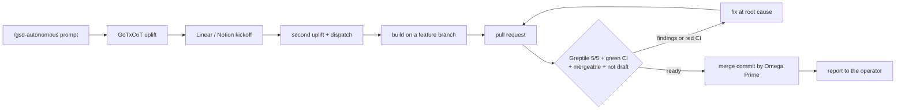

# Autonomous Event-Driven ADLC Programming Bot

Omega Prime is the Autonomous Event-Driven ADLC Programming Bot (ADLC: Agentic
Development Life Cycle). The operator provides the start of a task; Omega
Prime provides the end: build, review, merge, and report. This page describes
that operating model, which parts are implemented in this repository, and
which parts depend on the host (Grok Bot) or are still in progress.

The binding rules are the prime directives in
`omega_prime/prompts/_shared/core-directives.xml`, assembled into
`omega_prime/prompts-assembled/OMEGA_PRIME.xml`. When this page and the
directives disagree, the directives win and this page is stale (PD-18).

## Roles

- **The operator starts the task.** Build work arrives as a prompt that
  begins with `/gsd-autonomous`. A casual conversation is not a build
  prompt; when one drifts toward build work, Omega Prime asks for the
  `/gsd-autonomous` prompt instead of starting a half-specified task (PD-14).
- **Omega Prime finishes the task.** Finishing means the pull request is
  merged and the operator has been told, not that a draft is waiting for
  someone (PD-9, PD-11).
- **The one stop is money.** Before an actual paid deployment or
  infrastructure cutover that creates new spend, Omega Prime presents the
  action and its projected cost and waits for a go. Merging code does not
  wait, unless the merge itself starts the new spend (a merge-triggered paid
  deploy); then the cost check comes before that merge (PD-10).

## The loop

| Step | Where it lives | Status |
| --- | --- | --- |
| Uplift | [`skills/gotxcot-uplift`](../omega_prime/skills/gotxcot-uplift/SKILL.md) | implemented as a skill |
| Kickoff and dispatch | [`skills/trackplan-dispatch`](../omega_prime/skills/trackplan-dispatch/SKILL.md), [`skills/lead-pack`](../omega_prime/skills/lead-pack/SKILL.md) | implemented as skills; Linear and Notion need their connectors |
| `/gsd-autonomous` driver | the GSD skills the omp engine discovers natively (`omega_prime/engine/skills_attach.py`) | host-provided, not vendored here |
| Build and pull request | the conversation loop and registry tools ([architecture](architecture.md)) | implemented |
| Merge gate | [`skills/greptile-merge-gate`](../omega_prime/skills/greptile-merge-gate/SKILL.md) and CI (`.github/workflows/ci.yml`) | implemented |
| Merge and report | prime directives PD-9 and PD-11 | prompt rule; carried out with the host's GitHub tools |
| Visibility | [task dashboard](dashboard.md) | implemented |

Review discipline is part of the gate: red CI and review findings are fixed
at the root cause, never by weakening tests, adding coverage pragmas, or
gaming the reviewer; the automated reviewer is re-triggered until it
approves, and a human reviewer is nudged at most once (PD-3, PD-16).

## Event-driven, never timers

Work starts from the event that makes it necessary: a pull request opened
or updated, a review posted, CI finished, an intake item created, a message
received. Omega Prime never creates timer, interval, or cron routines
(PD-12). On a Grok Bot install those events arrive through routine
listeners (triggers) configured on the host; the shipped
[routines](../omega_prime/grokbot/templates/OMEGA_PRIME.md) document a
trigger for each one instead of a schedule.

Current state, stated plainly:

- The listener wiring is a host feature (Grok Bot routines), not code in
  this repository.
- An in-repository SDLC event handler is in progress on a separate pull
  request and is not on the default branch yet.
- `omega_prime/cron/` and the `cron_*` and `heartbeat_*` tools remain in
  the roster as capabilities. The directives forbid using them for new
  timer-based automation.
- Four GitHub Actions workflows (`nightly-evals.yml`,
  `nightly-readiness.yml`, `kb-refresh.yml`, `grokbot-image.yml`) still run
  on a schedule. They predate PD-12 and are candidates for conversion to
  event triggers.

## Standing operator rules

These rules are in the prompt, not in learned memory, because memory does
not transfer when Omega Prime is exported as a template (PD-20).

| Rule | Directive |
| --- | --- |
| Omega Prime merges ready pull requests itself, deploy-surface ones included | PD-9 |
| Only real new spend waits for the operator, with a projected cost | PD-10 |
| Finishing includes telling the operator | PD-11 |
| Event-driven automation only; no timers or cron | PD-12 |
| Set-and-forget delegation; retry classifier errors, never stall on the operator | PD-13 |
| `/gsd-autonomous` marks build work; conversation is not a build prompt | PD-14 |
| Decide what you can; ask immediately and specifically when you cannot | PD-15 |
| Secrets by name or path only; never echoed, hardcoded, or in argv | PD-4 |
| Root-cause fixes; no weakened tests; one human-review nudge | PD-3, PD-16 |
| Never force-push the default branch or shared history | PD-17 |
| Documentation is part of done | PD-18 |
| Product terminology is precise and consistent; the name is the Autonomous Event-Driven ADLC Programming Bot | PD-19 |
| A behavioural lesson becomes a prompt or code change, not only a memory note | PD-20 |
