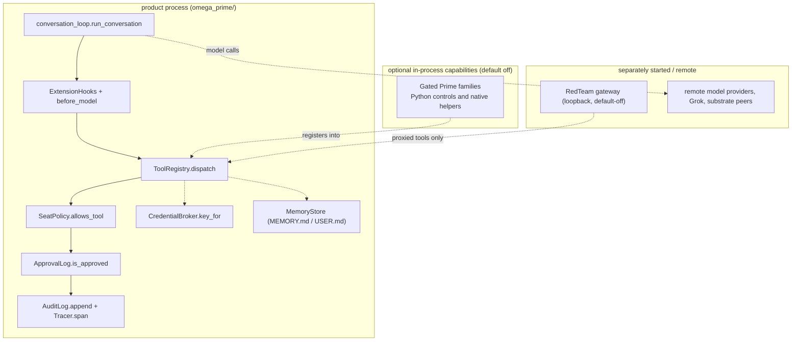
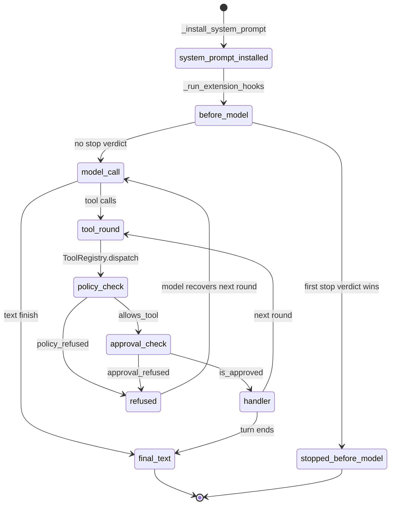
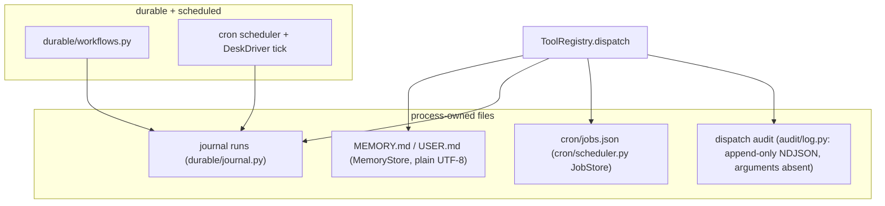
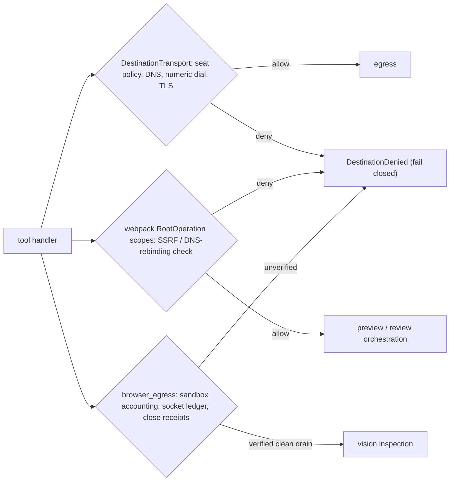

# Architecture

How Omega Prime is put together: one process, one loop, one registry, and the
planes around them. Tool membership follows the roster contract
(`omega_prime/contracts/tool-rosters/omega-prime.yaml`) and the generated
[catalog](tool-catalog.md), which is rendered from the live registry by
`omega_prime/tooling/catalog.py::render` over
`full_inventory_registry` — read it as inventory, not as proof that any
handler ran. Skills are `SKILL.md` files under `omega_prime/skills/` and
routines are prompt flows. For current suite/eval results, run the commands
under Verification and require a clean result.

The native Prime extension is an optional in-process library, not a sidecar;
the Red Team gateway is separately started and default-off. See
[the agent loop](agent-loop.md#native-prime-provider) for the selected native
path versus the rest of upstream. Roster/configuration evidence—not a prose
total—determines the offered inventory.

## The shape

The product is one Python process (`omega_prime/`). The core turn runs in
that process: `omega_prime/agent/conversation_loop.py::run_conversation`
(model call → tool round or text reply until the turn ends) composed by
`omega_prime/agent/runtime.py::OmegaPrimeAgent` with a `ToolRegistry` and a
model adapter. Optional native Prime helpers run in-process when enabled;
nothing else is required beside the process.

## The loop

`omega_prime/agent/conversation_loop.py` runs one turn: install the system
prompt once (`_install_system_prompt`), take the user row, then iterate
model call → tool round (`turn_tool_round`) or text reply until something
finishes the turn (`turn_finalizer`). The Omp harness rides the same loop as
options on the `Agent` (pause gates, output budgets, plan mode, extensions).
Before each model call the loop runs extension interception
(`_run_extension_hooks` → `ExtensionHooks.run_before_model`, then the legacy
`harness.run_before_model` for `Agent.before_model`); control-family
evaluations (goals/autonomous via `prime_hooks.evaluate_goal` /
`evaluate_autonomous`) run through `degraded.guarded_hook` and emit redacted
`prime_degraded` evidence on failure instead of failing the turn.
Magic keywords (`ultrathink`, `orchestrate`, `workflowz`) inject notices for
the turn when they appear as standalone prose
(`agent/magic_keywords.py`).

Tool-call arguments must be a JSON object (decoded in
`tools/registry.py::dispatch` via `_arguments`); malformed payloads become
`error:` rows, never executions. See [the agent loop](agent-loop.md) for the
full turn contract including Prime continuation bounds.

## The registry

`omega_prime/tools/registry.py::ToolRegistry` maps names to handlers in
registration order (`register`, `schemas`). Dispatch (`dispatch`) always
returns a JSON string; unknown names are errors, never exceptions. Three
gates wrap every call, in order: the seat policy
(`omega_prime/policy/policy.py::SeatPolicy.allows_tool`, plus
`allows_write` / `allows_host`), the approval log
(`omega_prime/tools/approvals.py::ApprovalLog.is_approved` — tools
registered with `requires_approval=True` wait for a person), and the audit +
tracer (`omega_prime/audit/log.py::AuditLog.append` records one verdict per
dispatch, `omega_prime/audit/trace.py::Tracer.span` records one span).
`runtime_bindings` carries non-tool resources published by the registering
family only; it never grants tools and never bypasses `dispatch`.

The roster is the contract: `omega_prime/tooling/roster.py::roster_names`
parses the `tools:` list of
`omega_prime/contracts/tool-rosters/omega-prime.yaml`, which must list
exactly the registered names in registry order, and the policy must allow
every one. The suite enforces both, and the [catalog](tool-catalog.md) is
generated from the live registry so docs cannot drift. The catalog's size is
a source inventory at generation time — it is not a live-capability claim
and must not be quoted as a fixed total in prose.

Prime capability families (`harness`, `goals`, `heartbeat`, `autonomous`,
`kernel`, `rlm`, `messaging`) are config-gated and default off: a disabled
family is not registered and is absent from the offered roster
(`omega_prime/mcp_server.py::default_registry` with
`omega_prime/config.py::prime_enabled`). The Red Team family
(gateway proxies named `tempest_*`, `omega_prime/tools/redteam.py`) is a
top-level `redteam` config key, not a Prime family, also default off: when
on, `register_redteam_tools` binds a `RedteamClient` to the configured
gateway (default `http://127.0.0.1:3333`). Non-loopback URLs require a bearer
under the upstream contract (`T3MP3ST_BEARER_TOKEN` /
`T3MP3ST_BEARER_TOKEN_FILE` via `resolve_bearer_token`); otherwise the adapter
returns `non_loopback_refused`. This is an external HTTP gateway, not a native
port or auto-started loop. Connection failures return `gateway_unreachable`
error rows. Those adapter errors are distinct from readiness's default-off
`feature_disabled` classification or named prerequisite-blocked rows.

## Memory and skills

Two file-backed stores (`MEMORY.md`, `USER.md`) owned by
`omega_prime/memory/store.py::MemoryStore` (`add` / `replace` / `remove` /
`load_from_disk`, plain UTF-8 files — no encryption claim) plus
bank-tagged episodic recall (`memory/hindsight.py`, `memory/mnemopi.py`,
`memory/omp.py` behind `memory/manager.py::MemoryManager`) serve every call
shape: Hermes learn/recall, Omp mnemopi, and the Hindsight
`retain`/`recall` pair. Skills are `SKILL.md` files under
`omega_prime/skills/`; routines are prompt flows (`sweep`, `nightly`,
`ultrathink_turn`) plus the desk lead routines. The curator
(`agent/curator.py`) folds nightly learnings back into memory. Intake for
the desk lead runs behind an injected seam (`tools/lead.py`:
`lead_intake_next` / `lead_intake_ack` over `IntakeStore`, a local
`intake.json` file holding one JSON object with an `orders` list, rewritten
by atomic replace under an exclusive `flock` on `intake.json.lock`; the
NDJSON file is the separate `events.ndjson` event mirror).

## Destination Transport & Browser Confinement

Egress and browser execution follow strict operational boundaries.
Diagrams never authorize: every arrow below is gated by the named check.

- Destination transport (`omega_prime/providers/destination.py`:
  `TransportLimits`, `DestinationDenied`) manages seat policy enforcement,
  DNS resolution, numeric dialing, and TLS validation.
- Composed preview and review orchestration (`omega_prime/tools/webpack.py`)
  uses registered `RootOperation` scopes to prevent SSRF and unmediated DNS
  rebinding.
- Browser egress confinement (`omega_prime/tools/browser_egress.py`)
  manages sandbox accounting, socket ledger proofs, and terminal close
  receipts.
- Vision inspection occurs only after complete session close and verified
  clean drain receipts.

## The operating model

Omega Prime runs as the Autonomous Event-Driven ADLC Programming Bot: the operator
starts a task and Omega Prime carries it through build, merge gate, merge
and report, triggered by events rather than timers. The behavioural rules
are prime directives in `omega_prime/prompts/_shared/core-directives.xml`,
assembled into the seat prompt, so they ship with an exported template;
learned memory does not. See [Autonomous Event-Driven ADLC Programming Bot](adlc.md).

## The Grok Bot shell

The same agent, addressed from Grok: `omega_prime/grokbot/templates/OMEGA_PRIME.md`
is the Add-Bot template (name, description, empty skill/routine sections —
bodies live in the repo), `grokbot/SETUP.md` is the four-step install, and
`omega_prime/scripts/assemble-prompts.sh` builds `prompts-assembled/OMEGA_PRIME.xml`
from the seat XML plus shared directives. `--check` fails CI on drift.

## The substrate surface

On wired installs the turn opens with a shared brief from substrate-mcp
(`conversation_loop._open_substrate` / `_close_substrate_turn`) and reports
session/prompt/tool/file events with graph provenance; memory writes go
through the shared plane; episodes come from the shared `ultrathink`
Hindsight bank with local fallback; docs answer from RAGflow. See
[Substrate surface](substrate.md). GreptimeDB, TimescaleDB, and DragonflyDB
stay behind the store lock — Omega Prime holds no clients for them, and a
test fails the build if one appears.

## Native Prime vs upstream boundary

The selected native path is explicit and narrow: build the pinned checkout
(`native/omega-prime-prime`), load it in-process
(`prime_kernel/native.py::load_extension`), and compose through
`OmegaPrimeAgent.from_prime` with a full model descriptor plus explicit
credentials (`providers/prime.py::PrimeProviderModel`, key or
`CredentialBroker` — no ambient-key or Python-provider fallback). The rest
of upstream (native `pa-agent`, `pa-core::SessionEngine`, TUI, daemon
supervision) does not own this composition and is not started by it. The
pinned checkout is not patched. See
[Native Prime provider](agent-loop.md#native-prime-provider).

## Verification

| Gate | Command | Current |
| --- | --- | --- |
| Suite | `pytest omega_prime/tests -q` | must pass (exit 0) |
| Evals | `omega_prime.evals.runner omega_prime/evals/cases` | must pass (exit 0) |
| Assembly | `assemble-prompts.sh --check` | clean |
| Setup | `omega_prime.setup_check --root .` | clean |
| Docs | catalog `--check` + link tests | clean |

A completion claim without a command and an exit code is not a claim.
See [Verification receipts](user-guide.md) and CONTRIBUTING.md.
