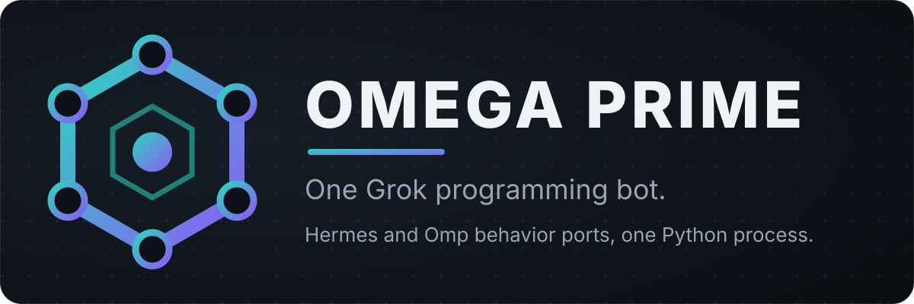
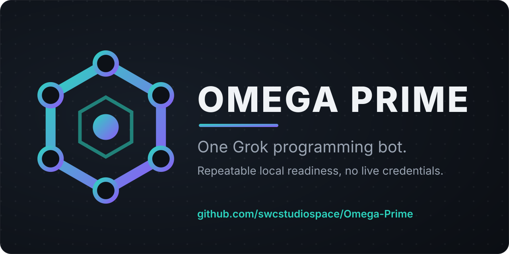

# Marketing



Positioning, a one-pager, use cases, a reproducible local demo, a launch
announcement and short/social copy for Omega Prime. Every factual claim names
the canonical file it comes from, and every use case names its evidence
level. When this page and a cited source disagree, the source wins.

## Evidence levels

- **Local proof:** a maintained command in this repository exercises it on
  your own machine, with no live credentials. The claim cites the command and
  its exit-code contract.
- **Optional capability:** shipped, but off by default or dependent on its
  own prerequisites, which you supply and authorize.
- **Unproven external:** depends on a Grok Bot, a Cursor account, a provider
  or a remote service. It stays unproven until you run the matching
  [user UAT](grok-bot-native.md#user-uat) rows. Platform facts behind these
  routes use the CONFIRMED / PARTIAL / UNPROVEN levels of the
  [import evidence ledger](grok-bot-native.md#import-evidence-ledger), which
  this page links rather than restates.

## Positioning

Omega Prime is one Python programming agent that combines Hermes
conversation-loop and oh-my-pi harness behavior ports with selected,
default-off Prime capabilities. It ships an MCP tool host and a Grok Bot
template. It is not proof of a connected Grok account, and it is not a whole
upstream-runtime port: Hermes and Omp are not imported.

Source: [README.md](../README.md) (opening paragraph and the Layout notes on
`hermes-agent/` and `oh-my-pi/`). The tagline "One Grok programming bot." is
the opening sentence of the package description in `pyproject.toml`.

## One-pager

| Question | Answer | Source |
| --- | --- | --- |
| What is it? | One Python process, one conversation loop, one tool registry. Optional native Prime helpers run in-process when enabled; no sidecar is required. | [Architecture](architecture.md), "The shape" |
| How do clients reach the tools? | An MCP tool host: stdio as a local process, and a remote listener that serves legacy SSE and Streamable HTTP on one port with bearer auth. | [Setup](setup.md), section 6 |
| How do people drive it? | 50 `/omega-*` commands today (16 curated, plus one per checked-in skill and routine), each sent as the whole message and routed through the `omega_command` tool. | [grokbot/SETUP.md](../omega_prime/grokbot/SETUP.md), "Prompting contract"; [CHANGELOG.md](../CHANGELOG.md), Grok Bot import packaging |
| How do I check it? | An isolated readiness profile accounts for every roster tool with no Grok account and no live credentials, and writes one JSON report whose rows are `exercised`, `feature_disabled`, `blocked` or `failed`. | [Local validation](local-validation.md) |
| What is off by default? | Every Prime capability family and the Red Team gateway family. The Red Team TypeScript backend is started separately and never auto-launched. | [README.md](../README.md), Configuration and Quickstart |
| What is not claimed? | Live Grok, provider or account attachment; a public marketplace listing; a hosted HTTPS deployment; a published image. | [Setup](setup.md), "Claim limits"; [import evidence ledger](grok-bot-native.md#import-evidence-ledger), closing paragraph |

## Use cases

### Check a fresh checkout without credentials

**Evidence: local proof.** `setup_check` runs the roster, template,
assembly, plugin, registry, ultrathink and substrate checks; skips are
reported, never failures. `tooling.catalog --check` fails when the generated
tool catalog is stale, and `tooling.plugin --check` fails when a generated
plugin file drifts from the checked-in skills, routines and curated commands.
Exit codes are listed in the [demo](#reproducible-local-demo).

Source: [Setup](setup.md), section 5.

### Account for every roster tool in one report

**Evidence: local proof.** The readiness profile really calls eligible local
handlers inside a disposable fixture on loopback and classifies the rest with
named prerequisites or disabled features. A `blocked` or `feature_disabled`
row is an honest unexecuted prerequisite, not a pass; only `exercised` with a
verified effect counts as run. The profile proves only that seat, not
providers, devices, browsers or remote services.

Source: [Local validation](local-validation.md); [User guide](user-guide.md),
"Receipts".

### Serve real tools over both transports, with approval gates

**Evidence: local proof.** The readiness core scenario starts a real loopback
host, checks a file write/read roundtrip with exact bytes over SSE and over
Streamable HTTP, and runs the approval lifecycle (denied before grant, grant,
revoke, denied again) over a gated local tool on each transport. Approval
state is in-memory, so a restart drops it.

Source: [Local validation](local-validation.md), "What is actually proven";
[User guide](user-guide.md), "Tools and approvals".

### Generate and check the `/omega-*` command set

**Evidence: local proof.** `python -m omega_prime.tooling.plugin --check`
fails on every drift class. `--verify` spawns the declared `mcp.json` stdio
command and a loopback bearer host and exits 0 only when both entries answer;
the ledger records that the stdio command answered `initialize` and
`/omega-help` (50 commands). These are owned local processes; none reaches a
Grok Bot or a Cursor account.

Source: `omega_prime/tooling/plugin.py` (module docstring and `main`);
[import evidence ledger](grok-bot-native.md#import-evidence-ledger), "Local
proof is separate".

### Opt into Prime capability families

**Evidence: optional capability.** Each Prime family is off until you enable
it in `omega-prime.json` or through its `OMEGA_PRIME_PRIME_<FAMILY>_ENABLED`
environment flag. `readiness --include-prime` also exercises the safe local
Prime lifecycles; without a child-model provider, RLM spawn and session
creation refuse with `not_configured: provider`.

Source: [README.md](../README.md), Configuration; [User guide](user-guide.md),
"Config and state roots"; [Local validation](local-validation.md), "Prime
lifecycles".

### Add the Red Team module

**Evidence: optional capability.** The Red Team pack is ordinary parent
content under `omega_prime/redteam/pack/`; its TypeScript backend is separate
upstream source, started separately and never auto-launched by Omega Prime,
and needs Node.

Source: [README.md](../README.md), Quickstart; [Red team module](red-team.md);
[Setup](setup.md), optional prerequisites.

### Set Omega Prime up on a Grok Bot

**Evidence: unproven external.** The Bot-driven setup is a documented,
locally verified setup path. Live import on a real Grok Bot is **UNPROVEN**
until you run [user UAT](grok-bot-native.md#user-uat) row 1. Details are in
[the Grok Bot route](#grok-bot-route) below.

Source: [grokbot/SETUP.md](../omega_prime/grokbot/SETUP.md), section 1.

### Import through a Cursor Teams/Enterprise team marketplace

**Evidence: unproven external.** The secondary route imports the repository
as a team marketplace on Cursor Teams or Enterprise plans. Its ledger rows
range from CONFIRMED (stated by platform documentation, not exercised here)
to PARTIAL and UNPROVEN, and live behavior is [user UAT](grok-bot-native.md#user-uat)
rows 2 to 4. The Remote HTTPS alternative is user UAT row 6.

Source: [grokbot/SETUP.md](../omega_prime/grokbot/SETUP.md), "Secondary:
Cursor Teams/Enterprise Import from Repo"; [import evidence
ledger](grok-bot-native.md#import-evidence-ledger).

## Reproducible local demo

Run these in order from a terminal with Python 3.12, `git` and network access
for the clone and install. No credential, Grok account or provider is needed,
and none is attached. The sequence proves only this checkout. No time
estimate is given: completion time depends on your machine and network, and
nothing here measures it.

1. Clone with the pinned submodules
   ([README.md](../README.md), Quickstart; [Setup](setup.md), section 2):

   ```bash
   git clone --recurse-submodules https://github.com/swcstudiospace/omes-bot.git omega-prime
   cd omega-prime
   ```

   Expected: exit 0. `git` exits non-zero when the clone or a submodule
   checkout fails.

2. Create the environment and install
   ([README.md](../README.md), Quickstart):

   ```bash
   python3.12 -m venv .venv
   .venv/bin/pip install -e '.[dev]'
   ```

   Expected: exit 0 from each. `pip` exits non-zero when resolution or
   installation fails.

3. Run the setup checks:

   ```bash
   .venv/bin/python -m omega_prime.setup_check --root .
   ```

   Expected: exit 0. It returns 0 only when every required check passes and
   1 when any check reports `FAIL`; skipped checks (ultrathink or substrate
   unconfigured) are reported, never failures. Source:
   `omega_prime/setup_check.py` (`main`); [Setup](setup.md), section 5.

4. Check the generated tool catalog:

   ```bash
   .venv/bin/python -m omega_prime.tooling.catalog --check
   ```

   Expected: exit 0 when `docs/tool-catalog.md` is up to date; 1 when it is
   stale or unreadable. Source: `omega_prime/tooling/catalog.py` (`main`).

5. Check the generated plugin set:

   ```bash
   .venv/bin/python -m omega_prime.tooling.plugin --check
   ```

   Expected: exit 0 when the generated files are up to date. 1 means drift
   that `--write` repairs; 3 means invalid source content that `--write`
   cannot repair; 4 means the generator cannot run in this interpreter; 2 is
   a usage error. Source: `omega_prime/tooling/plugin.py` (`main`).

6. Run the isolated readiness profile:

   ```bash
   .venv/bin/python -m omega_prime.grokbot.readiness --root . --json --output readiness-local.json
   ```

   Expected: exit 0 only when the validated report has `ok` true; 1 on any
   readiness failure (failed child, report shape or roster accounting, the
   secret gate, or `ok` false); 2 on usage errors such as no canonical roster
   under `--root`. The report is printed on stdout and written to
   `readiness-local.json`; read each row's `status` as described in
   [Local validation](local-validation.md). Source:
   `omega_prime/grokbot/readiness.py` (`main`).

7. Verify both plugin entries through the launcher:

   ```bash
   bash omega_prime/scripts/grokbot-1click.sh --verify --json
   ```

   Expected: exit 0 when the plugin verifier reports that the declared stdio
   command and a loopback bearer host both answer; its JSON report is
   printed on stdout. The launcher reuses the `.venv` from step 2: a `.venv`
   it did not stamp is used unchanged when the import probe passes and is
   never replaced. Failures exit 10 (`missing_prerequisite`), 11
   (`install_failed`), 12 (`catalog_drift`) or 13 (`host_unreachable`, any
   non-zero verifier exit), each with one JSON class line on stderr; 2 is a
   usage error. Source: `omega_prime/scripts/grokbot-1click.sh` (header and
   verify branch); [exit codes](grok-bot-native.md#exit-codes);
   [Setup](setup.md), section 6.

A green run of all seven is local proof for this checkout. It is not a live
Grok, provider or account check.

## Grok Bot route

**Status: documented, locally verified setup path. Live import UNPROVEN;
[user UAT](grok-bot-native.md#user-uat) row 1 is still pending.**

The primary route asks the default Grok Bot to run Omega Prime on its own
computer as a custom Command (stdio) MCP server. The prompt, quoted from
[grokbot/SETUP.md](../omega_prime/grokbot/SETUP.md) section 1 (that page is
canonical; replace the URL if you pushed your own copy):

```text
Set up Omega Prime on your own computer. In your shell:

1. git clone --recurse-submodules https://github.com/swcstudiospace/omes-bot.git /workspace/omega-prime
2. bash /workspace/omega-prime/omega_prime/scripts/grokbot-1click.sh --bootstrap-only
   Wait for exit 0. On exit 10, 11 or 12, show me the JSON class line it
   printed on stderr and stop.
3. Add a custom MCP server of type Command, named omega-prime, with no
   environment variables, running exactly:
   bash /workspace/omega-prime/omega_prime/scripts/grokbot-1click.sh --bootstrap --transport stdio
   If you cannot add MCP servers yourself, tell me that exact command so I
   can add it in your settings.
4. Check that the omega-prime server lists the omega_command tool, then call
   omega_command with the command /omega-help and show me the result.

Never ask me to paste a token, key or other secret in chat.
```

What is locally verified: the server command is the root `mcp.json` entry,
and step 7 of the demo spawns exactly that declared command. What is not:
whether the Bot adds the server itself, which Python its computer has, and
whether its MCP client waits out a cold install. Those, and every other
platform fact this route relies on, carry their level in the
[import evidence ledger](grok-bot-native.md#import-evidence-ledger) and stay
open until the [user UAT](grok-bot-native.md#user-uat) rows are recorded.
The Cursor Teams/Enterprise import is the secondary route (UAT rows 2 to 4).

## Launch announcement

> **Omega Prime: one Python programming agent you can check locally.**
>
> Omega Prime combines Hermes conversation-loop and oh-my-pi harness behavior
> ports with selected Prime capabilities that stay off until you enable them.
> It runs as one Python process with one tool registry, and ships an MCP tool
> host (stdio, plus legacy SSE and Streamable HTTP with bearer auth) and a
> Grok Bot template.
>
> Send `/omega-help` as the whole message to list the 50 `/omega-*` commands,
> each routed through one `omega_command` tool.
>
> Check it without credentials: clone the repository, install, then run
> `setup_check`, the catalog and plugin `--check`s and the isolated
> readiness profile. Each exits 0 only on success, and readiness writes one
> JSON report that separates exercised effects from disabled features and
> named prerequisites.
>
> Setting Omega Prime up on a Grok Bot is a documented, locally verified
> setup path. Live import on a real Bot is unproven until the user UAT rows
> are run, so we do not claim it.
>
> Start with the demo in `docs/marketing.md` and the evidence ledger in
> `docs/grok-bot-native.md`.

Sources, claim by claim: behavior ports and default-off capabilities,
[README.md](../README.md); one process and one registry,
[Architecture](architecture.md); transports, [Setup](setup.md) section 6;
50 commands and `omega_command`,
[grokbot/SETUP.md](../omega_prime/grokbot/SETUP.md) "Prompting contract";
exit codes, the [demo](#reproducible-local-demo) sources; readiness report,
[Local validation](local-validation.md); Bot route status,
[user UAT](grok-bot-native.md#user-uat).

## Short and social copy

**One line:** One Grok programming bot: one Python process, Hermes and Omp
behavior ports, repeatable local readiness with no live credentials.

**Short post:** Omega Prime is one Python programming agent with an MCP tool
host and 46 whole-message `/omega-*` commands. Check it locally with no
credentials: `setup_check` and readiness exit 0 only on success. Live Grok
Bot import is still unproven.

**Bot route line:** Grok Bot setup is a documented, locally verified path;
live import waits on user UAT.

Sources: tagline, `pyproject.toml`; behavior ports, [README.md](../README.md);
one process, [Architecture](architecture.md); readiness without live
credentials, [Local validation](local-validation.md); commands,
[grokbot/SETUP.md](../omega_prime/grokbot/SETUP.md); exit codes, the
[demo](#reproducible-local-demo); Bot route, [user UAT](grok-bot-native.md#user-uat).



Visual assets, all repository brand art rather than screenshots:

| Asset | Size | Use |
| --- | --- | --- |
| [`assets/banner.svg`](../assets/banner.svg) | 1200x400 | README and docs header |
| [`assets/social-card.svg`](../assets/social-card.svg) | 1280x640 | Social card source |
| [`assets/social-card.png`](../assets/social-card.png) | 1280x640 | Raster for sites that need PNG |

`assets/social-card.png` is rendered from the SVG, run from the repository
root with system CairoSVG 2.9.0 on PATH:
`python3 omega_prime/scripts/render_raster.py assets/social-card.svg`
(exit 0 on 2026-10-12; the result was pixel-identical to the previous
raster). The script records the SVG's SHA-256 in the PNG, so the asset test
fails when the SVG changes without a re-render. The SVG's header comment
records the same command. Using the card as a
repository social preview is a manual operator setting; this page does not
claim it was set or published anywhere.

## Receipts

A completion claim cites its evidence: the commands run and their exit
codes. Apart from the social-card render above (its command and exit code
are stated beside it), this page makes no completion claim of its own; the
demo states each command's exit-code contract so you can collect your own
receipts. A readiness row of `blocked` or `feature_disabled` is an honest
unexecuted prerequisite, not a pass; only `exercised` with a verified effect
counts as run.

Source: [User guide](user-guide.md), "Receipts".

## Claim limits

- Nothing on this page attaches a live Grok account, model or provider. A
  local model double (such as the `ScriptedModel` used by readiness) proves
  local composition only. Source: [Setup](setup.md), "Claim limits".
- The Grok Bot route and the Cursor team marketplace import stay UNPROVEN
  until you record the [user UAT](grok-bot-native.md#user-uat) rows.
- No fixed tool total is stated: the effective tool count comes from the
  roster/configuration intersection. The number 46 counts `/omega-*`
  commands, not tools. Source: [README.md](../README.md).
- No timing, measured result or performance figure is stated, and no
  screenshot is shown; the images are brand art.
- No public marketplace listing, hosted HTTPS deployment, published image,
  website or outreach campaign is claimed. Source: [import evidence
  ledger](grok-bot-native.md#import-evidence-ledger), closing paragraph.
- Secrets are supplied privately and never in chat; this page carries no
  credential example. Source: [Setup](setup.md), section 4.
