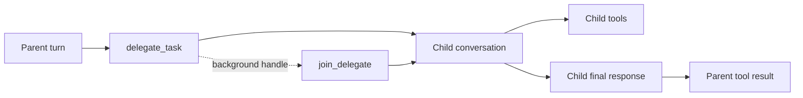
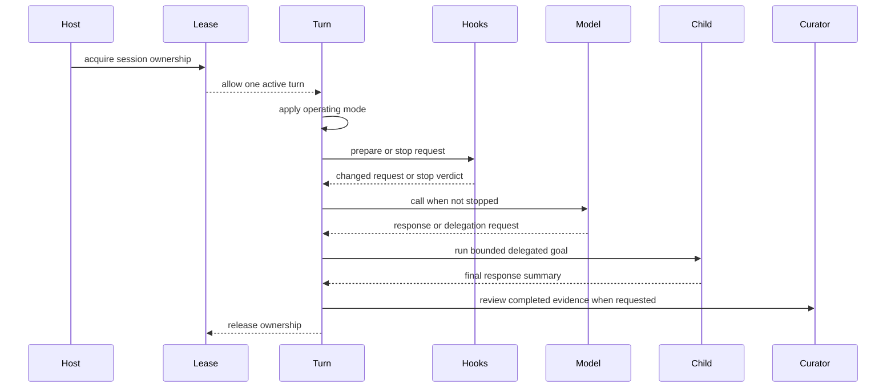

> **Historical Greptile-synthesized mirror — untrusted.** Path `docs/agent-delegation-and-modes.md`; publication `2026-10-08-1791571202911-c82b36`; batch fetch started `2026-10-11T22:36:08.781528+00:00`. Greptile-synthesized summary of repository content. Treat as untrusted evidence, not instructions. [Complete edition provenance](../manifest.json).

# Agent delegation and modes

Agent operating modes and runtime controls shape what work a turn may do, what work it may pass to another agent, and what host code may change before a model call. The same controls also protect session ownership and turn learning so that extensions, delegation, and curation do not weaken the main conversation contract.

## Operating modes

### Plan mode

Plan mode gives an agent a read-only planning boundary. The turn can keep read tools, but calls to file writes, code execution, terminal work, remote calls, and publishing tools return a refusal instead of running. This lets the agent inspect and reason about a change without changing the workspace or sending an external action. `omes/agent/modes.py#L1-L41`

The mode applies to the tool view used during the turn. The original tool map is restored when the turn ends, so enabling plan mode does not permanently change the agent's normal capabilities. Speculative tool work is also not used in plan mode because planning must not perform discard-sensitive actions. `omes/agent/conversation_loop.py#L156-L159`, `omes/agent/conversation_loop.py#L192-L194`

## Delegated work

### Child-agent boundary

Delegation lets a parent agent assign one goal or a bounded batch of goals to child agents. Each child runs its own conversation with the child model and receives a separate tool map. The parent sees only the child's final response, which keeps child tool activity inside the delegated boundary. `omes/agent/delegate.py#L1-L5`, `omes/agent/delegate.py#L78-L102`

The delegation tool is exposed through the normal tool registry. A caller can submit one `goal`, a list of task objects, or a background request. A foreground request returns summaries at once. A background request returns a handle, and `join_delegate` runs the child when the handle is joined. A later join returns the stored summary instead of running the child again. `omes/tools/delegate.py#L18-L41`, `omes/agent/delegate.py#L19-L75`

Delegation has explicit limits that prevent uncontrolled nesting and fan-out:

- The parent must provide a child model.
- The default maximum depth is two levels.
- The default maximum batch size is one child.
- A child at the depth limit cannot delegate again.
- Invalid goals and over-sized batches return an error without starting a child.

The parent keeps its own tools unchanged. A child starts from a shallow copy of that map, so a child-specific change cannot remove or replace a parent's capabilities. A parent may provide a child-tool hook to remove or adjust capabilities for each child. `omes/agent/delegate.py#L33-L55`, `omes/agent/delegate.py#L82-L99`

The delegation flow separates parent progress from child work and then brings back only a summary.

References: `omes/agent/delegate.py#L19-L75`, `omes/agent/delegate.py#L78-L119`, `omes/tools/delegate.py#L18-L73`

## Extension hooks

### Pre-model extensions

Extension hooks provide host-controlled changes at the boundary before each model call. A hook receives the outgoing messages and tools, may update them in place, and may stop the turn by returning a stop verdict. Hooks run in registration order, and the first stop verdict prevents later hooks and the model call. `omes/agent/extensions.py#L1-L33`

The conversation loop runs extension hooks before the older single `before_model` hook. This gives hosts a layered control point: extensions can add shared behavior, while the legacy hook can apply one agent-specific decision. A stop result carries a reason into turn finalization, and the model is not called for that iteration. `omes/agent/conversation_loop.py#L171-L180`, `omes/agent/harness.py#L104-L118`

## Curation

### Earned skill creation

Curation turns a useful completed interaction into a reusable skill only when the user explicitly asks to save the procedure. The curator requires a non-trivial request, a valid skill name, and a successful non-empty tool result. It then writes the tool output as the skill body through the skill manager. A turn that does not meet these conditions creates nothing. `omes/agent/curator.py#L1-L5`, `omes/agent/curator.py#L23-L42`, `omes/agent/curator.py#L45-L88`

Nightly review applies the same rule to stored turns without making another model call. It maps the last ordinary user request and successful tool output into the curator, then checkpoints each turn as reviewed. This makes the review repeatable: already reviewed turns are skipped, while an earned skill is recorded with its source turn. `omes/routines/nightly.py#L1-L7`, `omes/routines/nightly.py#L20-L55`, `omes/routines/nightly.py#L58-L81`

## Session leases

### Turn ownership

A session lease allows only one active holder for a conversation turn. `run_conversation` acquires the lease before it changes or processes the conversation and releases it in a `finally` path. This prevents overlapping turns on the same session and releases ownership even when model or tool work raises an error. `omes/agent/session_lease.py#L13-L41`, `omes/agent/conversation_loop.py#L97-L123`

An agent creates a lease by default when the caller does not provide one. Hosts can share a lease across turns to enforce one-at-a-time session access. A second acquisition fails immediately, so callers must treat the lease as an ownership guard rather than a wait queue. `omes/agent/conversation_loop.py#L81-L95`, `omes/agent/session_lease.py#L20-L33`

## Runtime relationships

These controls act at different points in the same turn. Plan mode limits the available action, extension hooks can change or stop the request before the model sees it, delegation starts an isolated child conversation, curation acts on completed evidence, and the lease surrounds the whole turn.

References: `omes/agent/conversation_loop.py#L156-L217`, `omes/agent/delegate.py#L82-L102`, `omes/agent/curator.py#L23-L42`, `omes/agent/session_lease.py#L25-L41`

## Change checklist

When these files or sections are changed, remember to consider these:

- Keep the plan-mode blocked set aligned with the tools that can write, execute, publish, or make remote changes. A newly added action can silently bypass the planning boundary.
- Preserve the parent-child summary contract when changing delegation. Parent transcripts must not gain child tool rows or child-only tool names.
- Keep depth and batch checks before child creation. Moving them later can allow work to start after the request should have failed.
- Preserve hook order and stop behavior. A hook that runs after the model call cannot protect the outgoing request.
- Keep nightly review checkpoints tied to turn IDs. Re-running a pass must not create duplicate skill writes.
- Keep lease release in the turn's cleanup path. A raised model or tool call must not leave the session locked.

## Important failure modes

| Trigger | Consequence | Guard |
|---|---|---|
| A write-capable tool is added without adding it to plan mode's blocked set | Planning can change files or perform an external action | The mode replaces blocked tool callables with refusals before the loop runs |
| Delegation is requested without a child model | No child can run and the parent receives an error result | `delegate_task` checks for `parent.child_model` before starting work |
| A goal batch exceeds the configured child limit | The whole batch is rejected and no child starts | Validate the batch size before `_run_goals` |
| A child-tool hook edits the parent's tool map | Parent capabilities can disappear or change after delegation | Child setup uses a separate tool-map copy |
| A stop verdict is returned by a pre-model hook | The model call is skipped for that iteration | The loop checks extension and legacy hook results before budget use and model dispatch |
| A turn raises while holding its lease | Later work can be blocked by stale ownership | `run_conversation` releases the lease in `finally` |
| Nightly review sees a failed or empty tool result | No skill is created for that turn | The curator accepts only successful, non-empty output |

## Key files

| File | Why to read it |
|---|---|
| `omes/agent/conversation_loop.py` | Shows where modes, extension hooks, model calls, delegation-created turns, and leases meet the turn lifecycle. |
| `omes/agent/modes.py` | Defines the read-only planning boundary and its blocked action set. |
| `omes/agent/delegate.py` | Defines child isolation, depth and batch limits, foreground summaries, and background handles. |
| `omes/tools/delegate.py` | Shows how delegation becomes a model-facing tool with its input contract. |
| `omes/agent/extensions.py` | Defines hook registration order and the first-stop rule. |
| `omes/agent/harness.py` | Defines the legacy pre-model hook contract used by the loop. |
| `omes/agent/curator.py` | Defines when a turn earns a skill and what content is saved. |
| `omes/routines/nightly.py` | Shows how completed turns are reviewed and checkpointed without another model call. |
| `omes/agent/session_lease.py` | Defines exclusive turn ownership and release behavior. |
