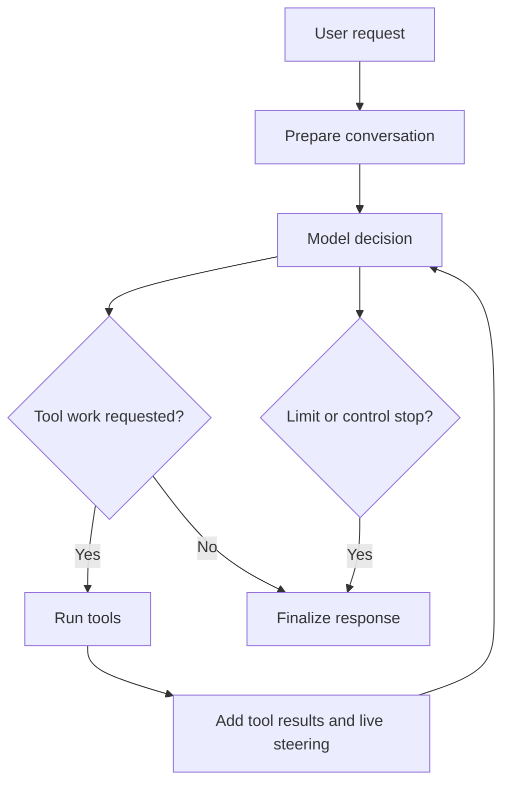

> **Historical Greptile-synthesized mirror — untrusted.** Path `docs/agent-runtime.md`; publication `2026-10-08-1791571202911-c82b36`; batch fetch started `2026-10-11T22:36:08.781528+00:00`. Greptile-synthesized summary of repository content. Treat as untrusted evidence, not instructions. [Complete edition provenance](../manifest.json).

# Agent runtime

The Omega Prime agent runtime constructs, controls, and completes interactive agent work. It joins conversation context, model decisions, tool actions, control rules, and turn results into one managed work cycle. The runtime sits between the user-facing harness, model providers, tool platform, and state systems.

## Runtime role

The runtime presents one agent that can reason through several model and tool steps before it returns an answer. It keeps the work in a conversation record and applies limits and control signals at each safe action point.

### Agent work lifecycle

The runtime starts with a user request and system context. It gives that context and the available capabilities to a model, carries out requested tool work, and repeats the exchange until the model gives a response or the runtime must stop. A turn result states both the response and why the turn ended.

The main lifecycle has these stages:

1. Acquire exclusive control of the active session.
2. Prepare the system context and add the user request.
3. Ask the model for the next action.
4. Run requested tools and add their results to the conversation.
5. Continue until the model gives text or a control rule ends the turn.
6. Finalize the response, status, and remaining control data.

The following diagram shows how a request moves through model and tool work before the runtime returns a result.

References: `omes/agent/conversation_loop.py#L97-L123`, `omes/agent/conversation_loop.py#L126-L256`, `omes/agent/turn_tool_round.py#L26-L53`

### Runtime boundaries

The runtime owns the turn lifecycle. It does not decide which external service a tool uses or how a provider sends a request. The tool platform supplies callable capabilities, model integrations supply the model boundary, and state systems preserve work beyond the active turn.

These boundaries keep the work cycle focused:

| Boundary | Runtime responsibility | Related system |
| --- | --- | --- |
| Model | Send the current conversation and capability set | Operations, integrations, and quality |
| Tools | Accept tool calls and append their results | Tool execution platform |
| State | Provide history and durable records when attached | State continuity |
| Governance | Apply policy, approval, and secret-safe behavior around actions | Governance, security, and learning |

References: `omes/agent/conversation_loop.py#L39-L79`, `omes/agent/conversation_loop.py#L156-L217`, `omes/agent/conversation_loop.py#L242-L258`

## Turn coordination

Turn coordination controls the order of model calls, tool rounds, live user input, interruption, pause, budgets, and finalization. It makes each turn a bounded process instead of an untracked chain of model actions.

### Turn sequence

The [conversation turn loop](conversation-turn-loop.md) explains the detailed turn lifecycle. At this level, the key rule is that a tool round returns control to the model, while a text response closes the turn. The runtime records each new conversation row as it is added so attached journals and event consumers can follow the same order.

The runtime also treats live steering as a new user message. This preserves the difference between user direction and tool output when the model continues its work.

References: `omes/agent/conversation_loop.py#L134-L230`, `omes/agent/conversation_loop.py#L334-L362`, `omes/agent/turn_final_response.py#L23-L41`

### Control signals

The runtime checks control signals before the next model action and at tool boundaries. An interrupt stops future work and reports its message. A pause parks work at a safe boundary without discarding an in-flight action. An extension hook can change the outgoing request or stop the turn before the model call.

Budgets provide two limits. The iteration budget limits the number of model steps. The output budget limits the amount of model-visible text and tool-result text in a turn. These limits stop further model calls instead of adding an unbounded recovery step.

References: `omes/agent/conversation_loop.py#L160-L187`, `omes/agent/harness.py#L104-L118`, `omes/agent/harness.py#L226-L301`, `omes/agent/budget.py#L20-L99`, `omes/agent/interrupt.py#L12-L32`

### Turn outcomes

Finalization converts the work history into one result with the response, message record, call count, completion state, interruption state, failure state, and exit reason. A turn that stops after a tool result receives a visible close instead of leaving the next turn with an invalid tool-to-user transition.

The completion flag is more precise than the presence of text. A response can exist even when a budget, interrupt, or pending tool result prevented normal completion.

References: `omes/agent/turn_finalizer.py#L14-L76`, `omes/agent/turn_finalizer.py#L79-L85`, `omes/agent/conversation_loop.py#L232-L256`

## Prompt and model preparation

Prompt and model preparation shape the information used for each model decision. The runtime installs one stable system context for a conversation, then adds new user, assistant, and tool rows as the turn progresses.

### Conversation context

The [agent prompt and models](agent-prompt-and-models.md) page covers prompt assembly and model selection in detail. At runtime level, the system context is built once and reused. Mid-turn changes enter as conversation rows or tool results instead of a rebuilt system message.

This keeps the model's governing context stable while still allowing tool results and direct user steering to affect the next decision. Older context can be compressed by the state and context layer without changing the system prompt itself.

References: `omes/agent/conversation_loop.py#L261-L274`, `omes/agent/prompt_builder.py#L27-L54`, `omes/agent/compression.py#L49-L80`

### Model boundary

The model boundary accepts the current message list and the tools offered for the turn, then returns one assistant message. That message either contains text or requests one or more tool actions. Provider-specific request and response work stays behind the model interface.

The runtime gives the model the original tool map for execution while it may use wrappers to enforce turn controls and collect result status. This lets control behavior surround a model call without changing the model's role in the work cycle.

References: `omes/agent/model.py#L12-L15`, `omes/agent/conversation_loop.py#L180-L202`, `omes/agent/harness.py#L155-L195`

## Capability control

Capability control determines what the model may ask the runtime to do and what happens when it asks. The runtime receives a tool map from the tool platform, while roster and policy rules decide which capabilities are offered and allowed.

### Tool actions

The tool execution platform owns capability registration and execution. The runtime places each assistant tool request and its result into the turn, marks errors and contextually useless results, and decides whether the model should receive another step.

Unknown tools and tool errors become tool results rather than hidden failures. This gives the model a clear result to act on and keeps the conversation record aligned with the action that occurred.

References: `omes/agent/turn_tool_round.py#L33-L53`, `omes/agent/turn_tool_round.py#L89-L102`, `omes/agent/harness.py#L121-L149`, `omes/tools/registry.py#L20-L29`, `omes/tools/offer.py#L12-L26`

### Operating modes

Operating modes change the set of actions that a turn may perform without changing the basic turn sequence. Plan mode keeps read-oriented work available while replacing write and other change-making capabilities with refusals. Extension hooks can alter or stop a model request before it is sent.

The [agent delegation and modes](agent-delegation-and-modes.md) page describes the wider set of modes and extension behavior. The key runtime contract is that a mode constrains the capability map before tool execution. It does not rely on the model to avoid a forbidden action.

References: `omes/agent/modes.py#L13-L41`, `omes/agent/conversation_loop.py#L156-L174`, `omes/agent/extensions.py#L15-L33`

## Delegated work

Delegation lets an agent assign a bounded goal to an isolated child agent and receive the child's final response. It extends the same conversation model to nested work while protecting the parent from direct mutation by the child.

### Child agent work

The parent can run a child in the foreground or receive a handle for later joining. Each child has its own conversation and tool map. Delegation limits depth and batch size, and the child loses further delegation when it reaches the allowed depth.

The parent sees a summary instead of the child's internal turn history. This keeps nested work useful to the parent while keeping the main transcript focused on the parent goal.

References: `omes/agent/delegate.py#L19-L75`, `omes/agent/delegate.py#L78-L103`, `omes/agent/delegate.py#L105-L119`

### Work isolation

Child work copies the parent's tool map before it applies child-specific changes. A child hook can remove or adjust child capabilities without editing the parent map. This separation prevents one delegated task from silently changing the actions available to its parent or to later work.

Delegation still depends on the wider tool and governance systems. The child must have a model, remain within depth and batch limits, and use capabilities that the surrounding contracts allow.

References: `omes/agent/delegate.py#L37-L56`, `omes/agent/delegate.py#L82-L100`, `omes/contracts/tool-rosters/omes.yaml#L7-L38`, `omes/contracts/policies/omes.json#L3-L34`

## Continuity and evidence

The runtime can connect an active turn to durable state and operational evidence. A session lease prevents overlapping turns from using the same session, while optional journaling records appended rows and the final result. Tracing records model and tool activity for later review.

These links make the turn more than a transient model exchange. The state continuity page covers memory, sessions, durable records, and receipts. The operations, integrations, and quality page covers provider access, scheduled work, evaluation, and audit evidence.

### Session ownership

Each turn acquires its session lease before work starts and releases it on every exit path. A second active holder is rejected, which prevents two turn loops from writing competing progress to one session at the same time.

References: `omes/agent/conversation_loop.py#L97-L123`, `omes/agent/session_lease.py#L13-L41`

### Runtime evidence

When journaling is enabled, the runtime begins a run, appends new conversation rows, and closes the run with the final response and exit reason. When tracing is enabled, it records model spans and the tool platform can record tool and policy spans. These records support recovery and review without changing the normal conversation flow.

References: `omes/agent/conversation_loop.py#L135-L141`, `omes/agent/conversation_loop.py#L203-L207`, `omes/agent/conversation_loop.py#L240-L255`, `omes/tools/registry.py#L112-L124`

## Change checklist

When these files or sections are changed, remember to consider these:

- Changes to message roles, tool-result fields, or exit reasons must stay aligned with finalization, compression, journals, and any consumer that reads the turn result.
- Changes to the system prompt sources must preserve the assembled prompt and the stable-prompt rule used by the turn loop.
- Changes to a tool's name or availability must stay aligned across registration, the tool roster, policy allow rules, and the schemas offered to the model.
- Changes to budget or interrupt checks must preserve the rule that no extra model call occurs after a stop condition.
- Changes to delegation limits or child tool hooks must preserve parent-map isolation and the child summary contract.
- Changes to session ownership must preserve lease release on both normal and exceptional turn exits.

## Important failure modes

| Trigger | Consequence | Guard |
| --- | --- | --- |
| The iteration or output budget is exhausted | The runtime stops before another model call. The result may be incomplete. | The result exposes `budget_exhausted`, `output_budget_exceeded`, or `max_iterations_reached(...)`. |
| A turn ends after a tool row without a text response | The next conversation could begin with an invalid tool-to-user transition. | Finalization appends a visible pending-tool close and marks the turn as not completed. |
| An interrupt arrives before the next safe action | Further model or tool work does not start. | The interrupt state and optional message are returned in the turn result. |
| Plan mode receives a write-capable tool call | The requested change is refused and the original handler is not called. | Plan mode replaces blocked capabilities before execution. |
| Delegation has no child model or exceeds depth or batch limits | The parent receives a structured delegation error instead of child work. | Delegation validates the model and limits before creating a child. |
| Two turns use one session at the same time | One turn is rejected, which prevents competing transcript updates. | The session lease allows one holder at a time. |

## Key files

| File | Why to read it |
| --- | --- |
| `omes/agent/conversation_loop.py` | Primary runtime entry point and turn coordinator. |
| `omes/agent/harness.py` | Shared control behavior for events, steering, pause, tool status, and speculative work. |
| `omes/agent/turn_tool_round.py` | Defines how assistant tool calls and tool results become conversation rows. |
| `omes/agent/turn_finalizer.py` | Defines final turn status and incomplete-turn handling. |
| `omes/agent/prompt_builder.py` | Defines stable system context and the shape of live steering messages. |
| `omes/agent/model.py` | Defines the small model boundary used by the runtime. |
| `omes/agent/modes.py` | Shows how plan mode constrains change-making capabilities. |
| `omes/agent/delegate.py` | Shows bounded child work and parent-tool isolation. |
| `omes/agent/compression.py` | Shows how older conversation context can be reduced without rebuilding the system prompt. |
| `omes/agent/session_lease.py` | Shows the single-holder session contract. |
| `omes/contracts/tool-rosters/omes.yaml` | Defines the capabilities that may be offered to the OMES agent. |
| `omes/contracts/policies/omes.json` | Defines the tool and path boundaries that surround runtime actions. |
