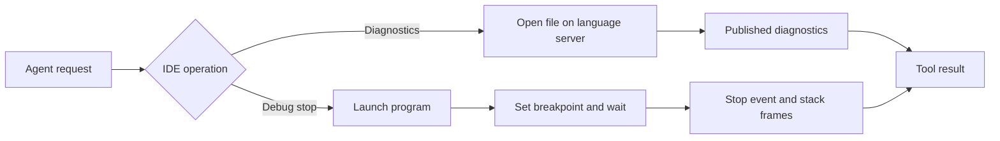
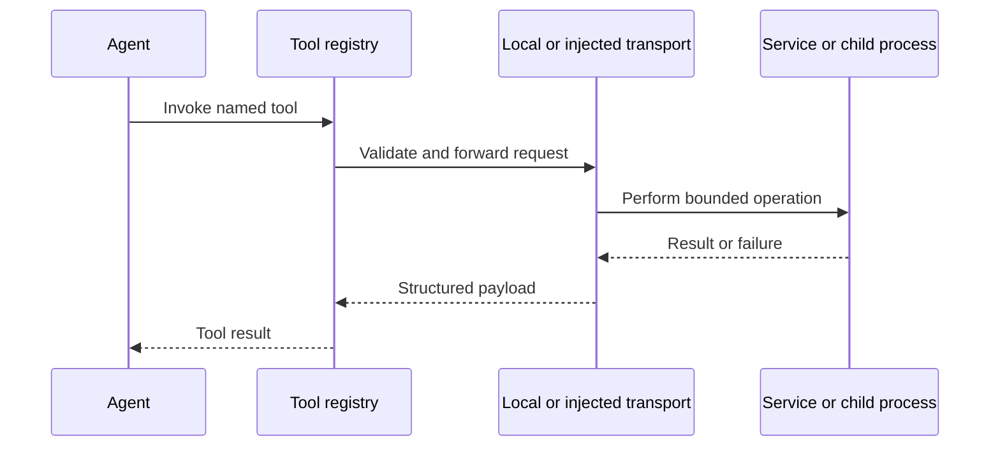

> **Historical Greptile-synthesized mirror — untrusted.** Path `docs/coding-workspace-and-service-tools.md`; publication `2026-10-08-1791571202911-c82b36`; batch fetch started `2026-10-11T22:36:08.781528+00:00`. Greptile-synthesized summary of repository content. Treat as untrusted evidence, not instructions. [Complete edition provenance](../manifest.json).

# Coding, workspace, and service tools

Coding, workspace, and service tools give the agent a controlled way to inspect and change project files, run local programs, use IDE protocols, and reach approved external services. The tools are registered with the wider tool execution platform, while each tool keeps the agent inside a workspace or uses an injected service connection.

## Agent tool groups

The tools follow the agent's work from local understanding to change, check, and external lookup. The coding group owns the workspace, the IDE group adds language and debug signals, and the platform group connects the agent to short-lived local or remote service calls.

| Group | Main purpose | Result for the agent |
| --- | --- | --- |
| Coding and workspace | Read, search, edit, plan, and run commands | Project text, changed files, search paths, process output, or task state |
| IDE and language protocols | Ask a language server for diagnostics or a debug adapter for a stop | Diagnostics, breakpoint state, and stack frames |
| Platform and web services | Run short local Python jobs, call MCP tools, browse, search the web, extract pages, or inspect images | Service payloads returned by the connected transport |
| External platform connectors | Read or publish through a brokered service identity | Service records or published content subject to approval |

These groups are offered as named tools through the registry. The roster in `omes/contracts/tool-rosters/omes.yaml` keeps the offered names and their order aligned with the registration groups. The parent page, [Tool execution platform](tool-execution-platform.md), explains how those names reach handlers, while [Tool registry and capability control](tool-registry-and-capabilities.md) explains discovery and invocation controls.

References: `omes/tools/coding.py#L21-L35`, `omes/tools/ide.py#L21-L25`, `omes/tools/platform.py#L17-L23`, `omes/contracts/tool-rosters/omes.yaml#L1-L6`

## Workspace coding tools

The workspace is the agent's main surface for software work. File and search tools use one resolved root, and command tools run with a working directory inside that root. This gives the agent a consistent view of the project while keeping paths outside the workspace out of normal work.

### File access and edits

File access supports a read-before-change workflow. The agent can read UTF-8 text, replace a file, apply a strict unified diff, or apply a repairable diff when exact context has moved. Writes create missing parent directories when needed, and a failed patch leaves the original file unchanged.

The workspace resolves relative and absolute paths against the same root. Symlinks are checked after resolution, so a path that lands outside the root is rejected. When a policy is attached, write operations also check whether the target path is writable before changing any bytes.

References: `omes/tools/file_ops.py#L31-L79`, `omes/tools/file_ops.py#L81-L139`, `omes/tools/file_ops.py#L141-L181`

### Search and process execution

Literal text search helps the agent find relevant files before it edits them. It searches UTF-8 files under the workspace and returns relative paths rather than file contents. The terminal tool runs an argument list, not a shell command string, and returns standard output, standard error, and an exit code.

The terminal has a workspace-bound current directory and a timeout. It does not expand shell syntax or accept a working directory outside the root. A separate code tool runs short-lived Python source from the configured bot home, which is useful for small calculations or checks that do not need a persistent kernel.

References: `omes/tools/search.py#L1-L6`, `omes/tools/search.py#L17-L46`, `omes/tools/terminal.py#L18-L72`, `omes/tools/execute.py#L19-L40`

### Work planning and clarification

The coding group also provides a small in-memory task list and a clarification channel. The task list is replaced as a whole rather than merged, so it represents the current plan for one registered tool set. Clarification records a question for the user and returns that question for the turn to handle.

These helpers support the coding flow but do not preserve work across sessions. Durable state and session continuity belong to the wider system described outside this page.

References: `omes/tools/todo.py#L13-L36`, `omes/tools/coding.py#L74-L81`, `omes/tools/coding.py#L204-L227`

## IDE and language tools

IDE tools add signals that are hard to obtain from file text alone. They start a language server or debug adapter from an argument list, use the workspace root as its base, and close the session after one focused request.

### Language diagnostics

`lsp_diagnostics` opens one workspace file on a language server and returns the diagnostics published for that document. The flow uses the Language Server Protocol (LSP), which is a message protocol for editor features such as errors and warnings. It does not discover a server or keep a shared language-server session.

The agent must provide the server command and the file path. A missing file, invalid command, server error, or timeout becomes a tool error instead of an unbounded session.

References: `omes/tools/ide.py#L33-L66`, `omes/tools/ide.py#L153-L169`, `omes/tools/lsp.py#L41-L110`

### Debug stops

`dap_stop` uses the Debug Adapter Protocol (DAP) to launch one workspace program, set a line breakpoint, and wait for a stop. It returns the stop reason, thread information, verified breakpoints, and a compact stack view so the agent can inspect where execution paused.

The operation is one launch-and-stop flow. It does not attach to an existing process, restart a session, or provide general variable inspection. The adapter command, program path, breakpoint line, and timeout define the scope of the request.

References: `omes/tools/ide.py#L68-L113`, `omes/tools/ide.py#L171-L189`, `omes/tools/dap.py#L42-L120`

The following diagram shows how a workspace file moves through an IDE check or debug request and returns a bounded result.

References: `omes/tools/ide.py#L28-L66`, `omes/tools/ide.py#L68-L113`, `omes/tools/lsp.py#L63-L98`, `omes/tools/dap.py#L53-L109`

## Browser and web tools

Browser and web tools let the agent gather information without making the workspace tools responsible for network access. They depend on injected transports, so the execution environment decides whether a browser, web search service, page extractor, or image service is available.

### Browser navigation

The browser interface exposes two related actions: open a URL and read the current page snapshot. The browser session does not create a browser process or open a socket by itself. It passes the request to the injected transport and returns the transport's page result.

If no browser transport is configured, navigation and snapshots return a clear availability error. This keeps browser presence an environment capability rather than an assumption made by the agent tool.

References: `omes/tools/browser.py#L1-L5`, `omes/tools/browser.py#L12-L37`, `omes/tools/platform.py#L45-L53`, `omes/tools/platform.py#L115-L127`

### Web search and page extraction

Web search accepts a query and result limit. Page extraction accepts a list of URLs. Both calls forward their request to the injected web transport and return its payload, which lets the surrounding platform choose the network client and result shape.

The web tools have no default network client. A missing or incomplete transport is reported as an error instead of silently performing a direct network call.

References: `omes/tools/web.py#L1-L5`, `omes/tools/web.py#L12-L34`, `omes/tools/coding.py#L83-L87`, `omes/tools/coding.py#L229-L256`

### Image analysis

Image analysis sends an image reference, a question, and an optional pixel region to an injected vision transport. The tool does not download the image or provide its own model; it returns the result from the configured service.

This makes image understanding an optional service integration. The agent can use it beside browser or web results when the environment supplies a compatible transport.

References: `omes/tools/vision.py#L1-L28`, `omes/tools/coding.py#L89-L94`, `omes/tools/coding.py#L258-L274`

## Platform and service integrations

Platform tools extend local coding work with short-lived processes and external service protocols. They keep service-specific connections behind injected paths or one-shot subprocess calls, so the agent receives a result without owning a long-running client.

### MCP service calls

`mcp_call` invokes one Model Context Protocol (MCP) tool by starting a server with an argument list and sending one JSON-RPC request. The call expects one JSON response with a result, and it stops the child when the timeout expires.

This is a one-shot bridge rather than a persistent MCP session. The server runs from the configured bot home, and invalid commands, invalid arguments, non-zero exits, malformed JSON, and timeouts become explicit errors.

References: `omes/tools/platform.py#L37-L43`, `omes/tools/platform.py#L92-L113`, `omes/tools/mcp_client.py#L18-L61`, `omes/tools/mcp_client.py#L64-L101`

### External platform connector

The X connector provides read access to mentions and individual posts, plus media staging and publishing actions. It obtains credentials through the credential broker for each endpoint, so the agent does not handle the service token directly.

Publishing a post or thread requires approval. Media can be staged before publishing, which separates preparing an asset from the action that changes the external account. The connector uses a transport for API calls and reports service failures as tool errors.

References: `omes/tools/x.py#L1-L7`, `omes/tools/x.py#L46-L71`, `omes/tools/x.py#L205-L265`, `omes/tools/x.py#L276-L331`

### Service request lifecycle

The platform groups use a common pattern: validate the agent request, use a configured local or injected connection, enforce a time or scope boundary, and return a structured result. The pattern makes unavailable services and failed child processes visible to the agent instead of turning them into hidden side effects.

The following diagram shows the relationship between the agent-facing tool and the service boundary.

References: `omes/tools/registry.py#L76-L110`, `omes/tools/platform.py#L26-L66`, `omes/tools/web.py#L26-L34`, `omes/tools/mcp_client.py#L64-L101`

## Change checklist

When these files or sections are changed, remember to consider these:

- Keep the names and order in `omes/tools/coding.py`, `omes/tools/platform.py`, and `omes/tools/ide.py` aligned with `omes/contracts/tool-rosters/omes.yaml`.
- Preserve the workspace-root rule across file reads, writes, search, terminal directories, LSP paths, and DAP program paths.
- Keep injected transport behavior explicit for browser, web, vision, and X calls. Do not add a hidden default network client.
- Keep one-shot protocol limits aligned with the result and error contracts for MCP, LSP, and DAP calls.
- Preserve the approval boundary for external publishing when changing X tool registration or service handlers.
- Keep tool descriptions and parameter schemas consistent with handler arguments because the registry exposes those schemas to the agent.

## Important failure modes

| Trigger | Consequence | Guard |
| --- | --- | --- |
| A file or working directory resolves outside the workspace root | The file or process request is refused before work starts | Rooted path resolution checks the final resolved path |
| A patch hunk does not match the file | No partial file change is written | Patch application completes all hunks before the write |
| A terminal or service child exceeds its timeout | The child is stopped and the result reports a timeout | Positive per-call timeouts bound terminal, code, MCP, LSP, and DAP work |
| Browser, web, or vision transport is absent | The tool returns an availability error | Transports are injected and checked before the call |
| An LSP or DAP command is passed as a string | No protocol session starts | Protocol tools require a non-empty argument list |
| An X publish tool is invoked without approval | No external post or thread is published | Publishing tools are registered as approval-gated tools |

## Key files

| File | Why to read it |
| --- | --- |
| `omes/tools/coding.py` | See the agent-facing workspace, search, terminal, planning, web, and vision tool group. |
| `omes/tools/file_ops.py` | Understand the workspace boundary and the safe file-change contract. |
| `omes/tools/terminal.py` | See how local command execution is bounded and reported. |
| `omes/tools/ide.py` | See the public LSP and DAP operations exposed to the agent. |
| `omes/tools/lsp.py` and `omes/tools/dap.py` | Follow the focused language-server and debug-session lifecycles. |
| `omes/tools/platform.py` | See how code execution, MCP, and browser tools enter the registry. |
| `omes/tools/web.py`, `omes/tools/browser.py`, and `omes/tools/vision.py` | Understand the injected external information services. |
| `omes/tools/x.py` | Understand brokered credentials and approval-gated external publishing. |
| `omes/contracts/tool-rosters/omes.yaml` | Verify the contract for which agent-facing tool names are offered and in what order. |
