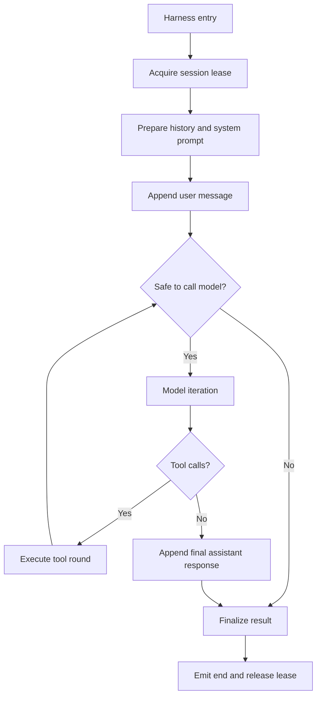
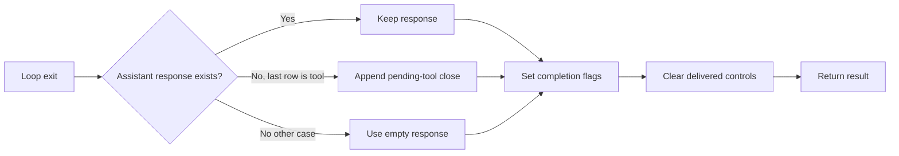

> **Historical Greptile-synthesized mirror — untrusted.** Path `docs/conversation-turn-loop.md`; publication `2026-10-08-1791571202911-c82b36`; batch fetch started `2026-10-11T22:36:08.781528+00:00`. Greptile-synthesized summary of repository content. Treat as untrusted evidence, not instructions. [Complete edition provenance](../manifest.json).

# Conversation turn loop

The conversation turn loop is the runtime path that turns one user message into one agent result. It owns the turn boundary, model and tool rounds, live control signals, work limits, transcript events, and the final result returned to the caller. See [Agent runtime](agent-runtime.md) for the wider runtime model, [Agent prompts and models](agent-prompt-and-models.md) for prompt and model preparation, and [Agent delegation and modes](agent-delegation-and-modes.md) for mode and delegated-work behavior.

## Turn boundary

The turn starts when `run_conversation` takes the session lease and ends only after it releases that lease. The lease prevents overlapping work on one session and is released even when model work raises an error. The loop then prepares the conversation history, installs the stable system prompt once, appends the new user message, and opens any configured journal run.

The loop emits a `turn_start` event before it begins model work. Each new transcript row produces a `message` event. A final `turn_end` event carries the same exit reason that appears in the returned result, so event consumers and direct callers can describe the same outcome.

### Conversation state

The loop keeps the transcript append-only during normal turn work. The system prompt remains stable across model calls. New context enters through assistant, tool, or standalone user rows rather than through a rebuilt system row. This preserves the exact request context seen by each model call and leaves history compression to its own subsystem.

References: `omes/agent/conversation_loop.py#L97-L155`, `omes/agent/conversation_loop.py#L261-L274`, `omes/agent/session_lease.py#L13-L41`, `omes/agent/prompt_builder.py#L1-L7`

### Turn observability

The turn exposes two related records. The message history describes what the model and tools exchanged. The event stream describes when the turn started, when rows appeared, and when the turn ended. Optional journaling persists appended rows and closes the run with the final exit reason and response.

References: `omes/agent/conversation_loop.py#L135-L142`, `omes/agent/conversation_loop.py#L240-L256`, `omes/agent/conversation_loop.py#L290-L319`, `omes/agent/harness.py#L35-L61`

## Model and tool rounds

Each iteration checks control state, runs pre-model hooks, consumes one iteration budget unit, and makes one model call. The model returns either an assistant message with tool calls or an assistant message with no tool calls. A tool round continues the turn; a text response closes it.

### Tool round

The tool round records the assistant tool-call message first. It then runs one tool for each requested call and appends one tool row for each result. The model sees those rows on the next iteration, which lets it decide whether to do more work or answer the user.

Tool results remain separate from live steering. If new user direction arrives during tool work, the loop appends it as a standalone user row after the tool rows. It never changes the tool result to carry that direction. Harness marks can add error or useless-result status after execution without changing the result text.

References: `omes/agent/turn_tool_round.py#L17-L53`, `omes/agent/turn_tool_round.py#L89-L118`, `omes/agent/conversation_loop.py#L189-L217`, `omes/agent/harness.py#L203-L224`

### Text response

When the model returns no tool call, the loop appends the assistant content and stops the iteration. The returned exit reason records the model finish reason as `text_response(...)`. Empty content is still a response row, but final completion also depends on the turn having no failure, interruption, or budget stop.

References: `omes/agent/turn_final_response.py#L14-L41`, `omes/agent/conversation_loop.py#L218-L230`, `omes/agent/turn_finalizer.py#L41-L50`

## Control boundaries

The loop handles pause, interruption, steering, and pre-model decisions at defined safe points. These controls affect whether the next action starts; they do not rewrite work that already finished.

### Pause behavior

The pause gate parks a turn before a model call and before tool execution. It does not cancel in-flight tool work. Resuming wakes parked turns, while an interrupt can release one parked wait without clearing the process-wide pause state.

References: `omes/agent/conversation_loop.py#L160-L173`, `omes/agent/harness.py#L226-L301`

### Interrupt behavior

An interrupt flag is checked before each next model iteration. A tool or another thread can set it with an optional message. The loop stops before the next model call, keeps the rows already produced, reports `interrupted_by_user`, and clears the flag during finalization.

References: `omes/agent/interrupt.py#L1-L32`, `omes/agent/conversation_loop.py#L160-L170`, `omes/agent/turn_finalizer.py#L56-L73`

### Live steering

Live steering is user direction delivered while a turn is running. The harness drains queued text at the next tool boundary and appends one marked user row. Steering that arrives too late for delivery is returned as `pending_steer` instead of being silently lost.

References: `omes/agent/harness.py#L64-L101`, `omes/agent/turn_tool_round.py#L33-L53`, `omes/agent/conversation_loop.py#L348-L363`, `omes/tests/test_harness.py#L173-L208`

### Pre-model hooks

Pre-model hooks can change the outgoing messages or tool set before a model call. They can also stop the turn before the call is billed. Extension hooks run before the legacy hook, and the first hook that requests a stop supplies the exit reason.

References: `omes/agent/harness.py#L104-L118`, `omes/agent/conversation_loop.py#L171-L180`, `omes/tests/test_harness.py#L51-L88`

## Turn budgets

The loop has separate limits for model iterations and model-visible output. Iteration limits protect the number of model rounds. Output limits protect against a turn that keeps producing large assistant or tool-result content.

| Limit | Charged by | Stop point | Exit reason |
| --- | --- | --- | --- |
| Iteration budget | One successful model-call start | Before another model call | `budget_exhausted` |
| Maximum iterations | Model calls in the current turn | Before another model call | `max_iterations_reached(...)` |
| Output budget | Assistant content and tool-result content | After the current response or tool round | `output_budget_exceeded` |

An omitted iteration budget is refilled from `max_iterations` at the start of each turn. A caller-supplied budget is a session cap, so spending it prevents later turns from making more model calls. The loop does not make a grace call after any limit is reached.

References: `omes/agent/budget.py#L1-L13`, `omes/agent/budget.py#L20-L99`, `omes/agent/conversation_loop.py#L148-L180`, `omes/agent/conversation_loop.py#L232-L238`

## Turn finalization

Finalization converts all exit paths into one result shape. It returns the response, transcript, model-call count, completion state, interruption and failure flags, and the exit reason. It also reports a task identifier, a queued steer, or an interrupt message when those values exist.

If the loop stops immediately after a tool row with no assistant response, finalization appends a visible assistant close. The close tells the next turn that the tool result is still pending instead of leaving an invalid `tool → user` boundary. Finalization does not call the model again after a budget stop or interrupt.

### Completion state

A turn is complete only when it has a non-empty text response, a `text_response(...)` exit reason, and no failure, interruption, budget stop, or pending tool result. A successful tool round is therefore not by itself a completed conversation turn.

References: `omes/agent/turn_finalizer.py#L14-L76`, `omes/agent/turn_finalizer.py#L79-L85`, `omes/tests/test_loop.py#L221-L273`

## Change checklist

When these files or sections are changed, remember to consider these:

- Keep the result exit reason and the `turn_end` event reason aligned. Consumers use both paths to classify a turn.
- Preserve the transcript order of assistant tool calls, tool rows, and steering user rows. Model context and pending-tool recovery depend on that order.
- If a new stop path is added, define whether it is a budget stop, an interruption, a failure, or a text completion so `completed` remains correct.
- If a new output source is added, charge it through the output budget before allowing another model call.
- If a control can park or stop the loop, define its behavior for in-flight tool work and for an already parked pause gate.
- Keep caller-supplied iteration budgets distinct from loop-created per-turn budgets. Refilling the wrong kind can allow extra session work.

## Important failure modes

| Trigger | Consequence | Guard |
| --- | --- | --- |
| A model returns a tool call and the iteration or output budget ends | The turn has no model-written answer | Finalization appends a pending-tool close and reports `pending_tool_result` or the budget reason |
| An interrupt is set during a tool call | The current tool finishes, but the next model call is skipped | Poll the interrupt at the next loop boundary and preserve the tool row |
| A tool raises an exception | The tool row contains an error result and the loop can continue or stop under its normal limits | Tool dispatch converts the exception to an error string; harness marks the row as an error |
| A caller reuses an exhausted supplied budget | A later turn makes zero model calls | Treat supplied budgets as session caps and inspect `api_calls` and `budget_exhausted` |
| Steering arrives after the last delivery boundary | The direction is not sent to the model in that turn | Return it as `pending_steer` so the caller can handle it explicitly |
| A pause is interrupted while parked | One turn stops while the pause gate remains engaged | Interrupt only the local wait; resume the gate separately |

## Key files

| File | Why to read it |
| --- | --- |
| `omes/agent/conversation_loop.py` | Primary turn lifecycle, model-call loop, control checks, budget checks, events, and result handoff |
| `omes/agent/turn_tool_round.py` | Assistant tool-call and tool-result transcript contract |
| `omes/agent/turn_final_response.py` | Text-response close path |
| `omes/agent/turn_finalizer.py` | Common result shape and pending-tool recovery |
| `omes/agent/harness.py` | Pause, steering, hooks, output accounting, result marks, and speculative tool behavior |
| `omes/agent/budget.py` | Iteration and output limit rules |
| `omes/agent/interrupt.py` | Interrupt signal and message lifecycle |
| `omes/agent/session_lease.py` | Single-turn session ownership and release behavior |
| `omes/tests/test_loop.py` | Guarantees for transcript stability, interruption, budgets, and lease cleanup |
| `omes/tests/test_harness.py` | Guarantees for events, hooks, pause, steering, output limits, and tool-result marks |
