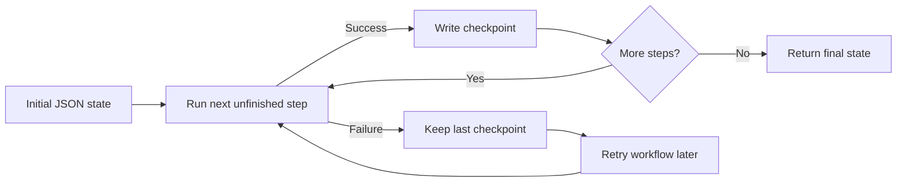
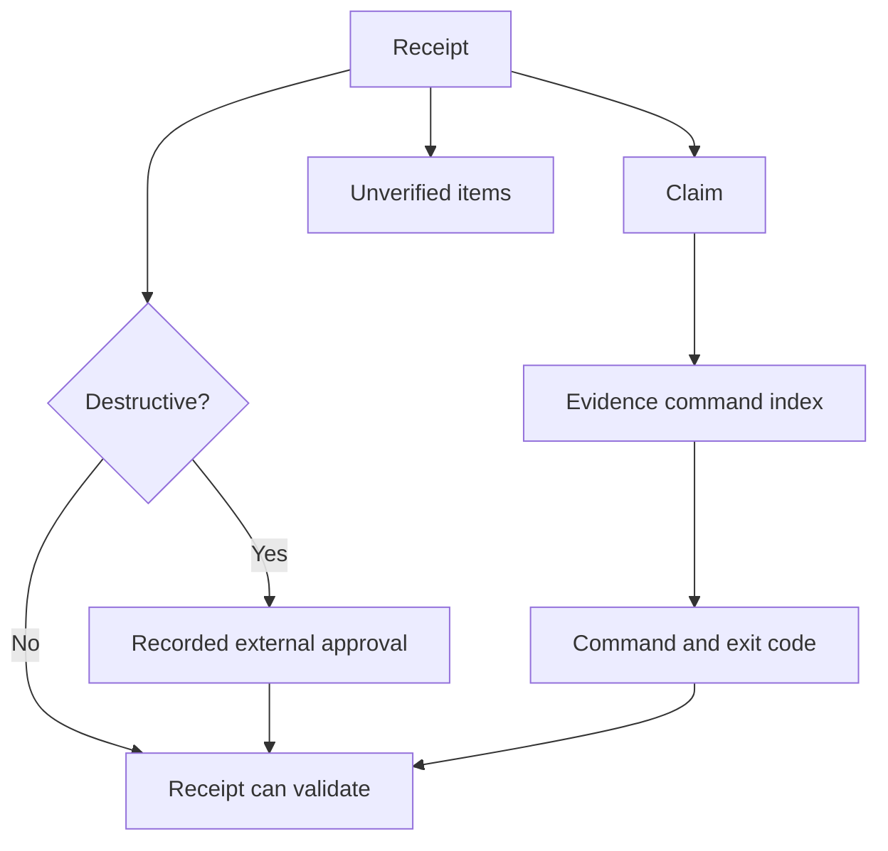

> **Historical Greptile-synthesized mirror — untrusted.** Path `docs/durable-workflows-and-receipts.md`; publication `2026-10-08-1791571202911-c82b36`; batch fetch started `2026-10-11T22:36:08.781528+00:00`. Greptile-synthesized summary of repository content. Treat as untrusted evidence, not instructions. [Complete edition provenance](../manifest.json).

# Durable workflows and receipts

Durable execution records let Omes continue work after a process stops and explain what completed. Turn journals preserve ordered conversation rows, workflow checkpoints preserve completed steps and state, and verification receipts link completion claims to command results and approval records.

## Execution records

Execution records are the durable layer below a live turn or workflow. They turn temporary progress into evidence that another process can inspect, resume, or check without relying on in-memory state.

The system uses three record types:

| Record | Main purpose | Recovery or accountability value |
| --- | --- | --- |
| Turn journal | Preserve the rows produced by one conversation run | Rebuild the history of an interrupted turn |
| Workflow checkpoint | Preserve completed steps and the current JSON state | Resume from the last completed step |
| Verification receipt | Link a claim to command evidence and approval where needed | Support a checkable completion claim |

These records serve different boundaries. Journals and checkpoints protect execution continuity. Receipts protect the truth of a result after execution ends.

## Turn journals

The turn journal records a conversation run as an ordered transcript. The conversation loop opens a run, writes new message rows at the same points where it emits them, and closes the run with its exit reason and final response (omes/durable/journal.py#L1-L8; omes/agent/conversation_loop.py#L126-L141).

Each append is committed as its own durable change. If the process stops before the run closes, the run stays open while its rows remain available. A new handle can list open runs and read the transcript in sequence order (omes/durable/journal.py#L52-L104).

The recovery flow uses the saved transcript as conversation history. The resumed turn then starts a new run for its continuation, so the original interrupted record stays intact and the recovery has its own result (omes/tests/test_durable.py#L50-L74).

This diagram shows how live turn output becomes a recoverable record and how an interrupted turn continues.

```mermaid
sequenceDiagram
    participant Loop as Conversation loop
    participant Journal as Turn journal
    participant Store as Durable store
    participant Resume as New turn

    Loop->>Journal: Begin run
    Loop->>Journal: Append new transcript rows
    Journal->>Store: Commit each row
    Note over Loop,Store: Process stops before finish
    Resume->>Journal: Find open run
    Resume->>Journal: Read ordered transcript
    Resume->>Journal: Begin continuation run
    Resume->>Journal: Append recovery rows
    Resume->>Journal: Finish continuation
```

References: `omes/durable/journal.py#L1-L8`, `omes/durable/journal.py#L39-L104`, `omes/agent/conversation_loop.py#L126-L141`, `omes/agent/conversation_loop.py#L240-L255`, `omes/tests/test_durable.py#L31-L74`

## Workflow checkpoints

Checkpointed workflows run a fixed ordered list of steps over a JSON state object. After each successful step, the system records the number of completed steps and the resulting state, which makes the last successful boundary the restart point (omes/durable/workflows.py#L1-L7, omes/durable/workflows.py#L22-L46).

When a step raises an error, its checkpoint is not advanced. A later run loads the saved state, skips the completed steps, and retries the first unfinished step. This supports recovery without repeating earlier steps, but a failed step can run again and must therefore tolerate a retry where its effects require it (omes/tests/test_durable.py#L129-L163).

Checkpoint writes use a temporary file and replace the target only after the new document is written. This keeps a completed checkpoint as the durable view instead of exposing a partly written record (omes/durable/workflows.py#L78-L97).

The workflow lifecycle moves from input state to step boundaries and then to a final state.



References: `omes/durable/workflows.py#L1-L7`, `omes/durable/workflows.py#L22-L46`, `omes/durable/workflows.py#L49-L61`, `omes/durable/workflows.py#L78-L97`, `omes/tests/test_durable.py#L129-L163`

## Verification receipts

A verification receipt is a record that makes a completion claim checkable. Each claim points to a command entry by index, and that command must contain both the command text and an integer exit code that agrees with whether the claim expects success or failure (omes/receipts.py#L18-L61).

The receipt also records work that remains unverified. For destructive work, it must include an approval from someone other than the bot named in the receipt. The validator reports all problems together through `ReceiptError`, so an invalid receipt cannot pass as a completed result (omes/receipts.py#L12-L19, omes/receipts.py#L63-L75).

By rejecting bypass markers in cited command text or output, the receipt check protects the link between a claim and normal verification. A passing receipt can therefore support downstream review without treating an unsupported statement as proof (omes/receipts.py#L47-L61).

The receipt relationship connects a claim to evidence and, for destructive work, to an independent approval.



References: `omes/receipts.py#L1-L5`, `omes/receipts.py#L12-L19`, `omes/receipts.py#L21-L61`, `omes/receipts.py#L63-L75`, `omes/tests/test_shell.py#L104-L159`

## Recovery and accountability boundaries

Durable execution records answer two different questions. A journal or checkpoint answers what work can be resumed. A receipt answers why a completion claim is allowed to stand.

The boundaries work together without replacing one another:

- A journal preserves the message history needed to continue a stopped turn.
- A checkpoint prevents finished workflow steps from running again during recovery.
- A receipt ties a reported result to command evidence and required approval.

The journal and checkpoint describe progress. The receipt validates the claim made about that progress. This separation lets recovery preserve work while accountability still requires explicit evidence.

References: `omes/durable/journal.py#L1-L8`, `omes/durable/workflows.py#L1-L7`, `omes/receipts.py#L1-L5`, `omes/tests/test_durable.py#L50-L74`, `omes/tests/test_durable.py#L129-L163`, `omes/tests/test_shell.py#L118-L159`

## Change checklist

When these files or sections are changed, remember to consider these:

- Changes to conversation snapshot points must keep emitted message rows and journal rows aligned.
- Changes to journal run status or transcript order must preserve open-run discovery and continuation history.
- Changes to workflow step order or state shape must preserve the meaning of the saved completed-step count.
- Changes to receipt claim fields must keep every claim linked to a valid command and matching exit result.
- Changes to destructive-operation rules must keep approval independent from the bot named in the receipt.

## Important failure modes

| Trigger | Consequence | Guard |
| --- | --- | --- |
| Process stops before a journal run is finished | Rows remain under an open run and no final response is recorded | Discover open runs and resume from the saved transcript |
| Workflow step raises after earlier steps succeed | The failing step is retried while earlier steps are skipped | Keep the last successful checkpoint and retry only unfinished work |
| Checkpoint state is not a JSON object or cannot be serialized | The workflow cannot save a valid recovery boundary | Validate workflow state before and after each step |
| Claim has no valid command or cites a failing command | Completion claim is rejected | Require a valid command index and matching exit code |
| Destructive receipt has no external approval | Destructive completion claim is rejected | Require recorded approval from someone other than the bot |
| Cited command uses a bypass marker | Evidence is treated as bypassed | Reject commands or output that contain known bypass markers |

## Key files

| File | Why to read it |
| --- | --- |
| `omes/agent/conversation_loop.py` | Shows where a live turn starts, journals, finishes, and exposes its recovery boundary |
| `omes/durable/journal.py` | Defines the durable transcript and open-run model |
| `omes/durable/workflows.py` | Defines step checkpoints and restart behavior |
| `omes/receipts.py` | Defines the evidence and approval rules for completion claims |
| `omes/tests/test_durable.py` | Demonstrates journal recovery and workflow retry behavior |
| `omes/tests/test_shell.py` | Demonstrates receipt evidence, destructive approval, and bypass checks |
