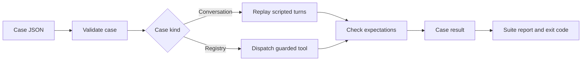

> **Historical Greptile-synthesized mirror — untrusted.** Path `docs/evaluation-and-audit.md`; publication `2026-10-08-1791571202911-c82b36`; batch fetch started `2026-10-11T22:36:08.781528+00:00`. Greptile-synthesized summary of repository content. Treat as untrusted evidence, not instructions. [Complete edition provenance](../manifest.json).

# Evaluation and audit

Evaluation and audit provide two views of system behavior. The evaluation runner checks expected outcomes in repeatable conversations and policy cases. Audit logs and traces show what happened during tool use and model turns so an engineer can inspect a result without exposing sensitive input.

## Evaluation runner

The evaluation runner is a deterministic check of agent behavior. It replays scripted model turns or direct tool requests in a temporary work area, then compares the result with structural expectations. Because it uses fixed inputs and no judge model, a run gives the same pass or fail result for the same case.

The runner supports two case groups:

- **Golden cases** check normal behavior, such as a final reply, a tool round trip, and the absence of a password.
- **Red-team cases** check that policy limits, approval gates, and untrusted tool output stop unsafe behavior.

`omes/evals/runner.py` loads `golden.json` and `redteam.json`, runs each case, collects all failures, and returns a report with per-case results. A malformed case or an unknown expectation is reported as a failure instead of stopping the full suite.

References: `omes/evals/runner.py#L25-L90`, `omes/evals/cases/golden.json#L1-L46`, `omes/evals/cases/redteam.json#L1-L53`

### Case expectations

Case expectations describe observable results rather than internal steps. They can check final text, the turn exit reason, whether a tool was called, whether a tool was not called, refusal text, or the number of tool messages.

The runner uses separate case paths for conversation loops and registry checks. Conversation cases use scripted model replies and optional stub tools. Registry cases apply policy and approval settings to a named tool, then check the returned error or call record. This split lets the suite validate both user-facing behavior and the guard that runs before a handler.

References: `omes/evals/runner.py#L93-L141`, `omes/evals/runner.py#L152-L185`, `omes/evals/cases/redteam.json#L3-L51`

### Evaluation flow

The diagram shows how a case moves from data to an isolated result and then into the suite report.

The continuous integration job runs the complete Python test suite and the evaluation suite on pushes and pull requests. A non-zero evaluation result blocks the check because the runner exits with success only when every case passes.

References: `omes/evals/runner.py#L51-L90`, `.github/workflows/ci.yml#L15-L20`, `omes/tests/test_evals.py#L13-L26`

## Audit log

The audit log is an append-only record of tool dispatch decisions. It gives operations a durable history of whether a tool was allowed, denied, failed, or unknown, while deliberately leaving tool arguments out because they may contain secrets.

Each record has an increasing sequence number, a UTC time, a tool name, and a verdict. A reason may be present and is redacted before storage. The log can be read in file order, and its violation view returns denied records for focused policy review.

References: `omes/audit/log.py#L1-L18`, `omes/audit/log.py#L21-L71`

### Dispatch outcomes

The tool registry records the final dispatch decision after policy, approval, and handler processing. Policy denial and missing approval are recorded before the handler runs, so the audit trail can show that a blocked action did not reach the tool. Unknown names and handler errors also create records instead of becoming silent gaps.

The audit record does not link tool arguments into the durable file. This protects the log from becoming a second store of credentials or other sensitive request data, but it also means that the record alone cannot reproduce the exact request.

References: `omes/tools/registry.py#L20-L29`, `omes/tools/registry.py#L76-L123`, `omes/tests/test_policy.py#L138-L169`

## Execution traces

An execution trace is an in-memory ordered view of one run. A `trace_id` identifies the trace, and each span records a sequence number, UTC time, kind, name, and fields. Optional duration data makes model-call timing visible without changing the main result.

The trace covers the main execution boundaries:

- Model spans show calls made by the conversation loop.
- Tool spans show dispatch verdicts.
- Policy spans mark policy refusals, including workspace write refusals.

String field values are redacted when spans are created. If no tracer is attached, the system records nothing for that boundary and keeps the normal execution path.

References: `omes/audit/trace.py#L1-L7`, `omes/audit/trace.py#L18-L55`, `omes/agent/conversation_loop.py#L60-L61`, `omes/tools/registry.py#L112-L124`

### Trace use

Audit logs and traces answer different questions. The audit log preserves tool decisions across process lifetime. The trace keeps the order and relationship of model, tool, and policy events for a single execution. Engineers can use the audit record to confirm a durable decision, then use the trace to see where that decision sat in the run.

The trace export contains the trace identifier and spans in sequence order. A conversation loop adds a model span after each model call, while an attached registry adds tool and policy spans at dispatch time. This gives an investigation a simple event timeline without storing full prompts or tool arguments.

References: `omes/audit/trace.py#L49-L55`, `omes/agent/conversation_loop.py#L276-L287`, `omes/tests/test_transports.py#L147-L188`

## Validation and investigation

Validation starts with the evaluation suite because it gives a repeatable answer about expected behavior. Investigation starts with the failed case or observed run, then uses refusal text, tool call expectations, audit verdicts, and trace order to locate the boundary that changed.

Use the following order when behavior is unexpected:

1. Run the relevant evaluation cases and identify the first failed expectation.
2. Check whether the tool was called. A missing call can indicate policy or approval refusal rather than a handler failure.
3. Read the audit verdict and redacted reason for the dispatch.
4. Inspect the trace timeline when the order of model, tool, and policy events matters.
5. Treat a malformed audit file as an integrity problem. The reader reports the line that cannot be parsed instead of hiding it.

References: `omes/evals/runner.py#L39-L48`, `omes/tools/registry.py#L76-L110`, `omes/audit/log.py#L47-L67`, `omes/tests/test_policy.py#L172-L181`

## Change checklist

When these files or sections are changed, remember to consider these:

- Keep the case names and the files loaded by `run_suite` aligned. A new case file is not part of the default suite unless the runner loads it.
- Keep expectation types in `runner.py` aligned with the JSON case contract. An unknown type fails the case rather than being ignored.
- Preserve the boundary order between policy, approval, handler, audit, and trace recording. A change can make a blocked tool appear to have run.
- Preserve redaction when adding fields to audit records or trace spans. Arguments and free-form reasons can carry secrets.
- Keep the CI command pointed at the shipped case directory so pull requests exercise the same suite used by local runs.

## Important failure modes

| Trigger | Consequence | Guard |
|---|---|---|
| A case has an unknown expectation type | The case fails with an explicit validation failure | `_check` rejects types that are not part of the expectation contract |
| A policy denies a tool | The handler is not called and the result contains a policy refusal | The registry records `denied` before approval and handler processing |
| A required approval is missing | The tool does not run and the result reports `approval required` | Approval is checked before `_call` |
| A handler raises or returns a non-serializable result | The dispatch is recorded as an error and returns a JSON error | The registry catches handler and encoding errors |
| An audit line is malformed | Reading the log raises an integrity error with the line number | `AuditLog.records()` validates each non-empty line |

## Key files

| File | Why to read it |
|---|---|
| `omes/evals/runner.py` | Defines case validation, replay, expectations, reports, and the command exit result |
| `omes/evals/cases/golden.json` | Shows the normal behavior cases that protect user-facing outcomes |
| `omes/evals/cases/redteam.json` | Shows the policy, approval, and injection-resistance cases |
| `omes/audit/log.py` | Defines the durable tool decision record and violation view |
| `omes/audit/trace.py` | Defines the ordered trace shape and redaction boundary |
| `omes/tools/registry.py` | Connects policy and approval decisions to handlers, audit records, and trace spans |
| `omes/agent/conversation_loop.py` | Shows where model-call spans enter a conversation run |
| `.github/workflows/ci.yml` | Shows how tests and evaluations run in continuous integration |
