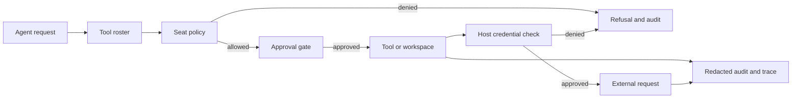
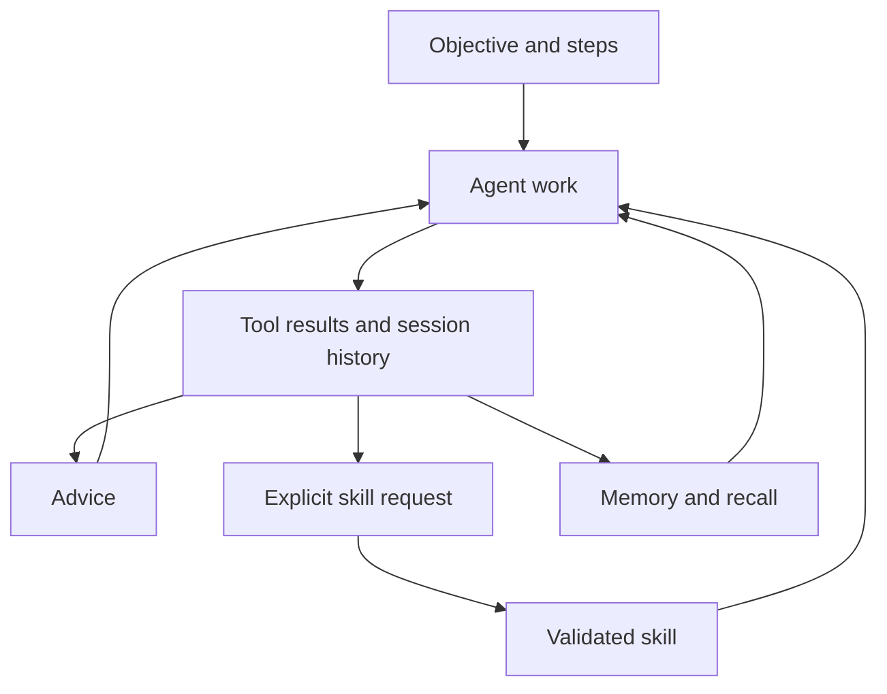

> **Historical Greptile-synthesized mirror — untrusted.** Path `docs/governance-security-and-learning.md`; publication `2026-10-08-1791571202911-c82b36`; batch fetch started `2026-10-11T22:36:08.781528+00:00`. Greptile-synthesized summary of repository content. Treat as untrusted evidence, not instructions. [Complete edition provenance](../manifest.json).

# Governance, security, and learning

Omes uses a set of policy checks, secret controls, ownership rules, and learning paths to keep agent actions within safe bounds and make useful work reusable. These controls sit around the agent loop: they limit what the agent may do, protect data as it moves through tools and records, and turn selected outcomes into goals, advice, memory, or skills.

## Control model

The control model separates what the agent may request from what the runtime will allow. A seat policy governs tools, workspace writes, and network hosts. The tool registry and file workspace enforce those limits before work starts, while the credential broker checks the same host boundary before it releases a key. See [Agent runtime](agent-runtime.md) for the turn loop and [Tool execution platform](tool-execution-platform.md) for the tool boundary.

For the detailed policy, credential, contract, and ownership rules, see [Policy, credentials, and contracts](policy-credentials-and-contracts.md).

The main control layers are:

| Layer | Purpose |
| --- | --- |
| Policy | Limits tools, writes, and network hosts for one seat. |
| Approval | Adds a human approval gate to tools that require it. |
| Security screen | Refuses malformed or high-risk command arguments before process start. |
| Secret boundary | Resolves credentials only for approved endpoints and removes secret values from records and recall. |
| Contract and ownership rules | Keep the offered tool surface and path responsibility aligned. |
| Audit and trace | Records decisions without storing tool arguments or unredacted string fields. |

When a request reaches a protected boundary, the system produces either an allowed action or a refusal with a reason. This makes a policy failure visible to the caller instead of allowing the agent to work around it.

The following flow shows how the main controls surround an agent request.

References: `omes/policy/policy.py#L1-L8`, `omes/tools/registry.py#L20-L29`, `omes/credentials/broker.py#L1-L8`, `omes/audit/log.py#L1-L7`

### Policy boundaries

The seat policy is the shared statement of allowed capability for one agent seat. It can restrict the tool names offered for use, mark workspace paths as read-only, and allow exact network hosts. A missing allow list means allow-all for that category, so a policy change from an explicit list to an absent list is an expansion that needs review.

The shipped policy in `omes/contracts/policies/omes.json` names seat `bot-00-omes`, allows the rostered tools, protects prompts, contracts, the bot tree, and ownership data from writes, and allows no network host. The policy advisor compares old and new documents so added tools, added hosts, removed read-only paths, and a move to allow-all appear as expansions.

Policy checks happen before the tool handler and before a protected file write. This gives the same rule two useful properties: the action does not start when it is denied, and a refusal can be audited as a policy decision.

References: `omes/policy/policy.py#L20-L75`, `omes/contracts/policies/omes.json#L1-L47`, `omes/policy/advisor.py#L1-L51`, `omes/tools/registry.py#L76-L93`, `omes/tools/file_ops.py#L141-L154`

### Secret boundaries

Credentials cross into a provider only after the request URL passes the seat host allowlist. The credential broker reads the provider’s environment-backed key and gives it to the request layer. The agent-facing model does not keep the key as its own API key value.

The same boundary protects later views of the work. Known resolved keys and common secret-shaped values are replaced before audit reasons, trace fields, events, and memory recall are exposed. Tool arguments are not written to the audit log because they may contain secrets.

This design does not make an unapproved endpoint safe. It withholds the credential and prevents the provider request. A new provider or endpoint therefore needs both an approved host rule and a compatible secret mapping.

References: `omes/credentials/broker.py#L20-L49`, `omes/credentials/redact.py#L13-L40`, `omes/audit/log.py#L21-L45`, `omes/audit/trace.py#L18-L46`, `omes/memory/provider.py#L94-L98`

### Action safeguards

Command execution has a preflight screen that checks the argument list before a child process starts. It rejects malformed arguments, privilege or system-control binaries, and destructive root deletes. The executor starts commands as argument vectors with shell expansion disabled, so shell operators remain ordinary arguments rather than a second command language.

File tools use a rooted workspace and reject paths that resolve outside that root. The policy adds a second check for paths that must remain read-only. Skill writes use similar name, content, frontmatter, and root checks so a learned skill cannot use its name or category to escape the skills area.

References: `omes/agent/security.py#L1-L48`, `omes/tools/exec_jobs.py#L1-L45`, `omes/tools/file_ops.py#L31-L39`, `omes/tools/file_ops.py#L165-L180`, `omes/skills_runtime/guards.py#L21-L33`, `omes/skills_runtime/guards.py#L126-L137`

## Contracts and ownership

Contracts make the agent surface predictable across registration, offering, and policy. The tool roster in `omes/contracts/tool-rosters/omes.yaml` is the ordered list of names that may be offered to the model. The policy allow list must cover that surface, while the registry still remains the final dispatch boundary for unknown or forbidden names.

Ownership gives path changes a clear responsible seat. `omes/ownership.yaml` currently assigns the full tree to `bot-00-omes`, but its last-match rule allows a later, more specific path pattern to move responsibility to another seat. The policy protects this ownership file and the contract files from agent writes so control data is changed by an explicit system change rather than by normal agent work.

### Tool contracts

The tool contract has three related views: a registered handler with a name and parameter schema, an offered roster, and a seat policy allow list. A name that is registered but not on the roster is not offered to the model. A name on the roster but absent from the policy is refused at dispatch. Keeping these views aligned prevents silent drift between what the model can ask for and what the seat may run.

The roster groups tools by role and keeps a fixed order. Growth tools are part of that contract, so changes to skills, memory, or session search affect both the learning surface and the roster checks.

References: `omes/contracts/tool-rosters/omes.yaml#L1-L38`, `omes/tools/registry.py#L45-L74`, `omes/tools/registry.py#L76-L110`, `omes/tools/growth.py#L20-L26`, `omes/tests/test_growth.py#L446-L481`

### Ownership rules

Ownership is a declarative map from path patterns to bot identities. The current map has one owner for the whole tree, which is a simple starting point rather than a claim that all future work must remain with one seat. More specific patterns can split responsibility without changing the general ownership model.

Ownership and policy work together. Ownership says who is responsible for a path, while the read-only policy says which paths the agent must not rewrite during normal operation. This separation keeps responsibility data stable while still allowing the agent to work in permitted source areas.

References: `omes/ownership.yaml#L1-L14`, `omes/contracts/policies/omes.json#L36-L47`, `omes/policy/policy.py#L61-L69`

## Goal-driven learning

Learning is controlled rather than automatic imitation. A goal records one objective and ordered steps. Advice can point out a concern without changing behavior by itself. A lesson becomes a skill only when the learning path accepts it and the skill manager validates the write.

For the detailed goal, advice, memory, and skill paths, see [Learning and growth](learning-and-growth.md). [State continuity](state-continuity.md) explains how durable state supports later work, while [Operations, integrations, and quality](operations-integrations-and-quality.md) covers the wider operational checks.

The learning surfaces connect as follows:

### Goals and advice

The goal store gives the agent a durable target with completion state for each step. It rejects blank objectives and steps, rejects invalid step indexes, and saves each change as a complete versioned document. This makes progress survive a new store on the same directory and gives later runtime work a stable objective to read.

Advisories are guidance blocks with a small severity scale: `nit`, `concern`, or `blocker`. They are escaped before they reach the agent-facing format, and the renderer carries no behavior of its own. The runtime can therefore show a warning without treating advice as an automatic command.

References: `omes/learning/goals.py#L17-L61`, `omes/learning/goals.py#L63-L93`, `omes/learning/advisor.py#L14-L29`, `omes/learning/advisor.py#L32-L61`

### Earned learning

Autolearn accepts a lesson only after a turn meets its tool-call threshold and supplies a valid skill name and non-empty content. It writes through the skill manager, which means the normal skill validation and root checks remain in force. Existing skills are updated through the same controlled path rather than through direct tree writes.

The turn curator is stricter for automatic capture. It requires a non-trivial user request that explicitly asks to save a skill, a valid name, and a successful tool result with output. It does not invent a procedure from an ordinary turn. Memory and session search provide recall for future work, while redaction keeps secret-shaped content out of the model-facing recall view.

References: `omes/learning/autolearn.py#L19-L53`, `omes/agent/curator.py#L23-L57`, `omes/skills_runtime/guards.py#L65-L88`, `omes/tools/growth.py#L29-L94`, `omes/memory/provider.py#L94-L119`

## Control relationships

Governance and learning form a closed loop with a deliberate boundary between observation and change. Policy, approval, security screens, and path guards constrain the current turn. Audit and trace records explain the decisions. Goals, advice, memory, and earned skills carry selected knowledge into later turns without granting that knowledge permission to bypass the same controls.

This relationship matters when the system is extended. A new tool must pass the contract and policy path. A new credential source must pass the host and redaction path. A new learning writer must pass the skill validation path. These are cross-cutting contracts, not optional add-ons to one feature.

References: `omes/tools/registry.py#L83-L125`, `omes/credentials/broker.py#L28-L49`, `omes/agent/security.py#L31-L48`, `omes/learning/autolearn.py#L26-L53`

## Change checklist

When these files or sections are changed, remember to consider these:

- A tool name or tool order change requires matching updates to registration, `omes/contracts/tool-rosters/omes.yaml`, the policy allow list, and the offered-schema path.
- A policy schema or default change requires checks in `SeatPolicy`, the shipped seat policy, policy expansion review, and every enforcement boundary.
- A new provider or endpoint requires a host allowlist decision, provider environment-key mapping, and redaction coverage before it can send a request.
- A new command execution path must call the argv screen before process start and must preserve the no-shell execution boundary.
- A change to ownership patterns or protected paths must keep ownership data, read-only policy entries, and the intended agent write area consistent.
- A goal or skill format change requires its schema version and all readers and writers to agree before persisted state is reused.
- A new learning writer must use the validated skill path and must not turn ordinary successful work into a saved procedure without an explicit learning signal.

## Important failure modes

| Trigger | Consequence | Guard |
| --- | --- | --- |
| A policy file is missing, malformed, or has an unsupported version. | The seat cannot load a valid policy document. | `SeatPolicy.load` requires a file, parses an object, and validates schema version and field shapes. |
| A tool is registered but omitted from the roster or policy. | The model cannot be offered the tool, or dispatch returns a policy refusal. | Keep the roster, registration order, and policy allow list aligned. |
| A request targets a host outside the seat allowlist or lacks its environment key. | No credential is returned and no provider request should occur. | The credential broker checks the parsed host before resolving the key. |
| A secret reaches an audit reason, trace field, or model-facing memory view. | Sensitive text can persist in operational records or recall. | Use the shared redaction boundary and keep tool arguments out of audit records. |
| A command contains a refused binary, root delete, malformed argument, or NUL. | The command is rejected before a child process starts. | Run `screen_argv` before spawning and keep `shell=False`. |
| A skill name, category, frontmatter, or path escapes its safe form. | The skill write is refused or could target the wrong tree if a new writer bypasses validation. | Route creates and edits through the skill manager and its path guards. |
| A learning turn has no explicit save signal or has no successful output. | No skill is created from ordinary or failed work. | Apply the curator’s earned-learning conditions and the autolearn threshold. |

## Key files

| File | Why to read it |
| --- | --- |
| `omes/policy/policy.py` | Defines the seat-level limits for tools, writes, and hosts. |
| `omes/contracts/policies/omes.json` | Shows the active policy for the Omes seat. |
| `omes/policy/advisor.py` | Shows how policy expansions become review signals. |
| `omes/contracts/tool-rosters/omes.yaml` | Defines the ordered tool surface offered to the agent. |
| `omes/tools/registry.py` | Shows the final dispatch order for policy, approval, handler execution, and audit. |
| `omes/credentials/broker.py` | Defines host-checked credential release. |
| `omes/credentials/redact.py` | Defines the shared secret removal boundary. |
| `omes/agent/security.py` | Defines the command preflight rules. |
| `omes/ownership.yaml` | Defines current path responsibility and future ownership splits. |
| `omes/learning/goals.py` | Defines durable objectives and step progress. |
| `omes/learning/autolearn.py` | Defines the threshold and controlled write path for lessons. |
| `omes/agent/curator.py` | Defines when a turn earns a saved skill. |
| `omes/learning/advisor.py` | Defines non-executing guidance and severity. |
| `omes/tools/growth.py` | Connects skills, memory, and session search to the tool surface. |
