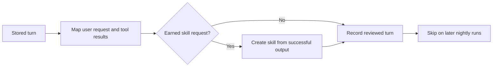
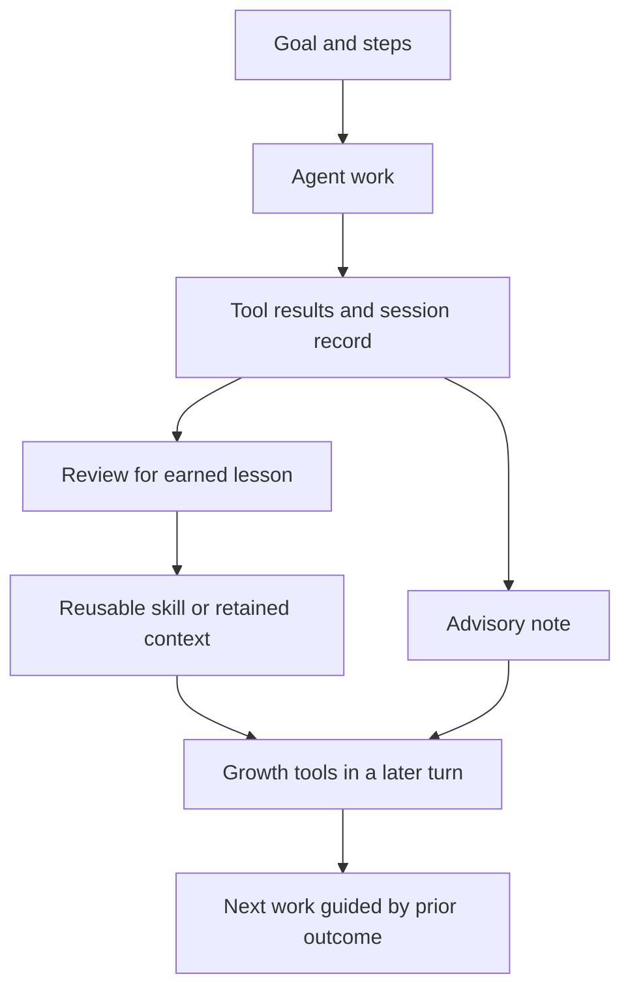

> **Historical Greptile-synthesized mirror — untrusted.** Path `docs/learning-and-growth.md`; publication `2026-10-08-1791571202911-c82b36`; batch fetch started `2026-10-11T22:36:08.781528+00:00`. Greptile-synthesized summary of repository content. Treat as untrusted evidence, not instructions. [Complete edition provenance](../manifest.json).

# Learning and growth

Learning and growth turns completed agent work into clearer aims, reusable skills, useful recall, and focused advice. The system keeps the improvement loop bounded: goals record the target, learning captures lessons only when a turn earns them, advisory notes guide the agent without acting for it, and growth tools expose these assets during later work. It is the learning part of [Governance, security, and learning](governance-security-and-learning.md), alongside [Policy, credentials, and contracts](policy-credentials-and-contracts.md).

## Improvement model

The improvement model links a work result to a small set of durable changes. A goal gives the work direction. A lesson becomes a skill only when the turn passes a meaningful threshold. Memory and session search make prior context available, while advisory notes mark issues by severity so the next action can focus on the most important gap.

The main relationships are:

| Area | Role in improvement |
| --- | --- |
| Goals | Hold one objective and its ordered steps. |
| Automated learning | Turn substantive lessons into reusable skills. |
| Advisory logic | Present notes as graded guidance for an agent turn. |
| Growth tools | Let the agent create, inspect, recall, and search learning assets. |
| Nightly review | Revisit stored turns and add only earned skills. |

The result is a feedback loop rather than a separate training system. Work produces outcomes. Review selects what is worth keeping. Later turns use the selected material to improve their next decisions.

## Goal tracking

Goals provide a small, durable plan for one piece of work. A goal has one objective and an ordered list of steps, and each step records whether it is complete. The goal store writes each change to a versioned JSON document so a later process can recover the same plan.

The goal lifecycle is:

1. Set or replace the objective.
2. Add unfinished steps in the order they should be handled.
3. Mark a step complete when the work reaches it.
4. Read the current objective and step status to guide the next action.

Blank objectives and steps do not enter the plan. A bad step index is rejected, so an update cannot silently mark a different step as complete.

References: `omes/learning/goals.py#L17-L61`, `omes/tests/test_modes.py#L174-L193`

## Automated learning

Automated learning captures a useful result as a skill without treating every turn as a lesson. `Autolearn` first checks that the turn has enough tool activity and that both the skill name and content are usable. It then sends the write through the skill manager, creating a skill or updating an existing one.

This path separates the decision to learn from the storage of the lesson. The learning controller decides whether a turn is substantial. The skill manager validates and stores the reusable document. A failed check leaves the skills area unchanged.

The captured skill is a durable procedure that later work can view or edit. It is not a model update, and this path does not invent extra procedure text beyond the supplied lesson.

References: `omes/learning/autolearn.py#L16-L53`, `omes/skills_runtime/manager.py#L23-L64`, `omes/tests/test_modes.py#L153-L172`

### Earned skill review

Earned skill review applies a stricter rule to a completed turn. The curator creates a skill only when the user explicitly asks to save a skill, supplies a valid name, and the turn contains successful tool output. Trivial prompts and unsuccessful or empty results do not create a skill.

The review keeps the source of the lesson visible: the skill body is the successful tool output. This makes the saved procedure traceable to an actual result instead of to an invented summary.

References: `omes/agent/curator.py#L1-L5`, `omes/agent/curator.py#L23-L88`, `omes/tests/test_growth.py#L374-L443`

### Nightly learning pass

The nightly learning pass applies earned skill review to stored turns. It maps the last non-steer user message and the tool results into curator input, reviews each new turn once, and checkpoints reviewed turn IDs after each review. A later run therefore skips work that already has a review decision.

This scheduled pass favors safe, repeatable improvement over broad rewriting. It can add skills for eligible turns, but it does not call a model and does not repeat a review after a checkpoint.

This diagram shows how a stored turn becomes either a reusable skill or a recorded no-op.

References: `omes/routines/nightly.py#L1-L7`, `omes/routines/nightly.py#L20-L81`, `omes/tests/test_nightly.py#L19-L47`

## Advisory logic

Advisory logic turns a note into agent-facing guidance without executing the guidance. Each note has text and one of three severities: `nit`, `concern`, or `blocker`. An optional advisor label identifies the source of the note.

The renderer emits one escaped `<advisory>` block per note. Escaping protects the note text and attributes when advice contains markup-like characters. Severity is therefore a display and prioritization signal, not a hidden command path.

| Severity | Meaning at a high level |
| --- | --- |
| `nit` | A small improvement. |
| `concern` | An issue that needs attention. |
| `blocker` | An issue that should stop or redirect the work. |

References: `omes/learning/advisor.py#L1-L7`, `omes/learning/advisor.py#L14-L61`, `omes/tests/test_modes.py#L195-L212`

## Growth tools

Growth tools are the agent-facing surface for using learned material during work. The growth tool group binds its storage locations outside the model request, then offers four capabilities through the common tool registry: manage a skill, view a skill, update memory, and search stored session messages.

These tools connect improvement assets to live agent work:

- `skill_manage` creates, replaces, or patches a reusable skill.
- `skill_view` reads a skill so the agent can apply or inspect it.
- `memory` adds, replaces, or removes one memory or user-profile entry.
- `session_search` finds stored messages by literal text so prior work can be recovered.

The registry exposes these names only when the tool roster requests them. It also returns tool outcomes as JSON and can apply policy or approval checks before a handler runs.

References: `omes/tools/growth.py#L1-L5`, `omes/tools/growth.py#L20-L94`, `omes/tools/registry.py#L20-L29`, `omes/tools/offer.py#L12-L26`

### Skill assets

Skills are reusable procedure documents. Their manager requires a safe name and valid frontmatter, keeps writes under the configured skills root, and supports create, full edit, exact patch, and view operations. A failed validation or an ambiguous patch leaves the existing skill unchanged.

This makes a skill useful as a controlled improvement unit. The agent can promote a known-good result into a named procedure, then revise that procedure without allowing an unsafe path or an uncertain text replacement to change the skills area.

References: `omes/skills_runtime/manager.py#L23-L64`, `omes/skills_runtime/manager.py#L67-L159`, `omes/skills_runtime/guards.py#L21-L88`, `omes/tests/test_growth.py#L141-L250`

### Memory and session recall

Memory stores compact notes in separate memory and user-profile areas. Adds avoid duplicates and reject entries that exceed the configured budget. Recall reloads the stored files and skips trivial prompts, so useful context is added to a turn without treating every greeting or acknowledgement as a search request.

Session search complements memory. It searches stored messages by literal substring and returns matches in insertion order. Memory preserves selected facts. Session search recovers evidence from prior conversations.

References: `omes/memory/store.py#L1-L5`, `omes/memory/store.py#L24-L63`, `omes/memory/provider.py#L39-L45`, `omes/memory/provider.py#L76-L99`, `omes/session/search.py#L15-L83`, `omes/tests/test_growth.py#L253-L372`

## Improvement flow

The full flow moves from an intended outcome to a later, better-informed turn. Goals describe what success should cover. Tool results show what happened. Review and learning decide what deserves to persist. Advice highlights remaining risk, while growth tools make the retained material available to the agent.

This diagram shows the high-level path from work to prioritized improvement.

The system keeps selection points explicit. Not every outcome becomes a skill, not every prompt loads memory, and advisory output does not run by itself. These limits keep the improvement loop focused on evidence and user intent.

References: `omes/learning/goals.py#L20-L61`, `omes/agent/curator.py#L23-L57`, `omes/routines/nightly.py#L41-L55`, `omes/tools/growth.py#L29-L94`

## Change checklist

When these files or sections are changed, remember to consider these:

- Keep the growth tool name tuple, its handler map, its schemas, and the tool roster aligned. A mismatch can hide a registered capability from the model.
- Preserve the earned-skill contract between transcript mapping and curator review. Changes to user-message selection or tool-result success flags can change which turns become skills.
- Keep skill validation and the skill manager write path aligned. A new skill format must remain readable by both automatic learning and `skill_view`.
- Treat nightly checkpoints as part of the review contract. Changes to turn IDs or checkpoint timing can cause duplicate reviews or skipped turns.
- Keep advisory severity values and the rendered attribute format compatible with the consumer that reads advisory blocks.
- Keep memory limits and delimiter rules consistent across memory storage, tool schemas, and recall rendering.

## Important failure modes

| Trigger | Consequence | Guard |
| --- | --- | --- |
| A turn has too few tool calls or blank skill data | Automated learning reports no lesson and writes nothing | Minimum tool-call threshold and non-blank name/content checks |
| A user asks to save a skill without a valid name or successful tool output | Curator returns no creation and leaves the skills root unchanged | Explicit save phrase, safe slug check, and successful-result requirement |
| A skill name, category, frontmatter, or path is unsafe | Skill creation or update fails without an unsafe write | Name, content, frontmatter, root, and symlink guards |
| A patch string matches zero or more than one location | The skill remains unchanged | Exact one-match patch rule |
| A nightly pass is run again for a reviewed turn | The turn is not reviewed or recreated | Per-turn reviewed checkpoint |
| An advisory note uses an unsupported severity or unescaped markup | Advice is rejected or could be malformed for its consumer | Fixed severity set and XML escaping |
| A memory add exceeds its character budget or contains the delimiter | The memory file is not updated | Size, delimiter, and duplicate checks |
| Session search receives an empty query | No messages are returned and an error is reported | Non-empty literal query requirement |

## Key files

| File | Why to read it |
| --- | --- |
| `omes/learning/goals.py` | Defines the durable objective-and-step model. |
| `omes/learning/autolearn.py` | Shows how substantive turns become skills. |
| `omes/learning/advisor.py` | Defines advisory severity and rendering. |
| `omes/agent/curator.py` | Defines the user-intent gate for earned skills. |
| `omes/routines/nightly.py` | Shows the repeat-safe review of stored turns. |
| `omes/tools/growth.py` | Connects skills, memory, and session search to agent tools. |
| `omes/skills_runtime/manager.py` | Defines the safe lifecycle of reusable skill documents. |
| `omes/memory/store.py` | Defines durable memory and user-profile entries. |
| `omes/session/search.py` | Defines literal search over stored session messages. |
| `omes/tests/test_growth.py` | Demonstrates the end-to-end growth tools and curator behavior. |
