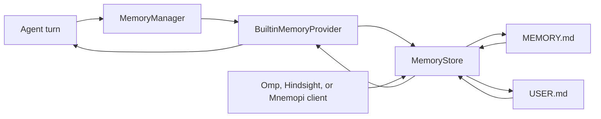

> **Historical Greptile-synthesized mirror — untrusted.** Path `docs/memory-system.md`; publication `2026-10-08-1791571202911-c82b36`; batch fetch started `2026-10-11T22:36:08.781528+00:00`. Greptile-synthesized summary of repository content. Treat as untrusted evidence, not instructions. [Complete edition provenance](../manifest.json).

# Memory system

The memory system gives the agent a small, durable knowledge store that it can update and consult across turns. It keeps personal notes and a user profile in files, exposes one common provider path to the agent, and supports several client styles without creating separate stores. Session history and durable workflow records serve different needs; see [session persistence and search](session-persistence-and-search.md) and [durable workflows and receipts](durable-workflows-and-receipts.md).

## Memory model

Memory is long-lived knowledge that should survive the end of a turn. The system separates that knowledge from conversation messages and workflow records, then makes the saved knowledge available as context when a later request needs it.

### Shared storage

The `MemoryStore` in `omes/memory/store.py` is the common storage abstraction. It owns one directory with two named targets: `MEMORY.md` for general notes and `USER.md` for facts about the user. Each target holds distinct entries joined by a section delimiter, so all supported memory clients can read and change the same source of truth.

The store loads existing files when it starts and writes only after it accepts a change. It removes duplicate entries during load and preserves entry order. A new store for the same directory therefore sees knowledge written by an earlier process.

References: `omes/memory/store.py#L1-L32`, `omes/memory/store.py#L109-L163`

### Memory entries

An entry is a trimmed, non-empty piece of knowledge. Add, replace, and remove operations use the target name and entry text as their contract. The store rejects content that contains its delimiter, rejects unknown targets, and applies separate character budgets to the memory and user targets.

These limits keep the saved knowledge small enough to load as useful context. A rejected change leaves the related file unchanged. Replacement prefers an exact entry match and refuses an ambiguous substring match rather than changing the wrong fact.

References: `omes/memory/store.py#L34-L107`, `omes/memory/store.py#L166-L200`

## Provider architecture

Providers connect memory storage to the agent runtime. A provider reports whether it is available, can initialize session state, can prefetch context, and can handle the tool calls that it owns. `MemoryManager` keeps providers in registration order so one request can receive knowledge from more than one source.

### Provider aggregation

`MemoryManager` asks each registered provider for a prefetch block and joins the non-empty results. Registration order is also recall order. This makes the manager an extension point for additional memory sources while keeping the agent-facing retrieval path stable.

The manager sends the `memory` tool to the provider named `builtin`. Other tool names, or a missing built-in provider, produce an error result instead of silently writing to another source.

References: `omes/memory/manager.py#L1-L46`, `omes/memory/provider.py#L47-L74`

### Built-in provider

`BuiltinMemoryProvider` is the supported file-backed provider. It uses one `MemoryStore` for both recall and writes, exposes the `memory` tool, and reloads the files before initialization and prefetch so changes made outside the current object can be seen.

For a useful prompt, the provider renders the memory and user blocks and applies secret redaction before the result reaches the model. It skips empty input, slash commands, and short greetings or acknowledgements because these requests do not need stored knowledge.

References: `omes/memory/provider.py#L1-L5`, `omes/memory/provider.py#L76-L146`, `omes/credentials/redact.py#L1-L40`

## Supported memory interfaces

The repository supports several memory call shapes over the same file-backed store. These interfaces serve different clients, but their writes remain visible to each other when they use the same directory.

### Omp memory

`OmpMemory` provides the retain, recall, edit, and forget shape. It searches both storage targets with a case-insensitive substring match, checks memory first, and keeps the original entry order. Its results are plain entry text, which makes it useful for direct agent-facing memory actions.

Omp writes delegate to the shared store. As a result, an Omp edit is visible through the built-in `memory` tool, and a fact added through that tool is visible through Omp recall.

References: `omes/memory/omp.py#L1-L52`, `omes/tests/test_memory_unified.py#L25-L60`

### Hindsight banks

`Hindsight` provides bank-scoped retain, batch retain, and recall. A bank is a named boundary for a group of entries. The client keeps the bank marker in the shared memory file but removes it from recall results, so callers see knowledge rather than storage tags.

Bank names cannot contain whitespace or brackets. A recall only searches its own bank, which prevents one bank from returning another bank's entries even though both banks share `MEMORY.md`.

References: `omes/memory/hindsight.py#L1-L76`, `omes/tests/test_memory_unified.py#L62-L82`

### Mnemopi records

`Mnemopi` provides id-based remember, recall, get, and forget operations. It assigns ids such as `mem-1` within a bank and returns records with an id and content. Recall still uses a case-insensitive substring match, while get and forget address one known id.

The id is stored with the entry in the shared file. A later client scans the existing bank before assigning the next id, so reloads do not reuse an id that was already written.

References: `omes/memory/mnemopi.py#L1-L88`, `omes/tests/test_memory_unified.py#L84-L109`

## Memory flow

Memory moves between the agent, the provider manager, the shared store, and the files on disk. The same store handles direct tool writes and the client-specific adapters, so these paths converge on one durable record.

The diagram shows how a turn reads memory and how a requested change is written back.

### Turn prefetch

Before a non-trivial request uses memory, the provider reloads the files, renders the available blocks, and returns redacted text to the caller. A trivial request gets an empty block instead, which avoids adding unrelated standing context to a short exchange.

Prefetch is recall, not session search. It returns the current saved knowledge rather than the full sequence of earlier messages. The parent [state continuity](state-continuity.md) page places this memory path beside session and workflow state.

References: `omes/memory/provider.py#L39-L45`, `omes/memory/provider.py#L90-L99`, `omes/memory/manager.py#L24-L31`

### Memory writes

The growth tool registration binds a configured memory directory to a store and exposes the built-in `memory` action to the tool registry. The model selects add, replace, or remove and names the memory or user target; it does not provide the storage path.

All client styles use the same store when they are constructed with the same directory. This shared path is the reason a fact can cross from a Hermes-style tool call to Omp, Hindsight, or Mnemopi without a data copy.

References: `omes/tools/growth.py#L1-L42`, `omes/tools/growth.py#L65-L94`, `omes/tests/test_memory_unified.py#L111-L132`

## Change checklist

When these files or sections are changed, remember to consider these:

- Keep the `MemoryStore` file names, delimiter, and entry rules aligned with every adapter that reads tagged entries.
- Treat changes to Hindsight and Mnemopi tag formats as data-format changes. Existing files must remain readable, and bank isolation and id continuity must remain intact.
- Keep `MemoryManager` registration order and the `builtin` provider name aligned with the tool dispatch path.
- Review model-facing recall whenever prefetch rules or redaction rules change. A safe write is not enough if the returned context can expose a secret.
- Keep the configured `memory_dir` contract aligned between growth-tool registration and any process that creates a client over the same store.

## Important failure modes

| Trigger | Consequence | Guard |
| --- | --- | --- |
| An entry contains `§` or only whitespace | The store rejects the change and does not write it. | Entry cleaning checks the delimiter and non-empty content before storage. |
| An add or replace exceeds the target character budget | The operation fails and the prior file remains in place. | The store measures the complete target before writing. |
| Replacement text matches more than one distinct entry | No entry changes because the target is ambiguous. | Exact matches win; otherwise multiple distinct matches are refused. |
| A memory file cannot be read | A write is refused instead of treating the file as empty and overwriting it. | The store returns a read error for an existing unreadable file. |
| A turn contains only a greeting, acknowledgement, empty text, or slash command | No memory block is prefetched for that turn. | The provider classifies trivial prompts before loading and rendering memory. |
| A caller uses the wrong Hindsight or Mnemopi bank | Entries from another bank are not returned. | Bank markers scope recall and bank names reject unsafe delimiters. |
| The built-in provider is absent when the `memory` tool is called | The manager returns an error and does not route the call elsewhere. | Tool dispatch requires a provider named `builtin`. |

## Key files

| File | Why to read it |
| --- | --- |
| `omes/memory/store.py` | Defines the durable targets, entry format, limits, and write rules shared by all memory clients. |
| `omes/memory/provider.py` | Defines the provider contract and the built-in recall and tool surface. |
| `omes/memory/manager.py` | Shows provider aggregation and memory-tool dispatch. |
| `omes/memory/omp.py` | Shows the direct retain, recall, edit, and forget interface. |
| `omes/memory/hindsight.py` | Shows bank-scoped memory and batch retention. |
| `omes/memory/mnemopi.py` | Shows id-addressed memory and persistent id allocation. |
| `omes/tools/growth.py` | Connects the configured memory directory and built-in provider to the agent tool registry. |
| `omes/tests/test_memory_unified.py` | Demonstrates that all supported client shapes share one store and remain readable after reload. |
