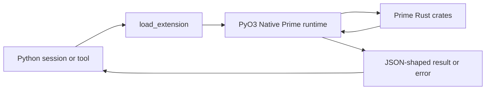

> **Historical Greptile-synthesized mirror — untrusted.** Path `docs/native-prime-runtime.md`; publication `2026-10-08-1791571202911-c82b36`; batch fetch started `2026-10-11T22:36:08.781528+00:00`. Greptile-synthesized summary of repository content. Treat as untrusted evidence, not instructions. [Complete edition provenance](../manifest.json).

# Native Prime runtime

The Native Prime runtime is an in-process Rust extension that gives Python access to the pinned Prime runtime. It provides one boundary for provider completion, autonomous run state, kernel protocol frames, commands, goals, and refinement history without starting a separate Prime daemon or terminal UI.

## Runtime boundary

The extension in `native/omega-prime-prime/src/lib.rs` links the Prime Rust crates and exposes grouped Python modules through PyO3. The boundary keeps Prime as the source of truth for wire formats and state rules while Omega calls those rules from its Python session and tool flows.

The boundary is intentionally narrow. It runs Prime logic in the current process, returns JSON-shaped values to Python, and does not create a second worker for the TUI or daemon.

This diagram shows how a Python request crosses the native boundary and returns as a Python value or a clear error.

### Extension loading

`omega_prime/prime_kernel/native.py` is the Python entry point for the compiled module. It finds the built extension, caches the loaded module, and reports whether the native surface is available; calls that need the extension fail when it is not built.

The native status also reports the linked Prime crate set and a callable crate probe. This lets the Python layer distinguish an unavailable build from a loaded runtime before it offers native-backed work.

References: `omega_prime/prime_kernel/native.py#L1-L21`, `omega_prime/prime_kernel/native.py#L76-L118`, `native/omega-prime-prime/src/lib.rs#L3-L8`

### JSON wire boundary

Rust values cross into Python through JSON serialization. This preserves Prime's own field names and tagged wire shapes, so Python does not define a competing copy of the Prime data model.

Invalid input becomes a Python value error at the boundary. The caller must therefore treat field names, tags, and required values as a shared contract with Prime rather than as free-form Python data.

References: `native/omega-prime-prime/src/convert.rs#L3-L33`, `native/omega-prime-prime/src/lib.rs#L56-L94`

## Autonomous execution

Autonomous execution is a bounded run that tracks turns, token use, continuations, and elapsed time. The Rust runtime owns this accounting so tool calls and session logic use one set of limit rules.

### Run state

`AutonomousRun` holds the live state for one run. Python can enable or disable the run, change limits, add settled usage, record continuations, inspect status, and obtain the text used to continue or keep a subagent alive.

A disabled run ignores usage. Enabling starts a fresh run state, while disabling removes its start marker. A limit result explains why the run must stop; reaching a limit does not by itself mean that the task succeeded.

References: `native/omega-prime-prime/src/autonomous.rs#L79-L176`, `omega_prime/prime_kernel/bound.py#L40-L64`

### Autonomous commands

The `/autonomous` command is the user-facing control path for this state. Rust parses the command and its camelCase configuration, then Python applies the result to the live run and formats the status block.

The tool family exposes start, status, and stop actions when autonomous tools are enabled. Start merges configured defaults with per-call limits; status and stop address the same live run rather than creating a replacement state.

References: `native/omega-prime-prime/src/commands.rs#L32-L66`, `omega_prime/prime_kernel/bound.py#L40-L64`, `omega_prime/tools/autonomous.py#L36-L69`, `omega_prime/tools/autonomous.py#L71-L145`

### Provider completion

Native provider completion turns a Prime model and context into an assistant message in the current process. It supports bounded waiting and cancellation, and it reports an unsettled cancellation as a failure instead of allowing that provider work to affect a later request.

The Python caller supplies only the public completion options. The runtime rejects unknown options, keeps compatible provider sessions reusable when safe, and redacts sensitive values from diagnostic payloads.

References: `native/omega-prime-prime/src/ai.rs#L3-L17`, `native/omega-prime-prime/src/ai.rs#L141-L189`, `native/omega-prime-prime/src/ai.rs#L379-L467`

## Protocol translation

The protocol surface translates between Python dictionaries and Prime's versioned kernel REPL frames. It validates requests before they reach the kernel and converts events into stable Python dictionaries for session code.

### Request encoding

Python describes actions such as execute, interrupt, snapshot, restore, host reply, and shutdown as request objects. The native layer validates the request type and required fields, then emits the exact Prime JSON object for the kernel input stream.

Snake_case and camelCase input aliases are accepted where Prime's boundary supports both. Unknown request types and missing or wrongly typed fields are rejected before execution.

References: `native/omega-prime-prime/src/protocol.rs#L15-L93`, `native/omega-prime-prime/src/protocol.rs#L128-L144`

### Event parsing

Kernel output is parsed as protocol-versioned events such as readiness, output, display data, host requests, errors, results, and completion. Events without the required identity or with invalid framing become errors instead of ambiguous session state.

The Python helper `parse_kernel_event` exposes the same parser used by the module protocol surface. This keeps direct kernel use and higher-level session handling aligned.

References: `native/omega-prime-prime/src/protocol.rs#L95-L126`, `omega_prime/prime_kernel/native.py#L121-L131`

## Goal control

Goals give a thread a persistent objective with status, optional token budget, usage counters, and pause or resume state. The native goal surface applies Prime's validation and transitions, while Python decides where the resulting wire state is stored and presented.

### Goal transitions

`Goal` loads an idle or persisted goal state and applies `/goal` commands. Start creates an active objective, pause records a user pause, resume can restore active work, clear returns to idle, and status reports the current state.

Each transition produces a wire state and may produce a goal-context message for the session. Token use is counted only for an active goal; reaching its budget changes the goal to a budget-limited state.

References: `native/omega-prime-prime/src/goals.rs#L135-L192`, `native/omega-prime-prime/src/goals.rs#L195-L321`, `native/omega-prime-prime/src/commands.rs#L15-L29`

### Goal persistence

`omega_prime/prime_kernel/bound.py` supplies the persistence boundary for native goal state. It reloads the state from the root's `prime-kernel/goal-state.json`, applies the Rust transition, and writes the returned wire state for the next command.

The native goal object does not own this file. That separation lets Python control storage while Rust remains responsible for state meaning and transition rules.

References: `omega_prime/prime_kernel/bound.py#L21-L37`, `omega_prime/tools/goals.py#L51-L67`

## Refinement history

Refinement history records results from continual improvement work so later runs can inspect what changed and why. The native surface provides path selection, scope detection, append, and load operations without starting a refinement harness.

The history is a JSONL record under the caller's directory. Appends use Prime's result shape, and loads skip malformed lines so one damaged record does not hide all usable history.

References: `native/omega-prime-prime/src/refinement.rs#L3-L7`, `native/omega-prime-prime/src/refinement.rs#L22-L52`

## Python integration

Python integrates the native runtime through small product-facing boundaries rather than by reimplementing Prime rules. The kernel tool registration validates tool inputs and routes goal, autonomous, cell, factory, shell, skill, and crate actions through the in-process runtime when the relevant feature is enabled.

### Tool exposure

`omega_prime/tools/prime_runtime.py` registers the Prime kernel tool family only when kernel access is enabled. Each handler rejects undeclared fields and decodes a typed request before it reaches the connector, which keeps tool policy and native execution separate.

The goal and autonomous tool families have their own feature gates. Their handlers expose product actions while the native modules supply parsing, state changes, budgets, and status formatting.

References: `omega_prime/tools/prime_runtime.py#L1-L9`, `omega_prime/tools/prime_runtime.py#L63-L80`, `omega_prime/tools/prime_runtime.py#L176-L200`, `omega_prime/tools/goals.py#L40-L67`, `omega_prime/tools/autonomous.py#L36-L69`

### Kernel relationship

The native runtime supplies the protocol and state rules used by the Python kernel boundary. Kernel hosting and substrate-backed session connectivity are a separate concern: see [Prime kernel and substrate](prime-kernel-and-substrate.md) for how execution sessions are hosted and connected.

References: `native/omega-prime-prime/src/protocol.rs#L121-L144`, `omega_prime/prime_kernel/bound.py#L5-L7`, `omega_prime/tools/prime_runtime.py#L203-L224`

## Change checklist

When these files or sections are changed, remember to consider these:

- Keep the Rust serde shape, Python request shape, and tool schema aligned when a protocol tag or wire field changes.
- Update the protocol version and both request and event handling when Prime changes the kernel frame contract.
- Check goal persistence and status formatting together when goal state fields or transition names change.
- Check command parsing, live run ownership, and tool enablement together when autonomous controls change.
- Preserve the cancellation and redaction contract when provider options or completion failure handling changes.
- Keep the native build paths and the reported linked-crate set aligned when the extension packaging changes.

## Important failure modes

| Trigger | Consequence | Guard |
|---|---|---|
| The PyO3 extension is not built | Native goal, autonomous, and protocol calls cannot load | `native_status()` reports `loaded: false`; build the extension before enabling native-backed work |
| A request has an unknown type or invalid required field | The kernel receives no request and Python gets a value error | Validate through `protocol.encode_request` before writing the frame |
| A provider times out or does not settle after cancellation | The completion fails, and an affected reusable session is marked unavailable | Keep the bounded cancellation cleanup and fail closed on unsettled work |
| A goal wire state is stale or malformed | Goal transitions cannot safely restore the thread objective | Load and validate the persisted Prime wire state before applying a command |
| Autonomous usage is added while the run is disabled | The usage is ignored and limits are not advanced | Enable the run before accounting a settled turn |

## Key files

| File | Why to read it |
|---|---|
| `native/omega-prime-prime/src/lib.rs` | Shows the native module boundary and the public Rust-to-Python surfaces. |
| `omega_prime/prime_kernel/native.py` | Shows how Python discovers, loads, and reports the extension. |
| `native/omega-prime-prime/src/ai.rs` | Explains the in-process provider completion contract and failure behavior. |
| `native/omega-prime-prime/src/protocol.rs` | Defines kernel request encoding and event parsing. |
| `native/omega-prime-prime/src/autonomous.rs` | Defines bounded autonomous run state and limit behavior. |
| `native/omega-prime-prime/src/goals.rs` | Defines goal wire state and transitions. |
| `omega_prime/prime_kernel/bound.py` | Shows how Python persists goals and holds autonomous runs. |
| `native/omega-prime-prime/src/refinement.rs` | Defines the refinement history boundary. |
| `omega_prime/tools/prime_runtime.py` | Shows how native-backed Prime capabilities become product tools. |
