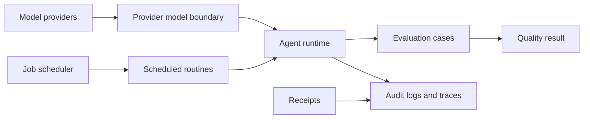
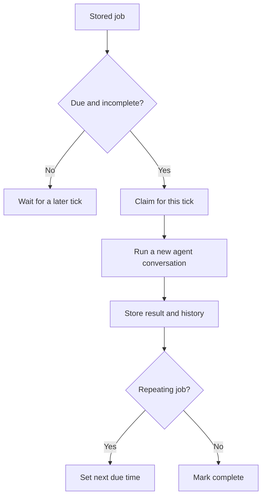

> **Historical Greptile-synthesized mirror — untrusted.** Path `docs/operations-integrations-and-quality.md`; publication `2026-10-08-1791571202911-c82b36`; batch fetch started `2026-10-11T22:36:08.781528+00:00`. Greptile-synthesized summary of repository content. Treat as untrusted evidence, not instructions. [Complete edition provenance](../manifest.json).

# Operations, integrations, and quality

OMES uses a small set of supporting systems to connect agent turns to model services, run work on a schedule, check behavior, and preserve evidence of important actions. Together they keep the runtime replaceable, repeatable, and reviewable without making provider access, maintenance work, or quality checks part of the core conversation flow.

## Supporting system map

The supporting systems form a path from external services and stored work to controlled agent behavior and reviewable results. The main agent runtime consumes the model boundary and tool boundary, while scheduled work and evaluation use the same runtime under more controlled conditions.

The child pages describe each area in more detail:

- [Model provider integrations](model-provider-integrations.md) explains the provider adapters and their shared model boundary.
- [Scheduled routines](scheduled-routines.md) explains recurring jobs, nightly review, and mention sweeps.
- [Evaluation and audit](evaluation-and-audit.md) explains behavior checks, audit records, traces, and receipts.

OMES also connects these systems to the [agent runtime](agent-runtime.md), [tool execution platform](tool-execution-platform.md), [state continuity](state-continuity.md), and [governance, security, and learning](governance-security-and-learning.md) areas.

## Model service boundary

The model service boundary lets the turn loop use different hosted or local model services through one model-facing contract. It keeps provider-specific request and response shapes at the edge so the rest of the runtime can work with a common assistant result.

### Provider adapters

The provider layer represents each service as an adapter that turns a transcript and optional tools into one request, then turns the response into an assistant message. The shared boundary covers Anthropic, Gemini, Grok, OpenAI, and Ollama adapters, with HTTP transport for live calls and a fake transport for controlled runs. A provider error stops the request when credentials are missing, transport fails, or the response cannot produce an assistant message.

References: `omes/providers/base.py#L17-L47`, `omes/providers/base.py#L73-L106`, `omes/providers/__init__.py#L5-L25`

### Network and credential controls

Live provider access passes through a transport that can enforce an allowed-host policy before it opens a connection. It retries connection and server failures within a bounded limit, while client errors and invalid JSON remain visible as provider failures. When a credential broker is attached, the model asks for a key for the provider URL instead of keeping that key in the agent turn.

References: `omes/providers/http.py#L1-L11`, `omes/providers/http.py#L65-L83`, `omes/providers/base.py#L50-L57`, `omes/providers/base.py#L73-L93`

## Scheduled operations

Scheduled operations move repeatable work out of interactive turns while keeping the same agent and tool boundaries. The scheduler stores jobs as durable records, and routines checkpoint their progress so a later run can continue without repeating completed work.

### Due-job execution

The job scheduler selects incomplete jobs whose due time has arrived. A one-shot job becomes complete after its run, while an interval job receives a new due time. Each run stores its result and a bounded history, and a claim marker prevents the same job from running twice for one scheduler tick.

The scheduler can run due prompts through a new agent with the selected model and tools. This gives scheduled work the same conversation behavior as interactive work without sharing an in-progress turn.

References: `omes/cron/scheduler.py#L1-L6`, `omes/cron/scheduler.py#L21-L61`, `omes/cron/scheduler.py#L117-L131`

### Maintenance routines

The nightly routine reviews saved turns and sends their useful results to the learning path. It records reviewed turn IDs after each turn, so a restart or repeat run does not review the same turn twice. The engagement sweep reads fresh mentions, creates reply drafts, and records each mention as drafted or skipped; it never publishes a reply itself.

These routines separate generation from approval. A scheduled pass can prepare work and retain its state, while a human or an approved job decides whether an external action should occur.

References: `omes/routines/nightly.py#L1-L7`, `omes/routines/nightly.py#L20-L55`, `omes/routines/sweep.py#L1-L7`, `omes/routines/sweep.py#L21-L66`

## Quality and operational evidence

Quality systems check both normal behavior and refusal behavior. Evidence systems then record what the runtime attempted, what policy decided, and which claims have direct command results, while avoiding the storage of secrets in routine records.

### Deterministic evaluation

The evaluation runner replays data-driven cases with scripted model turns and structural expectations. Golden cases check expected persona and tool behavior, while red-team cases check that policy escapes, unapproved publishing-shaped actions, and hostile tool output do not cause unsafe execution. The suite reports every case result and exits successfully only when all cases pass.

References: `omes/evals/runner.py#L1-L8`, `omes/evals/runner.py#L25-L75`, `omes/evals/runner.py#L78-L90`, `omes/evals/cases/golden.json#L1-L45`, `omes/evals/cases/redteam.json#L1-L53`

### Audit records and traces

The audit log provides an append-only record for each tool dispatch, including its sequence, time, tool name, and verdict. It omits tool arguments and redacts stored reasons, which limits the chance that credentials enter the operational record. The trace collector provides a related in-memory view of model calls, tool calls, and policy decisions, with ordered spans and a stable export shape for one turn.

References: `omes/audit/log.py#L1-L7`, `omes/audit/log.py#L21-L45`, `omes/audit/log.py#L47-L71`, `omes/audit/trace.py#L1-L7`, `omes/audit/trace.py#L18-L55`

### Verification receipts

Receipts turn completion claims into checkable evidence. Each claim must point to a recorded command with its command text and exit code, and destructive work must also point to an approval from someone other than the bot. The validator rejects missing evidence, failed commands used as success evidence, bypass markers, and destructive work without approval.

References: `omes/receipts.py#L1-L5`, `omes/receipts.py#L18-L61`, `omes/receipts.py#L63-L75`

## Change checklist

When these files or sections are changed, remember to consider these:

- When a provider adapter changes its assistant or tool-call shape, check the shared provider model boundary and every evaluation or runtime path that consumes assistant rows.
- When provider URLs or credential rules change, update the host policy and credential broker contract together so a new endpoint cannot bypass network or secret controls.
- When job state fields or claim rules change, preserve compatibility with stored job files and the no-duplicate guarantee for a single tick.
- When a routine changes its checkpoint IDs or output state, keep restart behavior aligned with the saved state files and downstream approval flow.
- When evaluation expectation types change, update the case files and the aggregate pass/fail contract used by command-line and CI runs.
- When audit or trace fields change, preserve redaction and keep consumers aligned with the exported record shape.
- When completion claims or destructive-action rules change, update receipt validation with the command and approval evidence contracts.

## Important failure modes

| Trigger | Consequence | Guard |
|---|---|---|
| Provider returns a non-object or no assistant row | The model turn fails instead of producing a usable response | `ProviderModel` validates the decoded payload and assistant role before returning it |
| Provider host is outside the allowed network policy | No socket is opened and the model request is refused | `HttpTransport` checks the host before connection setup |
| A scheduler tick sees a job already claimed or recorded at the same time | The job is not run twice for that tick | `JobStore` uses claim state and bounded run history |
| A sweep stops after drafting one mention | Completed drafts remain and later mentions can resume without duplication | The sweep checkpoints after each mention and tracks drafted and skipped IDs |
| A red-team case invokes a policy-blocked or approval-gated tool | The case fails if the tool runs or the refusal is missing | Registry cases assert refusal text and that the tool was not called |
| A receipt cites a failed or bypassed command | The completion claim is rejected | Receipt validation checks exit status, bypass markers, and evidence indexes |
| An audit record contains malformed JSON | Reading the audit history stops with a corruption error | `AuditLog.records()` validates each non-empty line as an object |

## Key files

| File | Why to read it |
|---|---|
| `omes/providers/base.py` | Defines the common provider-to-runtime contract and model completion boundary. |
| `omes/providers/http.py` | Shows the live network boundary, host checks, retries, and response failures. |
| `omes/cron/scheduler.py` | Shows how stored jobs become agent conversations and how repeat runs are controlled. |
| `omes/routines/nightly.py` | Shows checkpointed transcript review for learning work. |
| `omes/routines/sweep.py` | Shows safe preparation of external replies without automatic publishing. |
| `omes/evals/runner.py` | Shows how golden and red-team cases become a deterministic quality report. |
| `omes/evals/cases/golden.json` | Shows expected normal behavior expressed as data. |
| `omes/evals/cases/redteam.json` | Shows refusal and injection-containment checks expressed as data. |
| `omes/audit/log.py` | Defines the persisted, redacted tool-dispatch record. |
| `omes/audit/trace.py` | Defines the structured per-turn evidence export. |
| `omes/receipts.py` | Defines the evidence rules for completion claims and destructive actions. |
