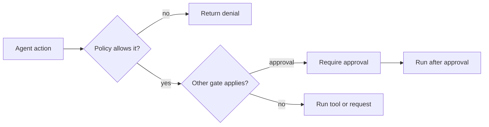
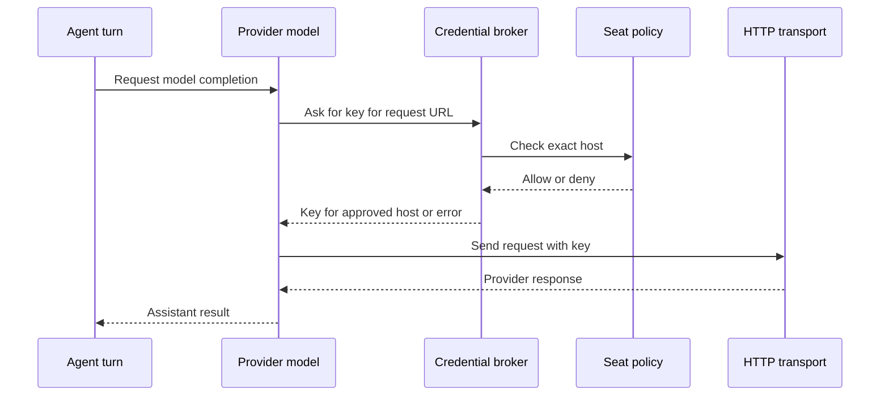

> **Historical Greptile-synthesized mirror — untrusted.** Path `docs/policy-credentials-and-contracts.md`; publication `2026-10-08-1791571202911-c82b36`; batch fetch started `2026-10-11T22:36:08.781528+00:00`. Greptile-synthesized summary of repository content. Treat as untrusted evidence, not instructions. [Complete edition provenance](../manifest.json).

# Policy, credentials, and contracts

OMES uses policy, brokered credentials, and shared contracts to keep agent actions inside approved limits. Policy advice identifies changes that widen access. Enforcement blocks disallowed tools, writes, and network hosts. Credential brokering lets approved requests use provider keys without giving key values to the agent, while redaction keeps secrets out of records and recalled context.

## Policy boundaries

The seat policy is the main boundary for one agent seat. A seat is the named execution identity that receives a set of allowed tools, writable paths, and network hosts. The policy is checked outside the agent's own decision process, so an agent cannot make an unsafe choice become safe by asking for it.

The policy has three operational controls:

| Control | Boundary | Default behavior |
| --- | --- | --- |
| Tool allow list | Which registered tool names may run | An absent list allows registered tools. An explicit list limits access. |
| Read-only path globs | Which workspace paths cannot be changed | Paths are checked as jailed relative paths. Absolute paths and parent traversal are refused. |
| Host allow list | Which network hosts may receive requests | Matching is exact and case-insensitive. A subdomain is not implied. |

The shipped seat is `bot-00-omes`. Its policy permits the tools in the roster, protects prompts, contracts, generated agent material, and `ownership.yaml` from writes, and allows no network host until a host is named in the policy. `omes/contracts/policies/omes.json` is the concrete policy contract.

## Policy enforcement

Policy enforcement happens at the point where an action can cause an effect. Tool dispatch checks the tool name before approval checks or handler execution. Workspace writers check the target before reading or writing bytes. The HTTP transport checks the host before opening a socket. This placement makes a denial stop the downstream action rather than only report it after the fact.

The main decision path is:

Denied tool dispatches and denied writes can also produce audit or trace evidence. Audit records keep the tool name and verdict but omit arguments. Policy denials are represented as `denied`, while unknown names and handler failures remain distinct outcomes.

References: `omes/policy/policy.py#L20-L75`, `omes/tools/registry.py#L20-L29`, `omes/tools/registry.py#L76-L125`, `omes/tools/file_ops.py#L31-L37`, `omes/tools/file_ops.py#L61-L154`, `omes/providers/http.py#L65-L83`, `omes/audit/log.py#L1-L7`, `omes/audit/log.py#L30-L71`

## Policy advice

Policy advice compares an old policy with a proposed policy and calls out expansions that need human review. It treats a newly allowed tool, a newly allowed host, removal of read-only protection, or a change from an explicit tool list to allow-all as an expansion. Narrowing access does not produce an expansion warning.

This advice is a review aid, not enforcement. The active `SeatPolicy` still decides each action at runtime. The two roles work together: the advisor makes a change visible before adoption, and the enforcement checks the adopted policy at the effect boundary.

References: `omes/policy/advisor.py#L1-L7`, `omes/policy/advisor.py#L14-L51`, `omes/policy/policy.py#L20-L75`, `omes/tests/test_policy.py#L108-L135`

## Credential brokering

The credential broker is the narrow path from provider configuration to an outbound request. A provider gives the broker its endpoint and the names of the environment values that can supply a key. The broker first checks the endpoint host against the seat policy, then finds a non-empty environment value. If either check fails, the request stops before transport work begins.

With a broker attached, the provider model first builds a request without a key so the broker can inspect its URL. It then rebuilds the request with the resolved key and sends it through the transport. The agent sees neither the key value nor a model object that stores it as its API key.

The same boundary applies to service tools such as the X connector. A tool can use a broker for each endpoint, so an approved read host does not automatically approve a media upload host.

References: `omes/credentials/broker.py#L1-L8`, `omes/credentials/broker.py#L20-L49`, `omes/providers/base.py#L50-L106`, `omes/providers/http.py#L65-L83`, `omes/tools/x.py#L47-L70`, `omes/tests/test_credentials.py#L27-L75`, `omes/tests/test_x.py#L24-L32`, `omes/tests/test_x.py#L125-L139`

## Secret redaction

Redaction is the output side of credential safety. It replaces broker-resolved values and recognized secret shapes with `[REDACTED]` before text enters logs, events, or recalled memory. It keeps labels such as `api_key` and `Bearer` visible so the record still shows what kind of value was present without exposing the value.

The audit log redacts failure reasons and deliberately leaves tool arguments out of records. Event emission redacts string payloads. Memory recall also returns redacted text rather than the stored secret. These paths protect downstream readers even when a provider error or tool result contains sensitive text.

References: `omes/credentials/redact.py#L1-L40`, `omes/credentials/broker.py#L28-L49`, `omes/audit/log.py#L1-L7`, `omes/audit/log.py#L30-L45`, `omes/agent/harness.py#L45-L61`, `omes/tests/test_credentials.py#L78-L111`

## Contract boundaries

Contracts are the shared declarations that keep separately assembled parts of OMES aligned. The tool roster defines the names offered to the model and the order of the tool families. The policy uses the same names as its allowed capability set. Tests treat the roster and policy as cross-checks, so a registered tool can exist without being offered unless the roster includes it.

The shipped contracts describe one seat and its current operational surface:

| Contract | Boundary it defines |
| --- | --- |
| Tool roster | Which registered capabilities are offered to the agent and in what order |
| Seat policy | Which offered tools may run, which paths are read-only, and which hosts are reachable |
| Ownership map | Which bot owns each repository path |

The roster and policy must agree on the seat name and tool names. The ownership map gives the current owner a broad default path pattern. Together these files define both what the agent may attempt and who is responsible for the paths it changes.

References: `omes/contracts/tool-rosters/omes.yaml#L1-L38`, `omes/contracts/policies/omes.json#L1-L47`, `omes/ownership.yaml#L1-L14`, `omes/tests/test_policy.py#L42-L56`, `omes/tests/test_providers.py#L227-L252`, `omes/tests/test_tools.py#L324-L364`

## Ownership definitions

Ownership defines responsibility for repository paths rather than permission to bypass policy. The current map assigns the `**` path pattern to `bot-00-omes`, which means the Omes bot owns the full tree until a later, more specific rule assigns part of it to another seat. The last matching path rule wins.

This distinction matters during change review. A path can belong to a bot and still be read-only under the seat policy. Conversely, a writable path does not change its declared owner. Ownership describes responsibility; policy describes permitted action.

References: `omes/ownership.yaml#L1-L14`, `omes/contracts/policies/omes.json#L36-L47`, `omes/tests/test_policy.py#L48-L53`

## Change checklist

When these files or sections are changed, remember to consider these:

- When a tool name changes, update the tool registration, the roster, and the policy allow list together. The offered tool set and the enforced tool set must remain aligned.
- When a provider endpoint or environment key name changes, update the provider contract, the broker lookup, and the policy host list. A missing host entry must fail before transport use.
- When a protected path changes, update both the policy read-only glob and the ownership rule if responsibility also changes. These files answer different questions.
- When a secret-bearing output path is added, route its text through the redaction boundary and keep raw tool arguments out of persisted audit records.
- When a policy widens access, review the advisor expansion report before replacing the active policy.

## Important failure modes

| Trigger | Consequence | Guard |
| --- | --- | --- |
| A tool is omitted from the policy allow list | Registry dispatch returns a policy denial and does not run the handler | The registry checks policy before approval and execution |
| A write targets a read-only glob | The file remains unchanged and the writer returns a policy error | Workspace writers check the jailed relative path first |
| A request targets an unapproved host | No credential is returned and no network request is made | The broker and HTTP transport check the exact host |
| A required provider key is absent | The provider call fails before transport use | The broker requires a non-empty configured environment value |
| A policy removes read-only protection or adds access | The change can widen the action surface without an automatic block | `diff_policy` reports the expansion for human review |
| A secret enters an audit reason or event string | The raw value could leak to an operational record | Redaction replaces known values and supported secret shapes |
| The roster and policy use different tool names | A capability may be offered but denied, or registered but not offered | Cross-check registration, roster, and policy as one contract |

## Key files

| File | Why to read it |
| --- | --- |
| `omes/policy/policy.py` | Defines the seat boundaries for tools, paths, and hosts. |
| `omes/policy/advisor.py` | Defines which proposed policy changes count as access expansions. |
| `omes/credentials/broker.py` | Shows how approved endpoints receive provider keys without exposing them to the agent. |
| `omes/credentials/redact.py` | Defines the common secret masking behavior. |
| `omes/tools/registry.py` | Shows the tool dispatch boundary and the order of policy and approval checks. |
| `omes/providers/base.py` | Shows how a brokered provider request moves from URL discovery to completion. |
| `omes/providers/http.py` | Shows the network boundary before socket creation. |
| `omes/contracts/policies/omes.json` | States the shipped seat policy. |
| `omes/contracts/tool-rosters/omes.yaml` | States the capabilities offered to the agent. |
| `omes/ownership.yaml` | States path responsibility and the current default owner. |
