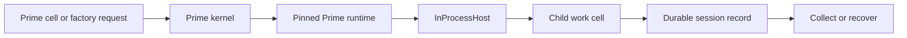

> **Historical Greptile-synthesized mirror — untrusted.** Path `docs/prime-kernel-and-substrate.md`; publication `2026-10-08-1791571202911-c82b36`; batch fetch started `2026-10-11T22:36:08.781528+00:00`. Greptile-synthesized summary of repository content. Treat as untrusted evidence, not instructions. [Complete edition provenance](../manifest.json).

# Prime kernel and substrate

The Prime kernel gives Omega Prime one in-process home for native Prime runtime features. It hosts cells, child work, factory runs, skills, and durable session records, while the substrate client and session connect local work to shared briefs, event history, documentation search, and graph leases. See [Native Prime runtime](native-prime-runtime.md) for the wider runtime boundary.

## Prime kernel

The Prime kernel is the local execution boundary for Prime capabilities. It keeps the main product in one Python process while loading the pinned Prime runtime and routing its requests to Omega's local host. The kernel tool family is available only when the Prime kernel feature is enabled; otherwise the normal local registry remains unchanged. (`omega_prime/tools/prime_runtime.py#L3-L9`, `omega_prime/tools/prime_runtime.py#L63-L75`)

The kernel presents a small set of product actions rather than a second agent process:

| Capability | Product purpose |
| --- | --- |
| Cells | Run related snippets in a persistent working namespace. |
| Work cells | Start, inspect, stop, resume, and view the graph of factory work. |
| Bash | Run shell work through the Prime runtime. |
| Skills | Discover and load executable skill packages from the pinned checkout. |
| Native crates | Report whether the linked native Prime crates are available. |
| Goal and autonomous commands | Apply Prime goal and autonomous-run state to the current process. |

Each request crosses a versioned typed boundary before the kernel loads the runtime or changes local state. This keeps malformed requests from reaching execution services and gives the tool registry one stable contract for approval and dispatch. (`omega_prime/prime/kernel.py#L44-L49`, `omega_prime/tools/prime_runtime.py#L76-L80`)

References: `omega_prime/tools/prime_runtime.py#L3-L9`, `omega_prime/tools/prime_runtime.py#L33-L57`, `omega_prime/prime/kernel.py#L187-L260`

## Native runtime and checkout

The pinned Prime checkout is the source of the real `rlm` runtime and skill packages. Omega imports these sources in place instead of copying them into its own package, so the checkout remains the authority for Prime cell, factory, and shell behavior. (`omega_prime/prime_kernel/checkout.py#L3-L7`, `omega_prime/prime_kernel/checkout.py#L19-L44`, `omega_prime/prime_kernel/skills.py#L3-L9`)

The native extension adds Rust-backed Prime behavior when it is built. Its absence is visible as an unavailable native surface; it does not cause Omega to claim that the crates are loaded or silently replace the native command path. (`omega_prime/prime_kernel/native.py#L76-L118`)

## Persistent cells

Persistent cells provide a shared scratch space for a kernel session. A cell runs in the Prime compiler with the same namespace as later cells, and returns its value plus captured output as data for the caller. A cell error ends that cell but leaves the kernel available for later work. (`omega_prime/prime_kernel/cells.py#L20-L27`, `omega_prime/prime_kernel/cells.py#L36-L68`)

The cell namespace also exposes the Prime runtime. This lets a cell ask the in-process host to start child work without moving the parent conversation or answer text into the child roster. (`omega_prime/prime_kernel/cells.py#L26-L27`, `omega_prime/tests/test_prime_kernel_cells.py#L117-L142`)

References: `omega_prime/prime_kernel/cells.py#L20-L27`, `omega_prime/prime_kernel/cells.py#L36-L68`, `omega_prime/tests/test_prime_kernel_cells.py#L31-L47`

## Work cells and checkouts

Work cells are the kernel's managed units of child execution. The host admits a child with a prompt, name, model choice, and durable identity, then runs it through a bounded local worker. The child can be collected for its result, listed for metadata, renamed, or deleted. (`omega_prime/prime_kernel/host.py#L36-L65`, `omega_prime/prime/rlm.py#L286-L328`, `omega_prime/prime/rlm.py#L559-L656`)

The host stores child records in the session directory. A completed record is not reported as complete until its durable record is written. A fresh host can recover owned records without replaying a child, while an interrupted running record becomes an explicit error. This makes a checkout a durable work record, not only a temporary worker directory. (`omega_prime/prime/rlm.py#L339-L383`, `omega_prime/prime/rlm.py#L393-L405`)

The Prime runtime's own host requests are answered by `InProcessHost`. It adapts the Prime `rlm` protocol to Omega's `RlmHost`, so spawn, create-session, collect, list, delete, rename, and progress operations stay inside the same process. (`omega_prime/prime_kernel/host.py#L36-L56`, `omega_prime/prime_kernel/host.py#L93-L122`)



References: `omega_prime/prime_kernel/host.py#L36-L56`, `omega_prime/prime_kernel/host.py#L93-L122`, `omega_prime/prime/rlm.py#L339-L405`, `omega_prime/prime/rlm.py#L559-L656`

## Factory work

Factory support turns a Prime factory specification into a tracked run. The kernel enables the factory for its local agent directory before starting work, then exposes run status, stop, resume, and graph views through the same typed tool boundary. (`omega_prime/prime_kernel/factory_api.py#L33-L67`, `omega_prime/prime/kernel.py#L210-L234`)

Factory help and specification validation remain available as local guidance. A factory run needs a valid specification and a durable run identity so later status or control actions address the same work. (`omega_prime/prime_kernel/factory_api.py#L50-L81`)

References: `omega_prime/prime_kernel/factory_api.py#L3-L15`, `omega_prime/prime_kernel/factory_api.py#L33-L81`, `omega_prime/prime/kernel.py#L210-L234`

## Skill packages

Skills extend the kernel with named capabilities from the pinned Prime skills tree. The kernel can list skill directories without importing them, then load one importable package when work needs it. A directory may be documentation-only and therefore visible but not executable. (`omega_prime/prime_kernel/skills.py#L21-L60`, `omega_prime/prime_kernel/skills.py#L63-L80`)

This split keeps discovery cheap and avoids loading unrelated code. A missing or non-importable skill produces an explicit load error instead of a partial capability. (`omega_prime/tests/test_prime_kernel_skills.py#L13-L20`, `omega_prime/tests/test_prime_kernel_skills.py#L34-L47`)

References: `omega_prime/prime_kernel/skills.py#L21-L80`, `omega_prime/tests/test_prime_kernel_skills.py#L13-L47`

## Substrate client

The substrate client is the external service boundary for the `grok-bot` surface. It sends briefs and event records to substrate-mcp, calls shared memory and documentation tools through MCP, and manages graph-node leases. It owns transport and authentication concerns so the kernel and session code can work with product-level operations. (`omega_prime/substrate/client.py#L1-L9`, `omega_prime/substrate/client.py#L51-L73`)

The client supports two kinds of external state:

| External state | Role in the product |
| --- | --- |
| Brief and events | Give a session shared context and a cross-agent trail. |
| Memory | Store or search shared facts and decisions. |
| Documentation | Retrieve product documentation excerpts. |
| Graph leases | Claim, renew, release, or complete shared work nodes. |

The client uses bearer credentials from an explicit token or the credential broker. It validates the service URL and redacts credentials from errors. Omega does not connect to substrate backing stores directly. (`omega_prime/substrate/client.py#L249-L283`, `docs/substrate.md#L22-L25`)

References: `omega_prime/substrate/client.py#L20-L38`, `omega_prime/substrate/client.py#L51-L73`, `omega_prime/substrate/client.py#L94-L225`, `docs/substrate.md#L11-L25`

## Substrate sessions

A substrate session binds external context to one local agent session. On open it emits a start event, fetches one brief, caches that brief, and can write an offline copy under `.substrate/BRIEF.md`. During a turn it records a bounded prompt summary, tool results, file edits, and the turn end; close emits the session end. (`omega_prime/substrate/session.py#L1-L9`, `omega_prime/substrate/session.py#L53-L125`)

The conversation loop adds the cached brief to the system prompt before the turn starts. It reports the turn trail through session hooks, but the hooks never block the local loop when the substrate is down. Tool arguments stay in the process; event summaries carry only the information needed for shared provenance. (`omega_prime/agent/conversation_loop.py#L81-L85`, `omega_prime/agent/conversation_loop.py#L152-L169`, `omega_prime/substrate/session.py#L92-L101`)

```mermaid
sequenceDiagram
    participant Loop as Conversation loop
    participant Session as Substrate session
    participant Client as Substrate client
    participant Service as substrate-mcp
    Loop->>Session: open
    Session->>Client: fetch brief and emit session.start
    Client->>Service: brief and event requests
    Service-->>Client: shared brief or service result
    Client-->>Session: brief or empty fallback
    Session-->>Loop: prompt brief block
    Loop->>Session: prompt, tool, file, and turn hooks
    Session->>Client: bounded event summaries
    Loop->>Session: close
```

References: `omega_prime/substrate/session.py#L24-L79`, `omega_prime/substrate/session.py#L81-L125`, `omega_prime/agent/conversation_loop.py#L136-L169`

## External execution services

The kernel and substrate connect to different execution planes. The Prime kernel runs native Prime capabilities locally and keeps child work in Omega's process. The substrate client sends shared context and coordination requests to an external substrate-mcp service. A session is the join point: it gives local work an identity and lets external events refer to the same run. (`omega_prime/prime_kernel/host.py#L36-L56`, `omega_prime/substrate/client.py#L249-L264`, `omega_prime/substrate/session.py#L117-L125`)

The connection remains useful during partial failure because the two planes degrade in different ways:

| Failure | Local effect | Shared-service effect |
| --- | --- | --- |
| Substrate brief or event outage | The turn continues with no brief or an unsaved event. | Shared context or event storage is missing. |
| Documentation retrieval outage | The docs tool returns an error. | No raw retrieval result reaches the model. |
| Graph claim or mutation outage | The caller receives an explicit error. | The shared node is not falsely marked as claimed or complete. |
| Missing Prime checkout or native extension | The affected kernel capability fails explicitly. | No substitute runtime is claimed to be native. |

This separation prevents external coordination from becoming a hidden requirement for local execution while preserving explicit errors for operations that must not be mistaken for success. (`omega_prime/substrate/client.py#L94-L181`, `omega_prime/tools/substrate_tools.py#L78-L113`, `docs/substrate.md#L42-L52`, `docs/adr/0002-prime-runtime-integration.md#L70-L79`)

References: `omega_prime/substrate/client.py#L94-L181`, `omega_prime/tools/substrate_tools.py#L78-L113`, `docs/substrate.md#L42-L52`, `docs/adr/0002-prime-runtime-integration.md#L70-L79`

## Change checklist

When these files or sections are changed, remember to consider these:

- Keep the kernel tool roster, typed request models, approval set, and tool schemas aligned.
- Keep the Prime runtime checkout path and skill discovery contract aligned with the pinned checkout.
- Preserve the link between child identity, durable session records, ownership, and recovery.
- Keep substrate event kinds and MCP tool names aligned with the substrate service contract.
- Preserve the fail-open and fail-closed split when changing client or session behavior.
- Keep brief caching and event summaries free of raw tool arguments and credentials.

## Important failure modes

| Trigger | Consequence | Guard |
| --- | --- | --- |
| Prime kernel is disabled | No Prime kernel tools are registered. | Treat the feature flag as the complete capability gate. |
| Runtime checkout is absent | Runtime-backed actions fail instead of using a copied or fake runtime. | Keep checkout loading explicit. |
| Native extension is not built | Native status reports `loaded: false`; native command paths cannot run. | Do not interpret the workspace crate list as loaded code. |
| Child record cannot be saved | Child admission fails or completion becomes an explicit error. | Require durable settlement before reporting success. |
| Substrate brief or event call fails | The local turn continues without shared context or stored trail. | Use the cached brief and fail-open session hooks. |
| Graph lease call fails | Claim, release, or completion is not treated as successful. | Return an explicit substrate error. |

## Key files

| File | Why to read it |
| --- | --- |
| `omega_prime/tools/prime_runtime.py` | Kernel tool surface and feature gate. |
| `omega_prime/prime/kernel.py` | Typed boundary between tools and kernel actions. |
| `omega_prime/prime_kernel/host.py` | In-process bridge from Prime `rlm` requests to Omega work. |
| `omega_prime/prime_kernel/cells.py` | Persistent cell behavior and result shape. |
| `omega_prime/prime/rlm.py` | Child work lifecycle and durable recovery contract. |
| `omega_prime/prime_kernel/factory_api.py` | Factory run and graph coordination surface. |
| `omega_prime/prime_kernel/skills.py` | Skill discovery and loading boundary. |
| `omega_prime/substrate/client.py` | External substrate transport and failure policy. |
| `omega_prime/substrate/session.py` | Session brief and event lifecycle. |
| `omega_prime/tools/substrate_tools.py` | Model-facing docs and graph tools. |
| `docs/substrate.md` | Service roles, backing systems, and deployment expectations. |
