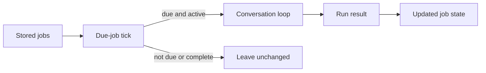

> **Historical Greptile-synthesized mirror — untrusted.** Path `docs/scheduled-routines.md`; publication `2026-10-08-1791571202911-c82b36`; batch fetch started `2026-10-11T22:36:08.781528+00:00`. Greptile-synthesized summary of repository content. Treat as untrusted evidence, not instructions. [Complete edition provenance](../manifest.json).

# Scheduled routines

Scheduled routines give OMES a controlled way to repeat operational work without treating each run as a new ad hoc request. The scheduler selects due jobs and sends them through the normal conversation path, while the nightly and sweep routines apply checkpoints so learning and engagement work can resume safely after an interruption.

This page is part of [Operations, integrations, and quality](operations-integrations-and-quality.md). It complements [Model provider integrations](model-provider-integrations.md), which explains model access, and [Evaluation and audit](evaluation-and-audit.md), which explains behavior checks and operational evidence.

## Scheduler

The scheduler is an in-process job store for prompt-based work. It keeps job timing and run results in a JSON file, so a new scheduler instance can continue from the state written by an earlier instance (`omes/cron/scheduler.py#L21-L52`). It is the generic timing layer; the nightly and sweep routines remain separate workflows with their own input and checkpoint rules.

### Job selection

Each tick considers jobs that are not complete and whose due time is at or before the supplied current time. A future job stays unchanged, which lets one tick safely handle a mixed set of one-shot and recurring work (`omes/cron/scheduler.py#L54-L69`).

The scheduler records a claim before it runs a job. This prevents the same job from running twice for one tick when the caller repeats that tick, and the bounded run history keeps recent evidence without growing without limit (`omes/cron/scheduler.py#L69-L95`).

References: `omes/cron/scheduler.py#L54-L95`, `omes/tests/test_durable.py#L77-L99`

### Job execution

Due jobs run through a fresh agent and the standard conversation loop. The job prompt becomes the user request, the configured model and tools are passed to the agent, and the job stores the conversation's final response as its last result (`omes/cron/scheduler.py#L117-L131`). This keeps scheduled work aligned with the same tool and model behavior used by ordinary agent turns.

One-shot jobs become complete after execution. Interval jobs move their next due time to the current tick time plus the configured interval, so the scheduler does not silently replay missed intervals one by one (`omes/cron/scheduler.py#L80-L95`).

References: `omes/cron/scheduler.py#L54-L60`, `omes/cron/scheduler.py#L80-L95`, `omes/cron/scheduler.py#L117-L131`, `omes/tests/test_delegate.py#L255-L311`

## Nightly learning

The nightly pass reviews a supplied set of recorded turns and turns only eligible outcomes into saved skills. It does not call a model itself; it maps each transcript into the curator's review input and lets the curator decide whether the turn earned a skill (`omes/routines/nightly.py#L1-L7`).

### Turn review

The pass treats the last non-steer user message as the request and converts tool messages into success or failure results. Steer messages do not become requests, and empty tool output does not become evidence for a skill (`omes/routines/nightly.py#L58-L81`).

The curator creates a skill only when the request explicitly asks to save a skill with a valid name and a successful tool result is available. A routine turn therefore produces no new skill, while an earned turn preserves the useful tool output as the skill content (`omes/agent/curator.py#L23-L42`, `omes/agent/curator.py#L45-L88`).

References: `omes/routines/nightly.py#L41-L55`, `omes/routines/nightly.py#L58-L81`, `omes/agent/curator.py#L23-L42`, `omes/agent/curator.py#L45-L88`

### Review checkpoints

The pass records every reviewed turn id in `nightly.json`, including turns that did not earn a skill. It writes the checkpoint after each turn, so a later run skips completed review work and an interruption does not force earlier turns to be reviewed again (`omes/routines/nightly.py#L37-L55`).

The result separates skills created in the current run from turn ids reviewed in the current run. This lets an operator see both useful output and completed work without treating “no skill created” as a failed review (`omes/routines/nightly.py#L38-L55`).

References: `omes/routines/nightly.py#L20-L55`, `omes/routines/nightly.py#L84-L115`, `omes/tests/test_nightly.py#L19-L47`

## Engagement sweeps

An engagement sweep reads recent mentions for an X identity and creates at most one reply draft for each new mention. It stops at the draft boundary: it never publishes a reply, so a human or an separately approved job controls the external write (`omes/routines/sweep.py#L1-L7`, `omes/tools/x.py#L81-L108`).

### Mention selection

The sweep asks the X connector for a bounded set of recent mentions. It ignores malformed entries and mentions that already have a draft or a recorded skip, then sends each remaining mention to an injected composer (`omes/routines/sweep.py#L21-L49`). The composer is the point where production can add model-backed reply logic without changing the sweep's selection and safety rules.

Non-blank composer output becomes a draft tied to the source mention. Blank output becomes a recorded skip instead of an empty external reply (`omes/routines/sweep.py#L49-L65`).

References: `omes/routines/sweep.py#L21-L65`, `omes/tools/x.py#L81-L108`, `omes/tests/test_sweep.py#L23-L46`, `omes/tests/test_sweep.py#L78-L96`

### Sweep checkpoints

The sweep checkpoints after each mention. Its state records drafted mention ids, skipped mention ids, and the accumulated draft list in a per-sweep JSON file (`omes/routines/sweep.py#L35-L60`, `omes/routines/sweep.py#L79-L98`). If composition fails after earlier mentions were handled, a later run resumes with those mentions excluded and continues with the remaining ones.

State writes replace the prior file only after the new content is written. This preserves the last complete checkpoint when a write fails and supports the resume behavior tested for interrupted sweeps (`omes/routines/sweep.py#L101-L117`).

References: `omes/routines/sweep.py#L35-L60`, `omes/routines/sweep.py#L79-L117`, `omes/tests/test_sweep.py#L48-L75`

## Routine boundaries

The scheduler and routines solve different parts of recurring work. The scheduler decides when a generic prompt job is due and runs it through the agent, while the nightly and sweep functions decide which records are new, what side effects are allowed, and where to checkpoint progress.

| Concern | Scheduler | Nightly pass | Engagement sweep |
|---|---|---|---|
| Work selected by | Due time and completion state | Unreviewed turn id | Undrafted and unskipped mention id |
| Main output | Conversation final response | Newly created skills | Reply drafts or recorded skips |
| External write | Agent tools may be supplied by the caller | Skill creation through the curator | No publication |
| Resume marker | Job claim, completion, next due time, and history | Reviewed turn ids | Drafted and skipped mention ids |

These boundaries matter when wiring a cadence. A scheduled job can invoke agent work, but the routine-specific checkpoint must still govern whether a turn or mention is eligible for processing.

### Operational state

Each scheduled area has a durable state shape that reflects its unit of work. Missing state starts empty, while malformed state raises an error rather than silently discarding progress (`omes/cron/scheduler.py#L97-L109`, `omes/routines/nightly.py#L88-L98`, `omes/routines/sweep.py#L79-L94`).

The scheduler stores one job collection, nightly learning stores one reviewed-id list, and sweeps store one state file per sweep id. This separation prevents a retry in one operational flow from marking work complete in another flow.

References: `omes/cron/scheduler.py#L97-L115`, `omes/routines/nightly.py#L84-L115`, `omes/routines/sweep.py#L79-L117`

## Change checklist

When these files or sections are changed, remember to consider these:

- Keep the scheduler's due-time and interval rules aligned with the claim and history checks. A change that updates the next due time without the same-tick guard can duplicate work.
- Preserve the scheduler's final-response contract when changing the conversation loop. Scheduled jobs store that response as their operational result.
- Keep nightly transcript mapping aligned with curator input. Changes to message roles, steer markers, or tool error fields can change which turns earn skills.
- Keep nightly checkpoints after each reviewed turn. Delaying the write changes restart behavior and can repeat skill creation.
- Keep sweep draft, skipped, and source mention ids in sync. A draft without its source id can be published against the wrong mention or recreated on the next sweep.
- Preserve the sweep's no-publish boundary when changing the X connector or the composer wiring.

## Important failure modes

| Trigger | Consequence | Guard |
|---|---|---|
| The scheduler runs with a time before a job's `due_at` value | The job is not run and its state stays unchanged | Due-job selection compares the stored due time with the caller's current time |
| The same scheduler tick is called again for an active job | The job would repeat without the claim and same-time history checks | The job records `claimed_at` and checks history entries for the tick time |
| A process stops during a nightly pass | Already reviewed turns remain complete while later turns wait for the next pass | The pass writes `nightly.json` after every turn |
| A composer returns blank text | No empty reply draft is queued | The mention id enters `skipped` and is not retried |
| A sweep fails after drafting earlier mentions | Earlier drafts could be duplicated on restart | Per-mention checkpoints exclude drafted and skipped ids on the next run |
| A scheduled job is one-shot | It must not run again after its first successful execution | The tick marks it `completed` rather than assigning another due time |

## Key files

| File | Why to read it |
|---|---|
| `omes/cron/scheduler.py` | Defines due-job selection, recurring timing, run history, and the bridge into the conversation loop. |
| `omes/routines/nightly.py` | Defines transcript review, skill creation results, and per-turn nightly checkpoints. |
| `omes/routines/sweep.py` | Defines mention selection, draft-only behavior, skip handling, and resumable sweep state. |
| `omes/agent/curator.py` | Defines the rule for when a reviewed turn earns a skill. |
| `omes/tools/x.py` | Defines the read path for mentions and the separate approval boundary for publishing. |
| `omes/tests/test_delegate.py` | Shows one-shot and interval jobs running through the conversation loop. |
| `omes/tests/test_durable.py` | Shows same-tick protection, bounded history, and reload behavior for job state. |
| `omes/tests/test_sweep.py` | Shows draft creation, interruption recovery, and one-time blank-draft skips. |
| `omes/tests/test_nightly.py` | Shows earned-turn filtering and idempotent nightly review. |
