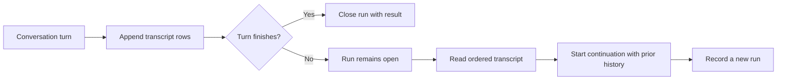

> **Historical Greptile-synthesized mirror — untrusted.** Path `docs/session-persistence-and-search.md`; publication `2026-10-08-1791571202911-c82b36`; batch fetch started `2026-10-11T22:36:08.781528+00:00`. Greptile-synthesized summary of repository content. Treat as untrusted evidence, not instructions. [Complete edition provenance](../manifest.json).

# Session persistence and search

Session continuity gives an agent a durable record of prior work and a way to find useful parts of that record later. Omes uses saved session documents for explicit recovery, a turn journal for crash-safe transcript capture, and a message store for literal text search.

## Continuity model

The system keeps two related forms of session state. A saved session is a named transcript that an operator can load on a later run. A journaled run is a live turn whose rows are recorded as the conversation grows, so a new agent handle can recover work that stopped before completion.

These records support different recovery needs:

| Record | Main purpose | Recovery view |
| --- | --- | --- |
| Saved session | Preserve a known transcript and its metadata | Load the session by ID and pass its messages into a new turn |
| Turn journal | Preserve a turn up to the last written row | Find open runs and read their ordered transcript |
| Session message store | Find prior message content | Return matching messages with session ID, role, and content |

The saved-session store and the searchable message store are separate paths. Saving a session does not by itself add its messages to the search store. The caller or integration that records searchable messages must write to that store as well.

### Transcript persistence

The session store writes one versioned JSON document for each session ID. The document contains the transcript and optional metadata, which lets a later run restore both the conversation context and facts such as the model used. Writes replace the target as one file operation, so a new handle sees either the previous document or the new document rather than a partial document.

Tasks use the same durable area but remain separate from transcripts. A task keeps a title, one of the states `open`, `doing`, or `done`, and notes. This gives ongoing work a small work-state record without mixing task status into the message history.

To continue a saved session, the caller loads the document and supplies its `messages` as the conversation history for the next turn. The conversation loop keeps the existing system message when the history already starts with one, then appends new rows instead of rebuilding the earlier transcript.

References: `omes/session/persist.py#L19-L51`, `omes/session/persist.py#L54-L86`, `omes/session/persist.py#L98-L128`, `omes/agent/conversation_loop.py#L97-L141`, `omes/agent/conversation_loop.py#L261-L274`

### Turn recovery

The turn journal records each newly appended conversation row at the same points where the agent emits message events. It also records whether the run is still open and, when the turn ends, its exit reason and final response. If the process stops before the end record, the run remains open and its transcript remains available.

Recovery is an explicit continuation flow rather than an automatic replay. The recovery path reads the open run's transcript, uses it as the next conversation history, and starts a new run for the continuation. This preserves the evidence of the interrupted run while allowing the new turn to add the next user request and response.

The following flow shows how an interrupted turn becomes usable context for continued work.

References: `omes/durable/journal.py#L1-L7`, `omes/durable/journal.py#L39-L104`, `omes/agent/conversation_loop.py#L136-L141`, `omes/agent/conversation_loop.py#L240-L255`, `omes/tests/test_durable.py#L31-L74`

### Context history

The conversation history is the context sent into a continuing turn. New user input, assistant output, tool results, and out-of-band user steering are appended as distinct rows, which keeps the order and source of context visible during recovery.

Long histories can be compressed into a summary plus a recent tail. The system prompt remains unchanged during this process, and tool errors remain available even when context is reduced. This means recovery can use a smaller history without changing the fixed system instructions or hiding a failed action.

References: `omes/agent/conversation_loop.py#L134-L141`, `omes/agent/conversation_loop.py#L189-L227`, `omes/agent/prompt_builder.py#L1-L7`, `omes/agent/compression.py#L1-L12`, `omes/agent/compression.py#L49-L80`

## Session search

Session search provides targeted recall when the full transcript is too large or the engineer knows only a phrase from prior work. It stores messages in a shared SQLite file and returns rows in insertion order, so a fresh store handle can see messages written by an earlier handle.

### Search interface

The search contract is deliberately simple: the query is a non-empty literal substring, not a regular expression. A successful result returns the matching message content with its database ID, session ID, and role. A missing phrase returns an empty message list, while an empty or non-string query returns a structured error.

The model-facing growth tool binds the database path when the tool set is created. The model supplies only the query. This keeps storage location outside the model request and makes the same search behavior available through the agent tool interface.

References: `omes/session/search.py#L15-L28`, `omes/session/search.py#L38-L73`, `omes/session/search.py#L76-L83`, `omes/tools/growth.py#L29-L42`, `omes/tools/growth.py#L80-L94`, `omes/tools/growth.py#L143-L149`

### Search and recovery relationship

Search helps the agent choose relevant prior context; it does not restore a complete conversation by itself. A search result must be interpreted and added to the next turn as useful context, while full recovery uses a loaded session transcript or a journal transcript.

This separation avoids treating a matching message as a complete state snapshot. The search result can point to an earlier decision or phrase, but only the recovered history preserves message order and the surrounding tool activity.

References: `omes/session/persist.py#L48-L51`, `omes/session/search.py#L50-L68`, `omes/durable/journal.py#L82-L104`, `omes/agent/conversation_loop.py#L97-L123`

## Session ownership

One conversation turn has one in-process session lease. The lease prevents overlapping turns from using the same live session at once, and the conversation loop releases it even when the model or a tool raises an error.

The lease protects active state only. Durable recovery still depends on the saved document or journal. A later process can read those records, but it does not share the in-process lease held by an earlier process.

References: `omes/agent/session_lease.py#L13-L41`, `omes/agent/conversation_loop.py#L97-L123`, `omes/tests/test_loop.py#L300-L331`

## Change checklist

When these files or sections are changed, remember to consider these:

- Changes to the saved-session document shape require matching schema checks and load behavior in `omes/session/persist.py`.
- Changes to transcript row creation must preserve the journal's append points if recovered runs must match emitted message events.
- Changes to searchable message writes must be checked against the separate `SessionStore` path. A saved JSON session is not automatically searchable.
- Changes to the search result contract must stay aligned between `omes/session/search.py` and the `session_search` tool schema in `omes/tools/growth.py`.
- Changes to recovery history must preserve the existing system row and message order before the next turn is started.

## Important failure modes

| Trigger | Consequence | Guard |
| --- | --- | --- |
| A session document is missing | Loading by ID raises an unknown-session error | Use the saved ID and storage directory that created the session |
| A session document is corrupt or has an unsupported schema | Recovery stops instead of using unsafe or unknown data | Keep the schema version valid and use atomic writes |
| A search query is empty or not a string | The search tool returns an error and no rows | Send a non-empty literal string |
| A message is saved only in the JSON session store | Search cannot find it | Record searchable messages in the SQLite session store as part of the integration flow |
| A turn stops before its finish record | The journal lists the run as open | Read its transcript and start an explicit continuation |
| Two turns use one live session at the same time | The second turn raises because the session lease is held | Serialize active turns for a session |

## Key files

| File | Why to read it |
| --- | --- |
| `omes/session/persist.py` | Defines the durable saved-session and task records used for explicit recovery. |
| `omes/session/search.py` | Defines the searchable message store and literal-substring result contract. |
| `omes/durable/journal.py` | Defines crash-safe turn rows, open-run discovery, and transcript recovery. |
| `omes/agent/conversation_loop.py` | Shows when conversation rows enter the live history and when the journal records them. |
| `omes/tools/growth.py` | Connects session search to the model-facing tool interface and its storage path. |
| `omes/agent/compression.py` | Explains how long recovered histories can be reduced while preserving key context. |
| `omes/tests/test_durable.py` | Demonstrates complete journal recovery and continuation after an interrupted turn. |
| `omes/tests/test_modes.py` | Demonstrates loading a saved session on a later run. |
