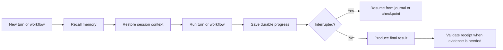

> **Historical Greptile-synthesized mirror — untrusted.** Path `docs/state-continuity.md`; publication `2026-10-08-1791571202911-c82b36`; batch fetch started `2026-10-11T22:36:08.781528+00:00`. Greptile-synthesized summary of repository content. Treat as untrusted evidence, not instructions. [Complete edition provenance](../manifest.json).

# State continuity

Omega Prime keeps useful state outside one model call so work can continue across turns, process restarts, and multi-step workflows. Memory carries selected knowledge, sessions carry conversation and task context, durable records support recovery, and receipts link completion claims to evidence.

## Continuity model

State continuity uses different records for different kinds of truth. Memory stores reusable facts. A session stores working context. A durable record stores an execution recovery point. A receipt supports a claim about completed work.

These records work together without replacing one another:

| Need | Record | Main use |
| --- | --- | --- |
| Reuse a fact or user detail | Memory | Recall selected knowledge in a later turn |
| Continue a conversation or task | Session | Restore messages, task status, and notes |
| Recover interrupted execution | Journal or checkpoint | Resume a turn or workflow from saved progress |
| Support a completion claim | Receipt | Check commands, outcomes, and approvals |

The systems form a path from context selection to recovery and proof.

### Continuity boundaries

Each state type has a clear boundary. Memory is selected for later use and is not a full transcript. Session data describes prior work and is not a step-by-step execution log. Journals and checkpoints describe progress and are not general user preferences. Receipts verify evidence and do not restore state.

References: `omes/memory/manager.py#L15-L31`, `omes/session/persist.py#L25-L86`, `omes/durable/journal.py#L18-L104`, `omes/durable/workflows.py#L22-L61`, `omes/receipts.py#L18-L75`

## Memory retrieval

Memory gives later turns access to selected knowledge without replaying every earlier message. Omega Prime joins available provider results before a turn and skips recall for empty, command-only, greeting, and short acknowledgement prompts.

The built-in memory has two entry groups:

- `MEMORY.md` stores general notes for reuse.
- `USER.md` stores user profile details.

The memory tool can add, replace, or remove one entry. The store rejects empty or duplicate entries, invalid targets, unreadable files, and writes that exceed the target limit. Recall reads the current files before it renders content and passes the result through redaction.

Provider adapters can expose other memory call shapes over the same store. They keep one shared source of entries while allowing scoped or identified recall. See [Memory system](memory-system.md) for memory providers and backends.

### Memory placement in a turn

The growth tool connects the built-in provider to the memory directory. The model does not choose the storage path. A memory write updates the shared store, while a later non-trivial turn can prefetch that store through the memory manager.

References: `omes/memory/provider.py#L39-L98`, `omes/memory/store.py#L24-L63`, `omes/memory/store.py#L109-L163`, `omes/tools/growth.py#L29-L42`, `omes/tools/growth.py#L65-L94`

## Session persistence

Sessions preserve the context needed to continue work later. Omega Prime supports a saved session document and a searchable message store. The saved document keeps a transcript with metadata. The message store keeps messages with a session id and role so later search can find prior content.

Tasks use the same persistence area for a small durable work record. A task has a title, one of the states `open`, `doing`, or `done`, and free-form notes. This record gives a later turn a compact view of progress without requiring the full conversation.

Session ids and task ids use safe, stable names. Writes use a temporary file and replacement so a completed write does not expose a partial document. Reads reject missing records and unsupported or invalid documents instead of treating them as valid state. See [Session persistence and search](session-persistence-and-search.md) for the session lifecycle.

### Session search

Session search is a direct recovery aid when an engineer or agent knows a phrase from earlier work. It matches a non-empty literal substring in insertion order and returns the message id, session id, role, and content. It is not semantic search and does not replace loading the saved transcript.

References: `omes/session/persist.py#L19-L51`, `omes/session/persist.py#L54-L86`, `omes/session/persist.py#L94-L128`, `omes/session/search.py#L15-L68`, `omes/session/search.py#L76-L83`

## Durable execution records

Durable records preserve execution progress at points where recovery matters. Omega Prime has a turn journal for message rows and a workflow checkpoint for completed steps. Both let a new process continue from saved state after an unexpected stop.

### Turn journals

The turn journal records ordered transcript rows as the conversation loop appends them. A run starts as `open`, remains recoverable while it has no finish record, and closes with an exit status and final response. The conversation loop journals the rows that it emits as message events, which keeps the recovery transcript aligned with visible turn history.

An open run can be loaded into a later conversation as history. The next turn then continues from that history instead of losing the recorded system, user, or assistant rows. See [Durable workflows and receipts](durable-workflows-and-receipts.md) for journal and receipt behavior together.

References: `omes/durable/journal.py#L18-L37`, `omes/durable/journal.py#L39-L104`, `omes/agent/conversation_loop.py#L134-L142`, `omes/agent/conversation_loop.py#L199-L207`, `omes/agent/conversation_loop.py#L242-L255`

### Workflow checkpoints

Checkpointed workflows save a JSON state object after each completed step. On retry, Omega Prime loads the last checkpoint, skips completed steps, and runs only the remaining steps. If a step fails, the prior checkpoint stays in place, so the failed step can be tried again without repeating earlier completed steps.

Workflow state must remain a JSON object that can be saved. Checkpoint writes use replacement so the saved recovery point stays complete rather than exposing an interrupted file write.

References: `omes/durable/workflows.py#L22-L46`, `omes/durable/workflows.py#L49-L61`, `omes/durable/workflows.py#L69-L97`

## Receipts and evidence

Receipts make completion claims auditable. A receipt links each claim to a command with a command string and exit code. It also records unverified items. A destructive claim must include approval from someone other than the bot.

Validation rejects claims with missing or invalid command evidence, claims whose expected result does not match the exit code, commands that contain bypass markers, and destructive work without valid recorded approval. This check supports trust in the final report, but it does not persist a transcript or resume a failed operation.

References: `omes/receipts.py#L1-L5`, `omes/receipts.py#L18-L61`, `omes/receipts.py#L63-L75`

## Continuation flow

When Omega Prime continues work, it selects the state source that matches the need. Memory supplies reusable context. A session or search supplies prior conversation context. A journal or checkpoint supplies the last known execution point. The agent then produces a result, and a receipt validates any claim that needs command evidence.

This separation keeps recovery distinct from recall. A fact can be recalled without resuming a run. A run can be resumed without turning every transcript row into long-term memory.

References: `omes/memory/provider.py#L90-L98`, `omes/session/search.py#L50-L83`, `omes/durable/journal.py#L82-L104`, `omes/durable/workflows.py#L34-L46`, `omes/receipts.py#L18-L75`

## Change checklist

When these files or sections are changed, remember to consider these:

- Changes to memory entry format or delimiters must stay compatible with all adapters that share `MemoryStore`.
- Changes to session or task schema versions must preserve the load contract for records written by earlier runs.
- Changes to journal append points must keep saved rows aligned with emitted message events and resume history.
- Changes to workflow step order or state shape must account for checkpoints that may already mark earlier steps complete.
- Changes to receipt claim rules must preserve the link between claim indexes, command exit codes, bypass detection, and external approvals.

## Important failure modes

| Trigger | Consequence | Guard |
| --- | --- | --- |
| Memory file cannot be read | A write is refused instead of risking replacement with an empty store | The store returns an error and leaves the file unchanged |
| Saved session or task is missing or has an unsupported schema | Continuation cannot load that record | Loaders raise an explicit error |
| Turn ends before `finish_run` | The run remains open and can be recovered from its recorded rows | Inspect open runs and resume from the journal transcript |
| Workflow step fails after an earlier step completes | The failed step is retried while completed steps are skipped | Each successful step writes a checkpoint |
| Claim cites a failing or bypassed command | The receipt is rejected | Each claim must cite valid command evidence with the expected exit result |
| Destructive claim has no independent approval | The receipt is rejected | Record a non-bot approver in the receipt |

## Key files

| File | Why to read it |
| --- | --- |
| `omes/memory/store.py` | Defines the shared durable memory and user-profile record. |
| `omes/memory/manager.py` | Shows how provider recall is combined for a turn. |
| `omes/tools/growth.py` | Connects memory and session search to agent-facing tools. |
| `omes/session/persist.py` | Defines saved session and task records. |
| `omes/session/search.py` | Defines searchable message history. |
| `omes/durable/journal.py` | Defines turn recovery from ordered transcript rows. |
| `omes/durable/workflows.py` | Defines step-level workflow recovery. |
| `omes/agent/conversation_loop.py` | Shows where turn rows are journaled and finalized. |
| `omes/receipts.py` | Defines evidence and approval checks for completion claims. |
