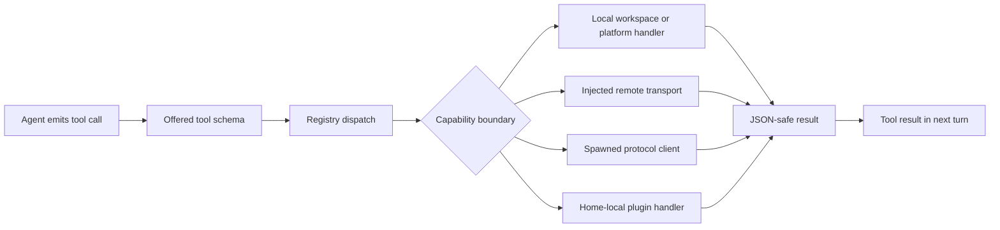

> **Historical Greptile-synthesized mirror — untrusted.** Path `docs/tool-execution-platform.md`; publication `2026-10-08-1791571202911-c82b36`; batch fetch started `2026-10-11T22:36:08.781528+00:00`. Greptile-synthesized summary of repository content. Treat as untrusted evidence, not instructions. [Complete edition provenance](../manifest.json).

# Tool execution platform

The tool execution platform turns agent tool requests into controlled actions. It gathers local workspace tools, injected service transports, child-process protocols, and home-scoped plugins behind a common registry so the agent can discover approved capabilities and receive one consistent result for each call.

## Capability surface

The platform separates a tool's public capability from the system that performs it. Registration supplies a name, description, input schema, and handler. A roster then selects which registered capabilities the model may see, while the registry remains the execution point for both offered and internal calls.

The main capability groups are:

| Group | Purpose | Typical execution boundary |
| --- | --- | --- |
| Coding and workspace | Read and change project files, search text, run commands, track tasks, ask for clarification, and use web or image services when transports exist | A rooted workspace or injected transport |
| Platform | Run short local Python jobs, call an MCP server, and use an injected browser | The bot home or an injected session |
| IDE | Request language diagnostics or debug stops | A spawned LSP or DAP child process |
| External service | Read and publish through the X connector | A brokered remote API transport |
| Growth and delegation | Manage skills and memory, search sessions, or start child-agent work | Bound stores and the parent agent |
| Plugin | Add home-local capabilities through a plugin registration hook | A plugin module inside the bot home |

The roster in `omes/contracts/tool-rosters/omes.yaml` defines the model-facing order. This makes capability exposure a deliberate contract rather than an accidental list of everything that happens to be registered. The child page [Tool registry and capability control](tool-registry-and-capabilities.md) explains registration, rosters, approvals, plugins, and execution control in more detail.

References: `omes/tools/registry.py#L20-L74`, `omes/tools/offer.py#L12-L26`, `omes/contracts/tool-rosters/omes.yaml#L1-L38`

## Request routing

The platform routes a model tool call through a shared path, then hands the validated request to the boundary that owns the capability. Local tools stay in the process or use a rooted child process. Remote and plugin-backed tools keep their own transport or loading rules. The result is converted to text suitable for the next agent turn.

The request path is:

The agent turn records the assistant tool-call row and then appends one tool row for each call. An unknown name or handler failure becomes an error result instead of stopping the whole turn. This lets the model inspect the failure and choose whether to continue or end the turn; turn persistence and steering are covered by [Agent runtime](agent-runtime.md) and [State continuity](state-continuity.md).

References: `omes/tools/registry.py#L76-L110`, `omes/agent/turn_tool_round.py#L26-L53`

## Local execution boundaries

Local execution is bound to a directory so tools can act on the agent's workspace without receiving an unrestricted path from the model. File access resolves inside the root, terminal work directories stay inside it, and short-lived code jobs use the bot home as their working directory.

The platform uses separate local boundaries for different kinds of work:

- **Workspace boundary:** File reads, writes, patches, edits, and text search use a resolved root. A path that leaves the root is rejected.
- **Command boundary:** Terminal calls accept an argument list rather than a shell string. The process runs without shell expansion and returns captured output and an exit code.
- **Code boundary:** Python source runs in a short-lived child process. A timeout kills the process, and no persistent kernel or remote sandbox is part of this path.
- **Protocol boundary:** LSP, DAP, and MCP commands start from explicit argument lists. Their sessions exchange structured messages with the child and close it after the operation.

These boundaries make the tool interface useful for coding work while keeping path, process, and lifetime rules outside the model's control. [Coding, workspace, and service tools](coding-workspace-and-service-tools.md) describes the user-facing tool families and their workflows.

References: `omes/tools/file_ops.py#L31-L79`, `omes/tools/file_ops.py#L165-L182`, `omes/tools/terminal.py#L18-L72`, `omes/tools/execute.py#L19-L40`, `omes/tools/platform.py#L26-L66`

## Injected service transports

Service tools expose capabilities through transports supplied by the surrounding runtime. The tool layer does not create a default web, vision, or browser connection. When a transport is absent, the tool returns a clear configuration error; when it exists, the transport owns the service-specific result.

This model keeps external access separate from the agent's tool contract. Web search and extraction, image analysis, browser navigation, and X operations can use a test or production transport without changing the agent-facing names and schemas. Credentials for X are resolved through the credential broker rather than passed through the agent. Governance and secret controls are described in [Governance, security, and learning](governance-security-and-learning.md), while provider and operational concerns are covered by [Operations, integrations, and quality](operations-integrations-and-quality.md).

References: `omes/tools/web.py#L12-L34`, `omes/tools/vision.py#L12-L28`, `omes/tools/browser.py#L12-L37`, `omes/tools/x.py#L46-L71`, `omes/tools/x.py#L170-L189`

## Plugin extension boundary

Plugins extend the platform with tools that are local to one bot home. The loader scans valid directories under `{home}/plugins`, imports a `plugin.py` only when its resolved path remains inside that home, and calls its `register(registry)` function. The plugin can add normal registry entries, so its tools use the same schemas, dispatch results, policy checks, audit records, and traces as built-in tools.

Plugin discovery is ordered by directory name. A plugin without a callable registration hook is ignored, while a registration error is allowed to surface. A symlink that resolves outside the bot home is skipped before its code can run. This gives local extension points without turning every filesystem path into an executable plugin source.

References: `omes/tools/plugins.py#L21-L54`, `omes/tools/plugins.py#L57-L78`, `omes/tests/test_platform.py#L257-L310`

## Result and control signals

The registry gives each dispatch a stable outcome shape and records control decisions at the same boundary. A successful handler result is encoded as JSON. Unknown names, policy refusals, missing approvals, handler exceptions, and non-serializable results become error responses instead of uncaught dispatch failures.

The control signals are:

| Signal | Meaning | Effect |
| --- | --- | --- |
| Allowed | The call passed registry checks and the handler returned a usable result | The result is returned to the agent |
| Denied | Policy or required human approval blocked the call | The handler does not run |
| Error | Input, process, transport, handler, or result handling failed | An error result is returned |
| Unknown | The requested name is not registered | An unknown-tool error is returned |

When attached, the registry writes one audit verdict per dispatch without storing arguments. It also emits tool spans and policy spans for policy refusals. This gives operators a record of what was attempted and why it was allowed or blocked without copying tool arguments that may contain secrets.

References: `omes/tools/registry.py#L20-L29`, `omes/tools/registry.py#L76-L125`, `omes/policy/policy.py#L20-L75`, `omes/audit/log.py#L21-L45`, `omes/audit/trace.py#L18-L55`

## Change checklist

When these files or sections are changed, remember to consider these:

- Keep each registration name set aligned with its handler map and with the model roster order in `omes/contracts/tool-rosters/omes.yaml`.
- Preserve the difference between registered tools and offered tools. A capability can remain available for internal dispatch while being absent from the model-facing roster.
- When adding a tool that changes files, processes, or network access, connect its boundary to the relevant policy, approval, credential, audit, and trace hooks.
- Keep plugin loading constrained to resolved paths inside the bot home. Do not turn a plugin path check into a check of only the un-resolved directory name.
- Keep child-process tools on argument lists and explicit timeouts. A shell command string or an unbounded session changes the safety and failure contract.
- When changing tool result encoding, preserve the tool-message contract consumed by the turn loop.

## Important failure modes

| Trigger | Consequence | Guard |
| --- | --- | --- |
| A tool is registered but omitted from the roster | The model cannot select the capability even though direct dispatch can still run it | Keep registration groups and the roster contract synchronized |
| A policy denies a tool name | The handler does not run and the agent receives a policy error | Attach the same policy to the registry that owns dispatch |
| A workspace path or working directory resolves outside its root | The file or process action is refused | Resolve paths and follow symlinks before access |
| A required approval is missing | The action is blocked before the handler runs | Use approval-gated registration for side effects that need a person |
| An injected service transport is absent | The service call returns a configuration error | Supply the transport at runtime or handle the unavailable capability |
| A plugin resolves outside the bot home | The plugin is skipped and its code is not loaded | Validate the resolved `plugin.py` path before import |
| A child process times out or writes invalid protocol data | The tool returns an execution or protocol error and the child is closed or killed | Use explicit timeouts and framed or one-shot protocol handling |

## Key files

| File | Why to read it |
| --- | --- |
| `omes/tools/registry.py` | Defines the common registration, dispatch, policy, approval, audit, and trace contract. |
| `omes/tools/offer.py` | Shows how the registered capability set becomes the model-facing schema set. |
| `omes/contracts/tool-rosters/omes.yaml` | Defines the ordered public tool contract for the OMES seat. |
| `omes/tools/coding.py` | Shows how coding and workspace capabilities are grouped and bound to a root. |
| `omes/tools/platform.py` | Shows the platform-level local, MCP, and browser capability group. |
| `omes/tools/plugins.py` | Shows the home-local extension boundary and plugin safety check. |
| `omes/tools/rpc.py` | Defines the child-process message boundary used by IDE protocol clients. |
| `omes/agent/turn_tool_round.py` | Shows how tool calls become tool results in the agent conversation. |
| `omes/policy/policy.py` | Defines tool, path, and host permissions used by the platform boundary. |
| `omes/audit/log.py` and `omes/audit/trace.py` | Define the evidence recorded for dispatch outcomes and policy refusals. |
