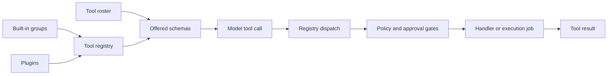

> **Historical Greptile-synthesized mirror — untrusted.** Path `docs/tool-registry-and-capabilities.md`; publication `2026-10-08-1791571202911-c82b36`; batch fetch started `2026-10-11T22:36:08.781528+00:00`. Greptile-synthesized summary of repository content. Treat as untrusted evidence, not instructions. [Complete edition provenance](../manifest.json).

# Tool registry and capability control

Tool registry and capability control is the part of the [tool execution platform](tool-execution-platform.md) that turns available actions into a governed set of agent capabilities. It keeps capability names and input schemas in one registry, selects the names that the model may see, and checks policy or human approval before a handler runs. The [coding, workspace, and service tools](coding-workspace-and-service-tools.md) page describes the capabilities that this page governs.

## Capability lifecycle

The capability lifecycle moves from registration to model exposure and then to controlled execution. Registration groups bind names to handlers, while the roster is the smaller contract that decides which registered names are offered to the model.

The registry can hold more tools than the model receives. The roster in `omes/contracts/tool-rosters/omes.yaml` names the allowed order for the `bot-00-omes` seat, and `omes/tools/offer.py` removes unknown, repeated, or unlisted names before schemas reach the model. This separation lets the runtime load capability providers without making every provider visible in every seat.

References: `omes/tools/registry.py#L20-L75`, `omes/tools/offer.py#L1-L26`, `omes/contracts/tool-rosters/omes.yaml#L1-L38`

### Capability registration

Registration defines the public shape of a capability and the action that fulfills it. A tool has a name, a plain description, a JSON input schema, and a handler; registration order is retained so the same order can flow into schema offering.

The main groups register coding, growth, delegation, platform, IDE, and external-service capabilities. Each group returns its names and checks that its handler set matches its declared names, which helps keep the roster contract aligned with the available actions.

References: `omes/tools/registry.py#L45-L74`, `omes/tools/coding.py#L21-L46`, `omes/tools/platform.py#L17-L66`, `omes/tools/ide.py#L21-L30`, `omes/tools/x.py#L20-L27`

### Plugin registration

Plugins extend the registry from a workspace-local `plugins/<name>/plugin.py`
location. A plugin exposes a `register(registry)` entry point and can add
tools to the same registry as built-in groups.

Plugin modules load only when `OMEGA_PRIME_PLUGINS=1` exactly. When disabled,
the host does not scan or import plugin files. Enabled modules are trusted
local Python and run unsandboxed; a plugin can add tools or replace existing
handlers and approval metadata. Plugin registration therefore does not itself
establish a safe or approved capability.

The `pin_bump_apply` action requires an exact human grant through the existing
admin grant/revoke route. Served-tool metadata is not itself an approval.

References: `omes/tools/plugins.py#L1-L54`, `omes/tools/plugins.py#L57-L97`

## Invocation controls

Invocation controls apply after a model selects a name and before the handler performs work. The registry returns a JSON result for success, unknown names, blocked calls, handler errors, and invalid arguments so the turn can continue with a tool result instead of an uncaught dispatch failure.

The order of control is important:

1. The registry resolves the name.
2. Seat policy can refuse the name.
3. A tool marked for approval must have an approval record.
4. The handler receives validated argument shape and runs.
5. The result is encoded and recorded for audit or tracing when those sinks are attached.

References: `omes/tools/registry.py#L76-L125`, `omes/tools/registry.py#L158-L205`

### Policy and approval

Policy is the seat-level boundary for whether a tool may run at all. Approval is a second gate for actions that need a person to agree to the exact tool name, and the bot cannot create its own approval.

The approval log is intentionally small. It records approved names in memory and does not provide a prompt or a queue. A missing approval log leaves every approval-gated tool blocked, while ordinary tools continue through the normal registry path.

The external-service tools show the intended split: reading X data is available without approval, while publishing a post or thread requires a human approval record. The registry also sends one verdict to the audit sink and one tool span to the tracer when those services are connected.

References: `omes/tools/approvals.py#L1-L45`, `omes/tools/registry.py#L20-L29`, `omes/tools/registry.py#L83-L123`, `omes/tools/x.py#L205-L264`

## Process clients

Process clients let a registered capability reach a tool server or development service without making that service part of the registry itself. They validate the command shape, exchange a defined message form, and turn process failure into a tool result or client error.

### MCP calls

The MCP client performs one short-lived call. It starts an argv list, sends one JSON-RPC `tools/call` request, reads one JSON response, and kills the process if the time limit expires.

`mcp_call` is exposed as a platform tool, so the model can name an MCP server command and a tool while the local platform supplies the working directory. A shell string is rejected; this keeps the process boundary explicit and prevents a command value from becoming an implicit shell program.

References: `omes/tools/mcp_client.py#L1-L61`, `omes/tools/mcp_client.py#L64-L125`, `omes/tools/platform.py#L37-L43`, `omes/tools/platform.py#L92-L113`

### RPC sessions

The RPC connection supports longer request and event exchanges over a child process. It frames UTF-8 JSON messages with a content length, queues complete messages for the client session, and closes or kills the child when the session ends.

The LSP and DAP clients use this shared channel for focused workflows. LSP opens one document and reads its diagnostics. DAP launches one program, waits for a stop, and reports breakpoints and stack frames. These clients expose service results through registered tools rather than exposing the protocol to the model directly.

References: `omes/tools/rpc.py#L1-L10`, `omes/tools/rpc.py#L31-L109`, `omes/tools/lsp.py#L1-L8`, `omes/tools/dap.py#L1-L9`, `omes/tools/ide.py#L33-L124`

## Execution jobs

Execution jobs provide a job handle for child processes that may need polling
or later control. The four `exec_job_start`, `exec_job_poll`, `exec_job_wait`,
and `exec_job_kill` tools are retained, approval-gated, and local to the
registry that owns them. Plan mode blocks start and kill; argv cwd is fixed to
the approved work root. Jobs can be polled, waited on, or killed and return
their cached final result after reaping.

References: `omes/tools/exec_jobs.py#L1-L9`, `omes/tools/exec_jobs.py#L21-L59`, `omes/tools/exec_jobs.py#L61-L111`, `omes/agent/security.py#L1-L48`

## Change checklist

When these files or sections are changed, remember to consider these:

- Keep each tool-group name list aligned with its registered handlers and with the matching section of `omes/contracts/tool-rosters/omes.yaml`.
- When adding a plugin capability, decide separately whether the active roster should expose its schema; registration alone does not make it model-visible.
- Preserve the distinction between policy refusal and approval refusal because both produce different audit and trace reasons.
- Keep MCP one-shot calls and RPC sessions on their stated message and lifetime contracts so a client cannot wait for a response format the server does not send.
- Preserve argv screening before process creation and result caching after reaping when changing job control or process-backed tools.

## Important failure modes

| Trigger | Consequence | Guard |
|---|---|---|
| A registered name is absent from the roster | The model cannot select that capability even though direct registry dispatch may still find it | Review the roster and the tool-group name list together |
| A roster names a tool that is not registered | No schema is offered for that name | `offered_schemas` skips names without a registered schema |
| A policy forbids a tool | The handler does not run and the dispatch returns a policy error | Policy is checked before approval and handler execution |
| An approval-gated tool has no human approval | The handler does not run and dispatch returns `approval required` | Record approval for the exact name through `ApprovalLog` |
| An MCP command is a string or returns invalid JSON | The child is not started or the call returns an MCP error | Require an argv list and one valid JSON result |
| An RPC child sends a bad frame or exceeds a size limit | The session raises a framing error and cannot safely consume the stream | Use the shared `RpcConnection` framing limits |
| A job argv fails the security screen | No child process starts | Run `screen_argv` before `Popen` |

## Key files

| File | Why to read it |
|---|---|
| `omes/tools/registry.py` | Defines the common capability record, schema view, dispatch path, policy gate, approval gate, and result recording. |
| `omes/tools/offer.py` | Shows how the active roster becomes the smaller schema set offered to the model. |
| `omes/contracts/tool-rosters/omes.yaml` | States the seat-specific tool names and their intended order. |
| `omes/tools/plugins.py` | Shows how workspace-local plugins add capabilities without bypassing path checks. |
| `omes/tools/approvals.py` | Defines the human approval boundary for gated tools. |
| `omes/tools/mcp_client.py` | Defines the one-shot process and JSON-RPC contract for MCP calls. |
| `omes/tools/rpc.py` | Defines the framed process channel used by LSP and DAP sessions. |
| `omes/tools/exec_jobs.py` | Defines process jobs, job ids, lifecycle control, and cached results. |
| `omes/agent/security.py` | Defines the pre-start command screen applied to execution jobs. |
