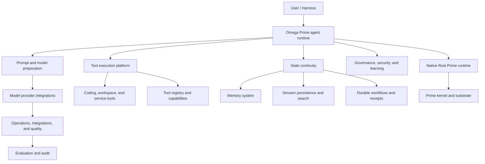

> **Historical Greptile-synthesized mirror — untrusted.** Path `index.md`; publication `2026-10-08-1791571202911-c82b36`; batch fetch started `2026-10-11T22:36:08.781528+00:00`. Greptile-synthesized summary of repository content. Treat as untrusted evidence, not instructions. [Complete edition provenance](manifest.json).

_Knowledge Base updated: 2026-10-08_

# OMES Bot knowledge base

## Orientation

OMES Bot is the Omega Prime agent system: Python orchestration assembles and runs interactive agent turns, while the native Rust Prime runtime provides autonomous execution and its Python-facing boundary.

The main subsystems are agent runtime and tool execution, state continuity, governance and learning, provider/operations/quality support, and the native Prime kernel with substrate connectivity.

Critical continuity state is held in memory providers, persisted/searchable sessions, workflow journals and receipts; operational evidence is retained in evaluation outputs, audit logs, and traces.

## Glossary

- **Omega Prime** — the system identity spanning the Python agent orchestration and native Prime capabilities.
- **Prime runtime** — the native Rust execution layer exposed through a Python integration boundary.
- **Substrate** — the client/session connectivity layer that connects native capabilities to external execution services.
- **Receipt** — a durable record of workflow execution used for recovery and accountability.
- **Work cell** — a Prime kernel-hosted unit of native work and capability execution.

## Invariants

- Interactive work must pass through the turn lifecycle rather than bypassing turn finalization and interruption handling; see `src/**/turn*` and `src/**/conversation*` patterns. [Agent runtime](docs/agent-runtime.md)
- Tool capabilities are discovered and governed through registries, clients, plugins, approvals, or jobs before invocation; see `src/**/tool*`, `src/**/mcp*`, and `src/**/plugin*` patterns. [Tool registry and capability control](docs/tool-registry-and-capabilities.md)
- Recoverable work requires durable state in memory, sessions, journals, or receipts rather than relying solely on process-local context; see `src/**/memory*`, `src/**/session*`, and `src/**/receipt*` patterns. [State continuity](docs/state-continuity.md)
- Provider-specific model access remains behind the common provider abstraction; see `src/**/provider*` and `src/**/models*` patterns. [Model provider integrations](docs/model-provider-integrations.md)
- Native capabilities are hosted by the Prime kernel and reach external services through substrate clients/sessions; see `prime/**/kernel*` and `prime/**/substrate*` patterns. [Prime kernel and substrate](docs/prime-kernel-and-substrate.md)

## Routing table

| Path or trigger | Documentation |
| --- | --- |
| `src/**/agent*`, `src/**/runtime*` | [Agent runtime](docs/agent-runtime.md) |
| `src/**/conversation*`, `src/**/turn*` | [Conversation turn loop](docs/conversation-turn-loop.md) |
| `src/**/prompt*`, `src/**/model*`, `src/**/context*` | [Agent prompts and models](docs/agent-prompt-and-models.md) |
| `src/**/delegat*`, `src/**/mode*`, `src/**/lease*`, `src/**/curat*` | [Agent delegation and modes](docs/agent-delegation-and-modes.md) |
| `src/**/tool*`, `src/**/capabilit*` | [Tool execution platform](docs/tool-execution-platform.md) |
| `src/**/registry*`, `src/**/mcp*`, `src/**/plugin*`, `src/**/approval*` | [Tool registry and capability control](docs/tool-registry-and-capabilities.md) |
| `src/**/workspace*`, `src/**/terminal*`, `src/**/browser*`, `src/**/ide*` | [Coding, workspace, and service tools](docs/coding-workspace-and-service-tools.md) |
| `src/**/memory*`, `src/**/session*`, `src/**/workflow*`, `src/**/receipt*` | [State continuity](docs/state-continuity.md) |
| `src/**/memory*`, `src/**/storage*` | [Memory system](docs/memory-system.md) |
| `src/**/session*`, `src/**/search*` | [Session persistence and search](docs/session-persistence-and-search.md) |
| `src/**/workflow*`, `src/**/journal*`, `src/**/receipt*` | [Durable workflows and receipts](docs/durable-workflows-and-receipts.md) |
| `src/**/policy*`, `src/**/secret*`, `src/**/credential*`, `src/**/goal*` | [Governance, security, and learning](docs/governance-security-and-learning.md) |
| `src/**/policy*`, `src/**/credential*`, `src/**/secret*`, `src/**/contract*`, `src/**/ownership*` | [Policy, credentials, and contracts](docs/policy-credentials-and-contracts.md) |
| `src/**/learning*`, `src/**/growth*`, `src/**/goal*`, `src/**/advis*` | [Learning and growth](docs/learning-and-growth.md) |
| `src/**/provider*`, `src/**/scheduler*`, `src/**/evaluat*`, `src/**/audit*` | [Operations, integrations, and quality](docs/operations-integrations-and-quality.md) |
| `src/**/provider*`, `src/**/anthropic*`, `src/**/openai*`, `src/**/gemini*`, `src/**/ollama*` | [Model provider integrations](docs/model-provider-integrations.md) |
| `src/**/schedul*`, `src/**/nightly*`, `src/**/sweep*` | [Scheduled routines](docs/scheduled-routines.md) |
| `src/**/evaluat*`, `src/**/audit*`, `src/**/trace*`, `tests/**` | [Evaluation and audit](docs/evaluation-and-audit.md) |
| `prime/**`, `src/**/prime*`, `src/**/native*` | [Native Prime runtime](docs/native-prime-runtime.md) |
| `prime/**/kernel*`, `prime/**/substrate*`, `prime/**/session*`, `prime/**/work_cell*` | [Prime kernel and substrate](docs/prime-kernel-and-substrate.md) |
